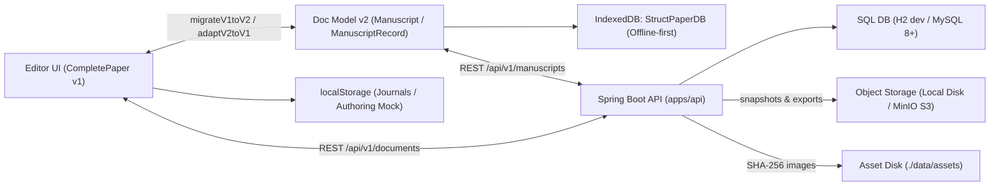
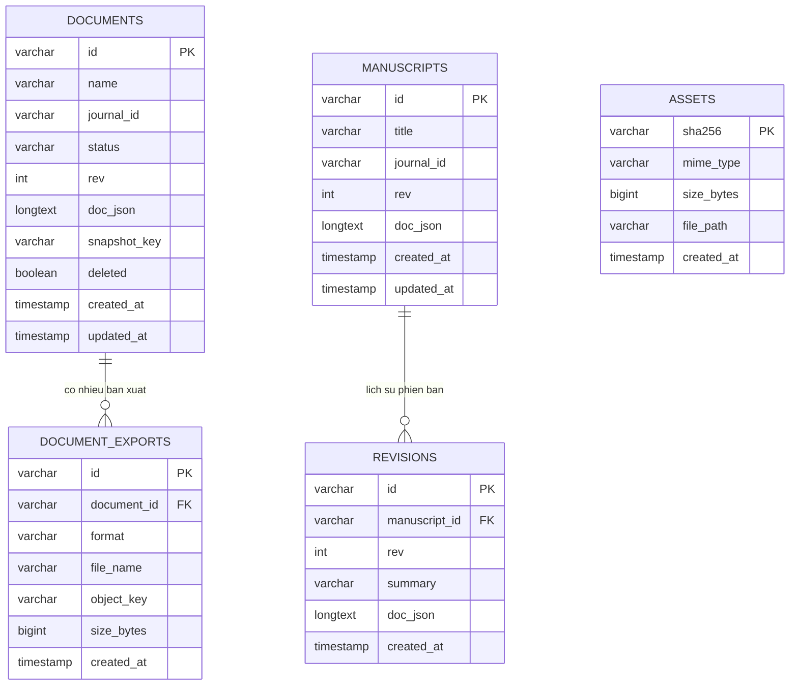

# Cấu trúc Schema của StructPaper

Tài liệu này tổng hợp toàn bộ cấu trúc dữ liệu (schema) xuyên suốt hệ thống **StructPaper**, bao gồm 4 lớp chính:
1. **Backend Database & Object Storage** (`apps/api`)
2. **Client Local Storage & IndexedDB** (`packages/storage`, `apps/web`)
3. **Document Model — Mô hình tài liệu bài báo** (`packages/doc-model`, `apps/web`)
4. **Template & Journal Profile Schema** (`packages/journal-profiles`, `apps/web`)

---

## 1. Tổng quan kiến trúc lưu trữ

---

## 2. Backend Database & Object Storage (`apps/api`)

Backend sử dụng **Flyway** (`apps/api/src/main/resources/db/migration/`) để quản lý schema SQL (tương thích cả **H2** khi dev và **MySQL 8+** khi production).

### 2.1. Sơ đồ quan hệ bảng (SQL ERD)

### 2.2. Chi tiết các bảng SQL

#### Luồng Documents (`V2__documents.sql` — `/api/v1/documents`)
Phục vụ lưu tài liệu kiểu Word (tạo mới, autosave, optimistic locking theo `rev`, chụp snapshot và quản lý file xuất).
- **`documents`** (`DocumentEntity.java`):
  - `id` (`VARCHAR(64)`, PK): Mã tài liệu (ULID hoặc client ID).
  - `name` (`VARCHAR(200)`, NOT NULL): Tên hiển thị tài liệu.
  - `journal_id` (`VARCHAR(64)`): ID tạp chí áp dụng.
  - `status` (`VARCHAR(32)`, DEFAULT `'draft'`): Trạng thái quy trình biên tập.
  - `rev` (`INT`, DEFAULT `1`): Số phiên bản tăng dần, dùng để kiểm tra xung đột (`baseRev`).
  - `doc_json` (`LONGTEXT`): Nội dung JSON của bài báo.
  - `snapshot_key` (`VARCHAR(300)`): Key trỏ tới bản snapshot mới nhất trong Object Storage.
  - `deleted` (`BOOLEAN`, DEFAULT `FALSE`): Cờ xóa mềm.
  - `created_at`, `updated_at` (`TIMESTAMP`).
  - Index: `idx_documents_updated(deleted, updated_at)`.
- **`document_exports`** (`DocumentExportEntity.java`):
  - `id` (`VARCHAR(64)`, PK): ULID bản xuất.
  - `document_id` (`VARCHAR(64)`, NOT NULL): Tham chiếu `documents.id`.
  - `format` (`VARCHAR(16)`, NOT NULL): `'docx' | 'pdf' | 'xml'`.
  - `file_name` (`VARCHAR(300)`, NOT NULL): Tên file gốc đã làm sạch ký tự đặc biệt.
  - `object_key` (`VARCHAR(400)`, NOT NULL): Key lưu trong Object Storage.
  - `size_bytes` (`BIGINT`, NOT NULL): Dung lượng file.
  - `created_at` (`TIMESTAMP`).
  - Index: `idx_document_exports_doc(document_id)`.

#### Luồng Manuscripts & Assets (`V1__init_schema.sql` — `/api/v1/manuscripts`, `/api/v1/assets`)
- **`manuscripts`** (`ManuscriptEntity.java`): `id`, `title`, `journal_id`, `rev`, `doc_json`, `created_at`, `updated_at`. Khóa lạc quan qua HTTP header `If-Match` / `ETag`.
- **`revisions`** (`RevisionEntity.java`): `id`, `manuscript_id`, `rev`, `summary`, `doc_json`, `created_at`. Index: `idx_revisions_manuscript_id(manuscript_id)`.
- **`assets`** (`AssetEntity.java`): `sha256` (PK, 64 ký tự hex), `mime_type`, `size_bytes`, `file_path`, `created_at`. Chống trùng lặp file nhị phân theo mã băm SHA-256.

### 2.3. Cấu trúc Object Storage (MinIO / Local Disk) & Asset Disk

| Thành phần | Nơi lưu mặc định (`dev`) | Khi bật MinIO (`STRUCTPAPER_STORAGE_TYPE=minio`) | Quy ước đường dẫn / Key |
| :--- | :--- | :--- | :--- |
| **Snapshot tài liệu** | `./data/objects/` (`LocalObjectStorage`) | Bucket `structpaper` (`MinioObjectStorage`) | `documents/{id}/snapshots/{rev}.json` |
| **File xuất (`docx`/`pdf`/`xml`)** | `./data/objects/` (`LocalObjectStorage`) | Bucket `structpaper` (`MinioObjectStorage`) | `documents/{id}/exports/{exportId}.{fmt}` |
| **Ảnh / Asset nhị phân** | `./data/assets/` (`AssetService`) | Lưu trực tiếp trên ổ đĩa tại `structpaper.storage.asset-dir` | `{assetDir}/{sha256}` |

---

## 3. Client Local Storage (`packages/storage` & `apps/web`)

### 3.1. IndexedDB: `StructPaperDB` (Dexie Schema v2)
Định nghĩa tại `packages/storage/src/db/structpaper-db.ts` và `types.ts`, gồm **10 object stores**:

| Bảng (Store) | Khóa chính & Index (Dexie v2) | Kiểu bản ghi (`types.ts`) | Mục đích |
| :--- | :--- | :--- | :--- |
| `manuscripts` | `id`, `[journalId+updatedAt]`, `workflowStatus`, `displayName`, `*tags`, `pinned`, `archived`, `syncState`, `updatedAt` | `StoredManuscript` | Lưu bài báo offline (`doc: Manuscript` + metadata phẳng như `displayName`, `tags`, `workflowStatus`, `syncState`, `rev`) |
| `revisions` | `id`, `[manuscriptId+rev]`, `manuscriptId`, `rev`, `createdAt` | `StoredRevision` | Lịch sử các bản chụp nội dung bài báo trên máy |
| `assets` | `hash`, `mime`, `size`, `width`, `height`, `dpi`, `vector` | `StoredAsset` | Lưu binary `Blob` của hình ảnh theo SHA-256 |
| `assetRefs` | `[manuscriptId+hash]`, `manuscriptId`, `hash` | `StoredAssetRef` | Bảng liên kết N-N giữa bài báo và asset |
| `ingestSources` | `manuscriptId` | `StoredIngestSource` | Lưu file Word gốc (`blob`, `fileName`, `importedAt`) khi import |
| `outbox` | `++seq`, `manuscriptId`, `attempts` | `StoredOutboxItem` | Hàng đợi đồng bộ lên server khi offline |
| `compileCache` | `hash`, `cachedAt` | `StoredCompileCache` | Cache `pdfBlob` và `logs` biên dịch LaTeX theo hash |
| `settings` | `key` | `StoredSetting` | Cài đặt cục bộ dạng key-value |
| `profiles` | `[scopeType+scopeId+version]`, `scopeType`, `scopeId`, `version`, `state`, `fetchedAt` | `StoredProfile` | Cache cấu hình profile tạp chí 3 tầng |
| `profileIndex` | `[scopeType+scopeId]`, `scopeType`, `scopeId`, `checkedAt` | `StoredProfileIndex` | Chỉ mục theo dõi phiên bản mới nhất của profile |

### 3.2. `localStorage` trên Web / Desktop WebView2
- `structpaper_managed_journals` (`apps/web/src/lib/templates/journal-storage.ts`): Danh sách `ManagedJournalProfile[]` (7 tạp chí VNUHCM mặc định + custom profile người dùng tạo/chỉnh sửa).
- `structpaper_authoring_papers_v1` (`apps/web/src/lib/authoring/paper-storage.ts`): Danh sách `CompletePaper[]` cho Authoring Hub.

---

## 4. Document Model — Mô hình tài liệu bài báo

Hệ thống duy trì 2 biểu diễn dữ liệu và chuyển đổi qua lại bằng `migrateV1toV2` / `adaptV2toV1` (`packages/doc-model/src/adapters/`):

### 4.1. Canonical Schema v2 (`@structpaper/doc-model`)
Được kiểm định runtime bằng **Zod** tại `packages/doc-model/src/schemas/`:
- **`ManuscriptRecord`**: Bọc `{ info: ManuscriptInfo, doc: Manuscript, revision?: number }`.
  - **`ManuscriptInfo`**: Metadata quản lý danh sách/tab/dashboard (`id`, `displayName`, `submissionId`, `note`, `tags`, `workflowStatus`: `'draft' | 'in-review' | 'proofing' | 'ready' | 'published'`, `pinned`, `archived`, `color`, `source`, `ownerId`, `createdAt`, `updatedAt`, `lastOpenedAt`). Thay đổi `info` không làm tăng `doc.rev`.
- **`Manuscript`** (`schemaVersion: 2`):
  - `id`, `lang` (`'vi' | 'en'`), `journalId`, `articleType`.
  - `meta` (`FrontMatter`): `title: Inline[]`, `translations`, `authors: Author[]`, `affiliations: Affiliation[]`, `abstract: Inline[][]`, `keywords: string[]`, `dates`, `doi`, `volume`, `issue`, `pages`.
  - `body` (`Section[]`): Cây mục đệ quy (`id`, `level: 1 | 2 | 3`, `title: Inline[]`, `blocks: Block[]`, `children: Section[]`).
  - `back` (`BackMatterItem[]`): Lời cảm ơn, phụ lục, xung đột lợi ích...
  - `references` (`Reference[]`): `id`, `raw`, `csl`, `doi`, `url`, `parse` (`'ok' | 'partial' | 'failed'`).
  - `assets` (`Record<string, AssetMeta>`): Metadata ảnh (hash, MIME, kích thước, DPI).
  - `profilePin` (`ProfilePin`): Ghim đúng phiên bản `{ base, journal, articleType, environmentId }` khi mở lại bài cũ.
- **8 loại `Block`** (`packages/doc-model/src/types/block.ts`):
  `paragraph` · `list` · `quote` · `box` · `equation` (có `latex`, `omml`, `numbered`, `label`, `status`) · `figure` (`assetId`, `caption`, `source`, `panels`, `layout`) · `table` (`grid: Cell[][]` hỗ trợ `rowSpan`/`colSpan`, `headerRows`, `notes`, `source`, `layout`) · `pageBreak`.
- **6 loại `Inline`** (`packages/doc-model/src/types/inline.ts`):
  `text` (marks: `b`, `i`, `sup`, `sub`, `code`) · `cite` (`refIds`) · `xref` (`target`, `kind`) · `math` (`latex`) · `footnote` (`blocks`) · `link` (`href`, `content`).

### 4.2. Authoring UI Model v1 (`apps/web/src/types/paper.ts`)
Dùng trực tiếp trong giao diện soạn thảo hiện tại:
- **`CompletePaper`**:
  - `id`, `displayName`, `templateId`, `templateName`, `status`, `workflowStatus`, `createdAt`, `updatedAt`.
  - `metadata` (`PaperMetadata`): `title`, `titleEn`, `articleType`, `journalId`, `journalName`, `journalAbbv`, `authors`, `affiliations`, `corresponding`, `abstract`, `abstractEn`, `keywords`, `keywordsEn`, `dates`, `doi`, `volume`, `issue`, `year`, `firstPage`, `lastPage`, `publication` (`PublicationInfo`).
  - `sections` (`PaperSection[]`): Danh sách phẳng các khối theo thứ tự (`type`: `'h1' | 'h2' | 'h3' | 'paragraph' | 'figure' | 'table' | 'quote' | 'box' | 'citation' | 'equation'`, kèm `figure`, `table`, `equation`, `pageBreakAfter`, `pageLayout`).
  - `references` (`PaperReference[]`): `id`, `raw`, `authors`, `title`, `journal`, `year`, `doi`, `isCited`, `citationCount`.
  - `layoutSettings` (`LayoutSettings`): `paperSize`, `columnLayout` (`'1-column' | '2-column'`), `orientation`, `fontSize`, `columnSep`, `lineSpacing`, `pageNumbering`, `theme` (`ThemeSettings`).

---

## 5. Template & Journal Profile Schema

### 5.1. Journal Profile 3 tầng (`@structpaper/journal-profiles`)
Định nghĩa tại `packages/journal-profiles/src/types/profile.ts`, hợp nhất theo thứ tự **Base → Journal (`JournalTierProfile`) → ArticleType (`ArticleTypeProfile`)** thành `ResolvedProfile`:
- Định danh: `id`, `version`, `names` (`vi`, `en`, `short`), `color`, `languages`, `articleTypes`.
- Quy chuẩn nội dung: `frontMatter` (giới hạn từ `abstract`, số lượng `keywords`, `dateFormat`, `doiPattern`), `citation` (`style`, `inText`, `rangeDash`), `styleMap` (ánh xạ Word Style → cấu trúc bài báo).
- Quy chuẩn trình bày & biên dịch: `layout` (khổ giấy, số cột, lề), `typography` (font family, cỡ chữ từng cấp, leading, widow/orphan), `latex` (`cls`, `engine`: `'xelatex' | 'lualatex'`, `fonts`).
- Kiểm tra chất lượng: `qc` (`ruleset: string[]`, `weights: Record<string, number>`).

### 5.2. Template Engine / Builder Schema (`apps/web/src/types/template-engine/`)
Dành cho hệ thống dựng layout & style trực quan (tách biệt dữ liệu tài liệu khỏi quy tắc trình bày):
- **`SciSpaceTemplateSchema`** (`types/template-engine/schema.ts`):
  - Metadata: `id`, `name`, `shortName`, `description`, `journalId`, `primaryColor`, `accentColor`, `version`.
  - `pageArchitecture` (`PageArchitectureConfig`): Kích thước trang, lề, header/footer, đánh số trang.
  - `layoutZones` (`ZoneCssLayout[]`): Phân vùng CSS (`grid`, `flex`, `columns`, `block`, `inline-block` + `subSlots`).
  - `elementRules` (`Record<StandardSemanticElementType, SciSpaceElementAttributes>`): Bộ thuộc tính hữu hạn cho **23 semantic element** (từ `article-title`, `author-list`, `metadata-sidebar`, `heading-1..3`, `figure-caption`, `table-caption`, `equation-block` đến `bibliography-item`, `acknowledgement-box`...), chia thành 5 nhóm thuộc tính: `typography`, `spacing`, `layoutScope`, `decorations`, `numbering`.
  - `floatingRules` (`FloatingElementsDesignRules`): Quy tắc bố trí hình/bảng/chú thích chân trang.
- **`StructPaperTemplateFile`** (`lib/template-engine/storage/types.ts`): Định dạng file JSON tự chứa (`schemaVersion: '2.0.0' | '1.0.0'`), gói toàn bộ `pageArchitecture`, `gridConfig`, `zones`, `elements`, `floatingRules` để lưu/xuất/nhập template.
