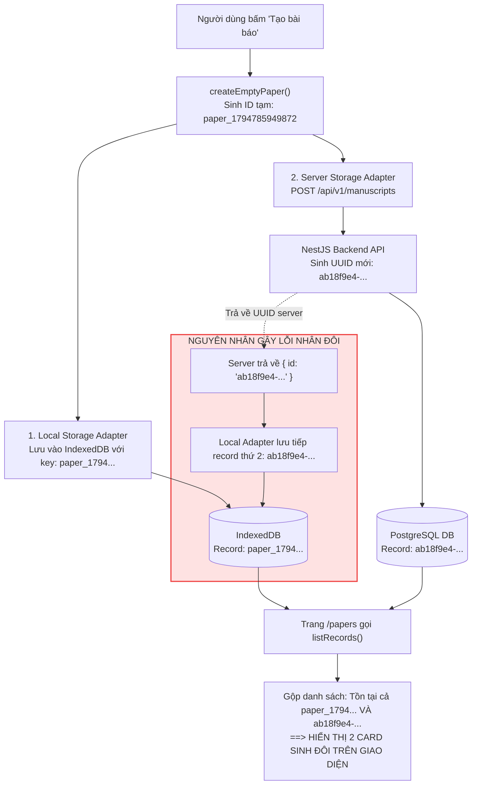
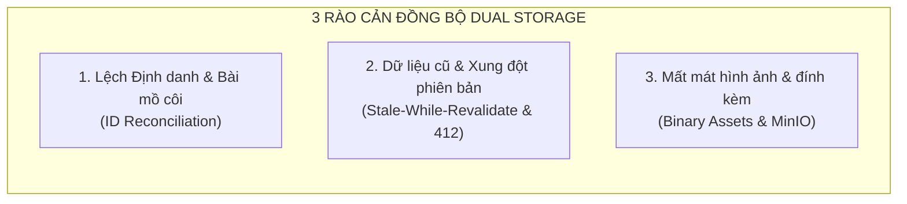

# Rào Cản Kỹ Thuật & Lộ Trình Đồng Bộ Song Song (Local + Remote Storage) trong StructPaper

> **Tài liệu Kỹ thuật Kiến trúc Hệ thống**  
> **Dự án:** StructPaper (Eatzy Monorepo)  
> **Tác giả:** Đội ngũ Kỹ thuật & Kiến trúc  
> **Ngày lập:** 16/11/2026  
> **Trạng thái cấu hình hiện tại:** Server-Only Mode (`ENABLE_LOCAL_STORAGE: false`)  
> **Mã nguồn liên quan:** `apps/web/src/lib/storage/*`, `apps/api/src/modules/manuscripts/*`, `apps/api/src/modules/assets/*`

---

## 1. Giới thiệu & Bối cảnh (Context & Overview)

Trong quá trình phát triển StructPaper, hệ thống ban đầu hỗ trợ lưu trữ bài báo cục bộ thông qua trình duyệt (IndexedDB / Dexie) để phục vụ cho các tác vụ ngoại tuyến (Offline) và Desktop App (Tauri). Khi phát triển Backend API (NestJS + PostgreSQL + MinIO), hệ thống được nâng cấp để hỗ trợ lưu trữ đám mây tập trung.

Tuy nhiên, việc duy trì **đồng thời cả 2 cơ chế lưu trữ (Dual Storage: Local + Remote)** đã phát sinh các xung đột về tính nhất quán dữ liệu, tạo ra lỗi nhân đôi bài viết (Duplicate Cards) và rủi ro lệch phiên bản (Stale Data).

Tài liệu này tổng hợp:
1. **Phân tích nguyên nhân gốc rễ (Root Cause Analysis)** của sự cố nhân đôi bài báo khi chạy song song.
2. **Chi tiết 3 rào cản kỹ thuật cốt lõi** cần giải quyết trước khi có thể an tâm bật lại tính năng lưu song song.
3. **Cấu trúc lưu trữ hiện tại (Composite + Null Object Pattern)** đã được chuẩn hóa.
4. **Lộ trình từng bước (Actionable Roadmap)** để hiện thực hóa kiến trúc Local-First hoàn chỉnh trong tương lai.

---

## 2. Phân tích Sự cố "1 bài tạo ra 2 bản sao" (Root Cause Analysis)

### 2.1 Hiện tượng
Khi người dùng bấm tạo mới một bài báo từ template (hoặc nhập từ Word), giao diện xuất hiện **2 thẻ bài báo giống hệt nhau** trên trang `/papers`:
- Một thẻ hiển thị nhãn trạng thái **"Đã đồng bộ"** (Server UUID).
- Một thẻ hiển thị nhãn trạng thái **"Chỉ trên máy"** (Client ID tạm thời).



### 2.2 Điểm nghẽn kỹ thuật
1. **Lệch định danh (ID Mismatch):** Phía client tự sinh ID tạm `paper_${Date.now()}`, trong khi PostgreSQL lại sinh mã UUID v4 độc lập (`ab18f9e4-...`).
2. **Thiếu cơ chế dọn dẹp ID tạm (Orphan Record Leak):** Khi server cấp UUID mới, client lưu bản ghi mới vào IndexedDB nhưng **không xóa ID tạm cũ**. Kết quả là IndexedDB lưu trữ 2 bản ghi song song của cùng 1 bài viết.
3. **Trở ngại điều hướng (Navigation Glitch):** Khi tiến trình lưu song song bị nghẽn mạng hoặc lỗi bất đồng bộ chưa trả về kịp `remoteResult.id`, client không lấy được ID server để chuyển trang, dẫn đến việc người dùng bị kẹt lại ở màn hình Papers thay vì được đưa vào Editor.

---

## 3. Ba Rào Cản Kỹ Thuật Cốt Lõi Khi Chạy Song Song

Để một hệ thống kết hợp giữa **Local Database (IndexedDB)** và **Cloud Database (PostgreSQL)** hoạt động mượt mà không lỗi, bắt buộc phải giải quyết 3 bài toán sau:



---

### Rào cản 1: Lệch Định danh & Bản ghi mồ côi (ID Reconciliation)

* **Vấn đề:** 
  Khi người dùng tạo bài khi đang offline hoặc mạng chập chờn, client bắt buộc phải sinh một client ID tạm. Khi online, Server lại cấp một UUID authoritative từ database. Nếu không có cơ chế liên kết (ID Mapping / ID Swap), hệ thống sẽ xem đây là 2 bài viết khác nhau.
* **Hậu quả:** Xuất hiện bài rác, bài mồ côi (orphan records), người dùng sửa bài này nhưng server lại lưu vào bài kia.
* **Giải pháp cần thiết:**
  1. **Dọn dẹp ID cũ trong `UnifiedManuscriptRepository`:**
     Khi `remoteResult.id !== originalLocalId`, sau khi lưu bản mới với ID server vào Local, phải gọi ngay `await this.local.delete(originalLocalId)`.
  2. **Chuẩn hóa Client-side UUID:**
     Thay vì sinh `paper_${Date.now()}`, client sinh trực tiếp UUID v4 chuẩn qua `crypto.randomUUID()`. Backend chấp nhận client UUID hợp lệ này nếu chưa tồn tại trong database. Khi đó, ID ở Local và Server trùng khớp 100% từ giây đầu tiên.

---

### Rào cản 2: Đọc dữ liệu cũ & Xung đột sửa đổi (Stale Cache & Concurrency)

* **Vấn đề:**
  Trong mô hình Local-First, khi người dùng mở bài (`loadPaper`), hệ thống sẽ đọc từ Local Storage trước để mở ngay lập tức (tốc độ 0ms).
* **Rủi ro thực tế (Đa thiết bị):**
  * Buổi sáng: Người dùng dùng laptop văn phòng sửa bài báo (Server tăng version lên `version: 5`).
  * Buổi tối: Người dùng mở PC ở nhà. Local Storage trên PC ở nhà vẫn đang giữ bản cũ (`version: 2`).
  * Nếu hệ thống chỉ đọc Local, người dùng sẽ thấy văn bản cũ và tiếp tục gõ chữ.
  * Khi bấm Lưu: Phía server sẽ kiểm tra header `If-Match: "2"`, nhận thấy DB đã là `version: 5`, server sẽ từ chối với lỗi **HTTP 412 Precondition Failed**! Nếu không có giao diện giải quyết xung đột, người dùng sẽ bị kẹt không thể lưu bài và có nguy cơ mất toàn bộ đoạn văn bản vừa viết buổi tối.
* **Giải pháp cần thiết:**
  * **Cơ chế Stale-While-Revalidate:** Mở ngay bản Local để người dùng không phải chờ màn hình loading xoay tròn, nhưng song song gọi API kiểm tra `version` mới nhất từ Server.
  * **Conflict Resolution Modal (Hộp thoại giải quyết xung đột):** Khi gặp lỗi 412, hiển thị modal cho người dùng chọn:
    1. *Ghi đè bản server bằng bản hiện tại.*
    2. *Tải bản mới nhất từ server về.*
    3. *Tạo một bản sao mới (Fork as Copy) để không mất dữ liệu của cả 2 bên.*

---

### Rào cản 3: Đồng bộ Hình ảnh & Tệp đính kèm (Binary Assets & MinIO)

* **Vấn đề:**
  Khi người dùng chèn ảnh vào bài báo ở máy local, ảnh được lưu dưới dạng binary Blob vào `IndexedDbAssetRepo` trong trình duyệt.
* **Rủi ro thực tế:**
  * Payload API `POST /api/v1/manuscripts` chỉ nhận JSON cấu trúc bài báo (AST) và lưu vào PostgreSQL.
  * Toàn bộ binary Blob của ảnh vẫn nằm kẹt trong ổ cứng trình duyệt của chiếc máy tính đó.
* **Hậu quả:**
  Khi mở bài báo trên máy tính khác hoặc chia sẻ cho đồng nghiệp xem, bài báo tải được chữ nhưng **toàn bộ hình ảnh bị vỡ (broken image)** vì ảnh chưa từng được đẩy lên MinIO Object Storage!
* **Giải pháp cần thiết:**
  Xây dựng **Background Asset Sync Pipeline**:
  ```mermaid
  sequenceDiagram
      autonumber
      actor User as Người dùng
      participant Editor as Web Editor
      participant MinIO as MinIO S3
      participant API as NestJS API
      participant DB as PostgreSQL

      User->>Editor: Chèn hình ảnh vào bài
      Editor->>Editor: Lưu Blob tạm vào IndexedDB
      Editor->>API: POST /assets/upload-intent (Lấy Presigned URL)
      API-->>Editor: Trả về Presigned Upload URL & assetId
      Editor->>MinIO: PUT Binary Blob trực tiếp lên S3/MinIO
      Editor->>API: POST /assets/upload-complete
      Editor->>API: POST /manuscripts (Lưu AST với assetId chính thức)
      API->>DB: Ghi nhận AST hoàn chỉnh kèm link ảnh
  ```

---

## 4. Hiện Trạng Kiến Trúc Đã Refactor (Current State)

Nhằm chấm dứt tình trạng code "rác" `if-else` kiểm tra cấu hình rải rác trong các React hooks, hệ thống hiện đã được tái cấu trúc theo tiêu chuẩn công nghiệp:

### 4.1 Cấu trúc thư mục mới (`apps/web/src/lib/storage/`)
```
apps/web/src/lib/storage/
├── storage.config.ts                     # Điểm cấu hình duy nhất (ENABLE_LOCAL_STORAGE)
├── types.ts                              # Interface chuẩn hóa: ManuscriptStorage, SavePaperResult
├── converters.ts                         # Chuyển đổi dữ liệu 2 chiều (AST <-> Remote DTO)
├── storage-factory.ts                    # Factory khởi tạo Repository dựa trên config
├── unified-manuscript-repository.ts      # Composite Repository điều phối Local + Remote
├── adapters/
│   ├── local-storage-adapter.ts          # Adapter đọc/ghi IndexedDB (Dexie)
│   ├── server-storage-adapter.ts         # Adapter gọi NestJS API (@structpaper/api-client)
│   └── noop-storage-adapter.ts           # Null Object: Xử lý êm dịu khi tắt Local
└── context/
    └── StorageContext.tsx                # Dependency Injection qua React Context (useStorage())
```

### 4.2 Lợi ích của thiết kế hiện tại
1. **Zero If-Else trong UI:** Các hook như `usePaperStorage`, `usePapersHub`, `useCreatePaper`, `useDeletePaper` chỉ gọi một interface duy nhất `storage.savePaper()`, `storage.loadPaper()`, không hề biết bên dưới đang chạy Local, Remote hay cả hai.
2. **Bật/Tắt tức thì:** Khi cần chuyển từ `Server-Only` sang `Dual-Storage`, chỉ cần sửa đúng 1 dòng trong `storage.config.ts`:
   ```typescript
   export const STORAGE_CONFIG = {
     ENABLE_LOCAL_STORAGE: false, // Đổi thành true khi hoàn thiện 3 rào cản
   };
   ```
3. **An toàn tuyệt đối:** Với chế độ `Server-Only` hiện tại (`ENABLE_LOCAL_STORAGE: false`), `NoopStorageAdapter` hoạt động như một Null Object, vô hiệu hóa hoàn toàn IndexedDB rác mà không gây ra bất kỳ lỗi runtime nào.

---

## 5. Lộ Trình Triển Khai Dual-Storage (Roadmap to Local-First)

Khi sản phẩm có nhu cầu mở rộng sang phiên bản Offline-First hoặc Desktop App (Tauri), lộ trình triển khai gồm 4 bước:

| Giai đoạn | Nội dung thực hiện | Mục tiêu kiểm thử | Trạng thái |
| :--- | :--- | :--- | :---: |
| **Pha 1 (Hiện tại)** | **Vận hành Chế độ Server-Only** qua NestJS + PostgreSQL + Cookie Auth. Bật `ENABLE_LOCAL_STORAGE: false`. | 100% dữ liệu nhất quán, không nhân đôi card, không mất đồng bộ. | ✅ **ĐÃ XONG** |
| **Pha 2** | **Chuẩn hóa ID & Dọn dẹp Orphan Record**: Sử dụng `crypto.randomUUID()` từ client và xóa ID tạm khi nhận ID server trong `UnifiedManuscriptRepository`. | Tạo bài khi mạng yếu không sinh 2 card giống nhau. | ✅ **ĐÃ TÍCH HỢP CODE** |
| **Pha 3** | **Đồng bộ Asset tự động lên MinIO**: Tích hợp hook upload Blob ngầm khi chèn hình ảnh vào Editor trước khi gửi payload AST. | Tạo bài ở máy tính A có ảnh, mở máy tính B ảnh hiển thị bình thường. | 📋 *Chờ triển khai* |
| **Pha 4** | **Stale-While-Revalidate & Conflict Dialog**: Kiểm tra `version` ngầm khi mở bài; bật popup giải quyết xung đột khi gặp mã 412. | Sửa bài trên 2 tab/2 máy không bị ghi đè mất chữ. | 📋 *Chờ triển khai* |
| **Pha 5** | **Kích hoạt Dual Mode chính thức**: Chuyển `ENABLE_LOCAL_STORAGE: true` trong `storage.config.ts`. | Ứng dụng hỗ trợ Offline mượt mà như Google Docs / Figma. | 🚀 *Mục tiêu tương lai* |

---

## 6. Kết luận & Khuyến nghị

1. **Khuyến nghị hiện tại:** Tiếp tục duy trì chế độ **Server-Only thuần túy** (`ENABLE_LOCAL_STORAGE: false`). Hệ thống hiện tại đang chạy rất ổn định, sạch sẽ và an toàn.
2. **Giá trị kiến trúc:** Việc refactor sang mô hình **Composite + Null Object Pattern** đã giải quyết triệt để vấn đề coupling giữa UI và Storage. Toàn bộ nền tảng kỹ thuật đã sẵn sàng, khi cần kích hoạt tính năng Offline/Local-First, hệ thống chỉ cần bổ sung Asset Sync và Conflict UI mà không phải đập đi xây lại tầng ứng dụng.
