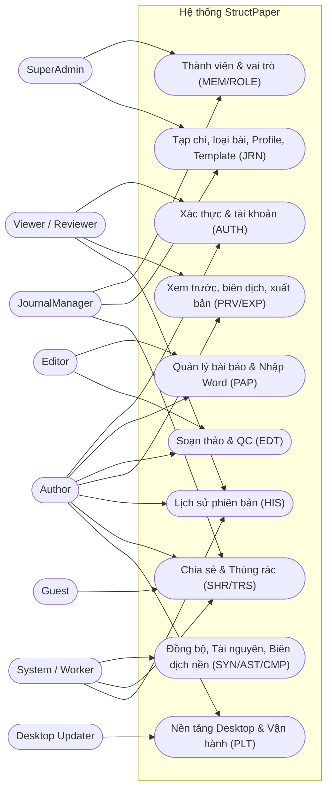

# 2.1.0 Use case – Tổng quan hệ thống

Sơ đồ mức cao: các actor và **nhóm** use case. Chi tiết từng nhóm ở các file kế tiếp (01–08). Danh sách UC đầy đủ: [1.1 Use case](../../1-BRD/1.1-Use-case.md).

## Quan hệ giữa các actor

> Mũi tên = "được kế thừa/mở rộng quyền". Thực tế quyền do CASL tính từ vai trò hệ thống **và** vai trò thành viên trên từng bài (`OWNER`, `COAUTHOR`, `EDITOR`, `REVIEWER`, `VIEWER`).

## Tổng quan use case theo nhóm

## Ma trận actor × nhóm use case

| Nhóm | Guest | Viewer | Author | Editor | JournalManager | SuperAdmin | System |
|---|:-:|:-:|:-:|:-:|:-:|:-:|:-:|
| AUTH | – | ✔ | ✔ | ✔ | ✔ | ✔ | – |
| MEM / ROLE | – | – | – | – | ✔ (trong phạm vi) | ✔ | – |
| JRN (xem) | ✔ (profile công khai) | ✔ | ✔ | ✔ | ✔ | ✔ | – |
| JRN (quản trị) | – | – | – | – | ✔ | ✔ | – |
| PAP | – | xem | ✔ | ✔ | ✔ (mọi bài tạp chí) | ✔ | – |
| EDT | – | – | ✔ | ✔ (nếu là thành viên EDITOR) | ✔ | ✔ | – |
| PRV / EXP | xem PDF | xem | ✔ | ✔ | ✔ | ✔ | – |
| HIS | – | xem | ✔ | ✔ | ✔ | ✔ | tự động tạo |
| SHR | link `VIEWER` | – | ✔ (Owner) | ✔ | ✔ | ✔ | – |
| TRS | – | – | thùng rác của mình | thùng rác của mình | ✔ (cả tạp chí) | ✔ | tự dọn |
| SYN / AST / CMP | – | đọc | ✔ | ✔ | ✔ | ✔ | worker |
| PLT | – | – | ✔ | ✔ | ✔ | ✔ | outbox, updater |
