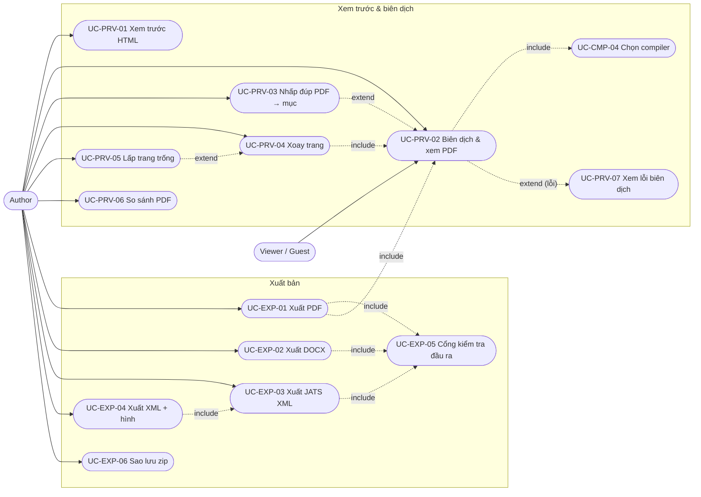
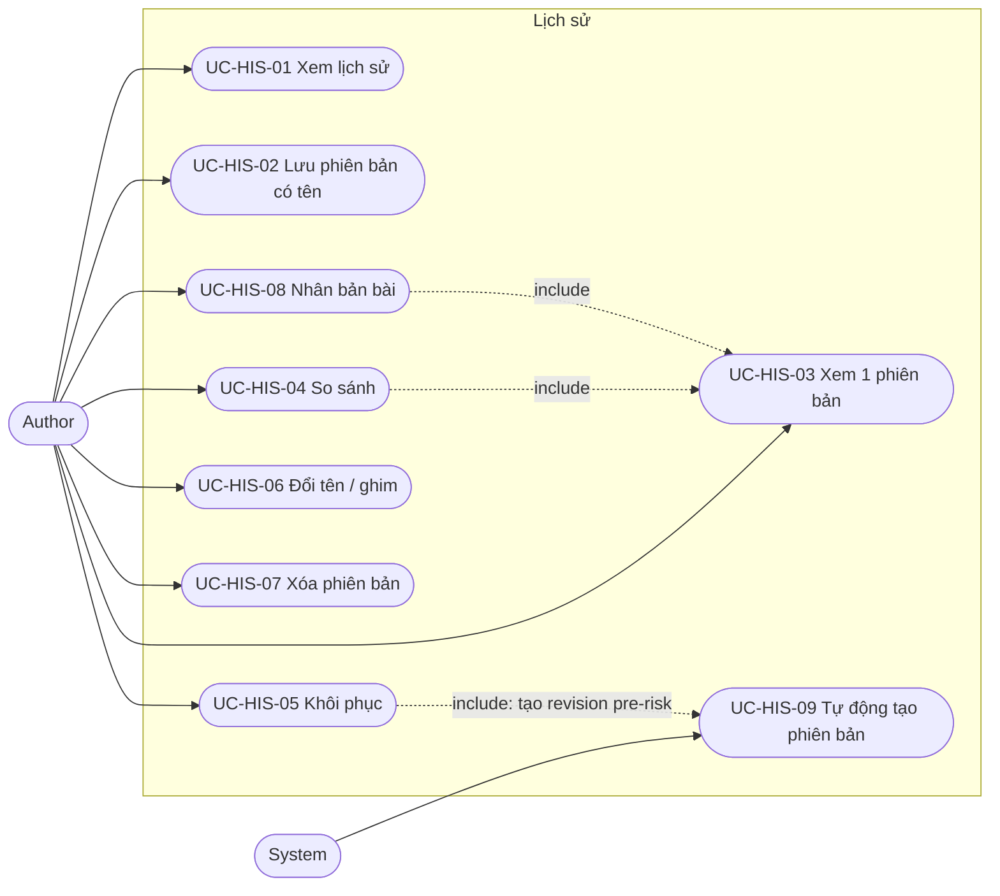
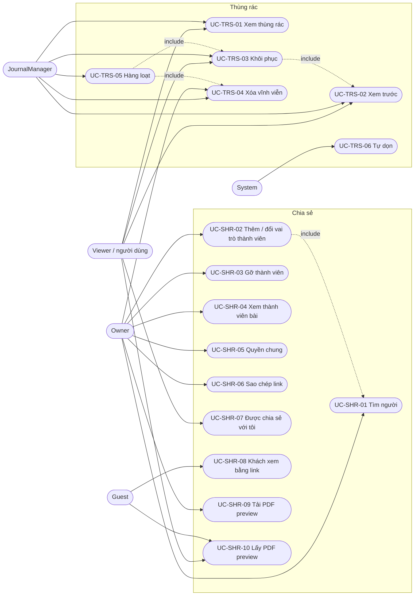
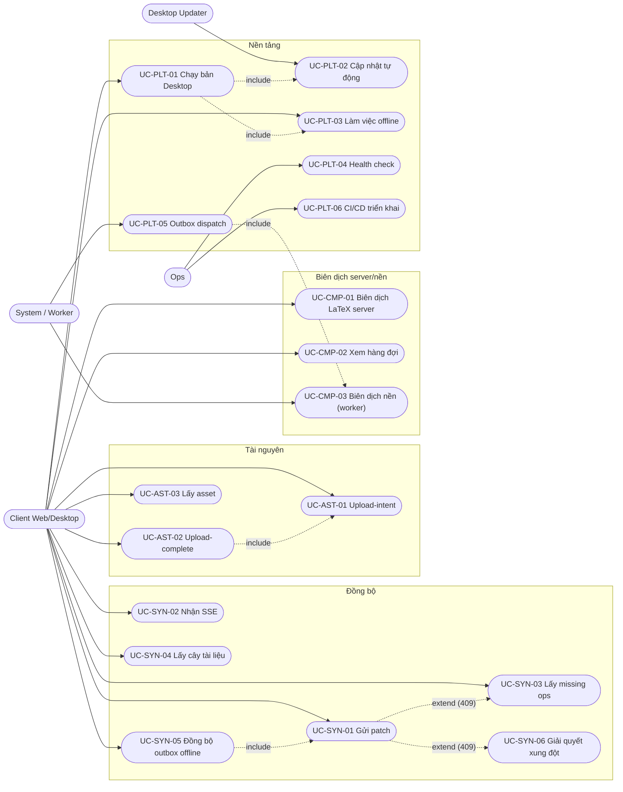

# 2.1.4 Use case – Xem trước/Xuất, Lịch sử, Chia sẻ/Thùng rác, Đồng bộ & Nền tảng

## Xem trước & Xuất bản (UC-PRV, UC-EXP)

## Lịch sử phiên bản (UC-HIS)

## Chia sẻ & Thùng rác (UC-SHR, UC-TRS)

## Đồng bộ, tài nguyên, biên dịch nền & nền tảng (UC-SYN, UC-AST, UC-CMP, UC-PLT)

