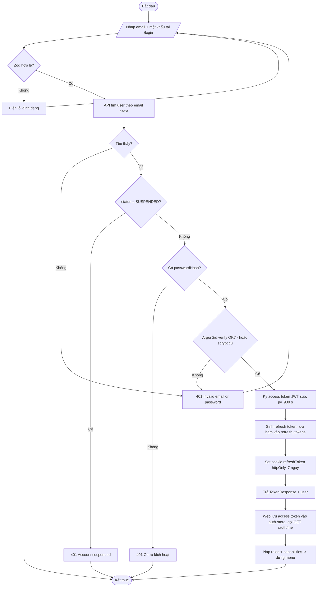
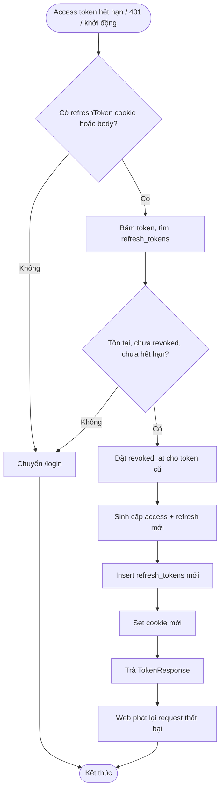
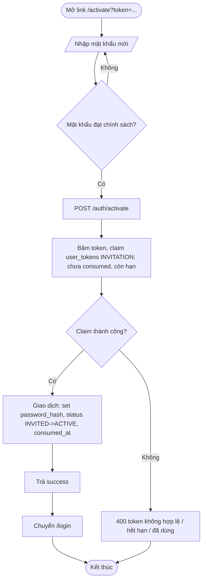
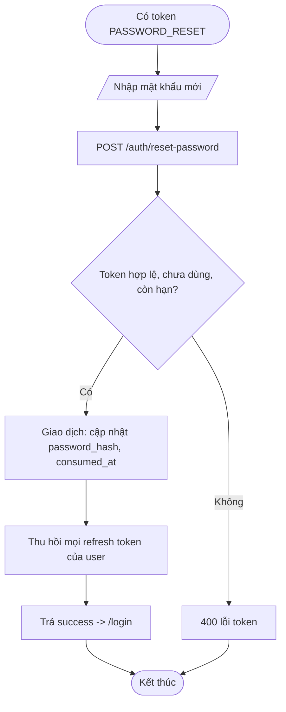
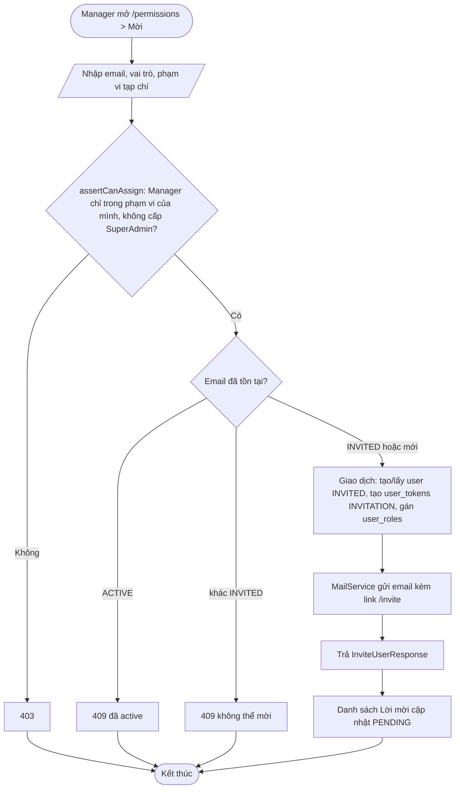
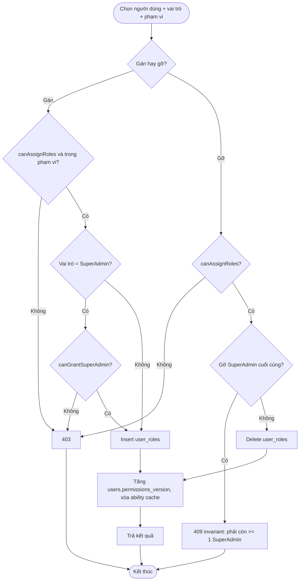

# 2.2.1 Activity – Danh tính, thành viên, phân quyền (AD-01 … AD-07)

Sequence tương ứng: [2.3.1](../2.3-Sequence/01-identity-access.md) (SD-01 … SD-07).

## AD-01 Đăng nhập (UC-AUTH-01)



## AD-02 Làm mới phiên (UC-AUTH-02)



## AD-03 Kích hoạt tài khoản từ lời mời (UC-AUTH-04)



## AD-04 Đặt lại mật khẩu (UC-AUTH-05)



## AD-05 Mời thành viên (UC-MEM-02)



## AD-06 Gán / gỡ vai trò (UC-ROLE-02/03/04)



## AD-07 Kiểm tra quyền mỗi request (CASL)

```mermaid
flowchart TD
    S([Request đến API]) --> PUB{Route @Public?}
    PUB -- Có --> H[Chạy handler]
    PUB -- Không --> TK{Có Bearer token hợp lệ?}
    TK -- Không --> OA{@OptionalAuth?}
    OA -- Có --> GU[Coi như Guest, ability rỗng]
    OA -- Không --> E1[401]
    TK -- Có --> PV{pv trong token == permissions_version?}
    PV -- Không --> E1
    PV -- Có --> AC{Ability trong cache?}
    AC -- Có --> POL
    AC -- Không --> LD[Nạp roles + manuscript_members, build AbilityFactory, ghi cache]
    LD --> POL
    GU --> POL
    POL{@CheckPolicies đạt?}
    POL -- Không --> E2[403]
    POL -- Có --> H
    H --> SV[Service kiểm tra ability.can theo từng bản ghi subject]
    SV --> OK[Trả response + access flags]
    OK --> E([Kết thúc])
    E1 --> E
    E2 --> E
```
