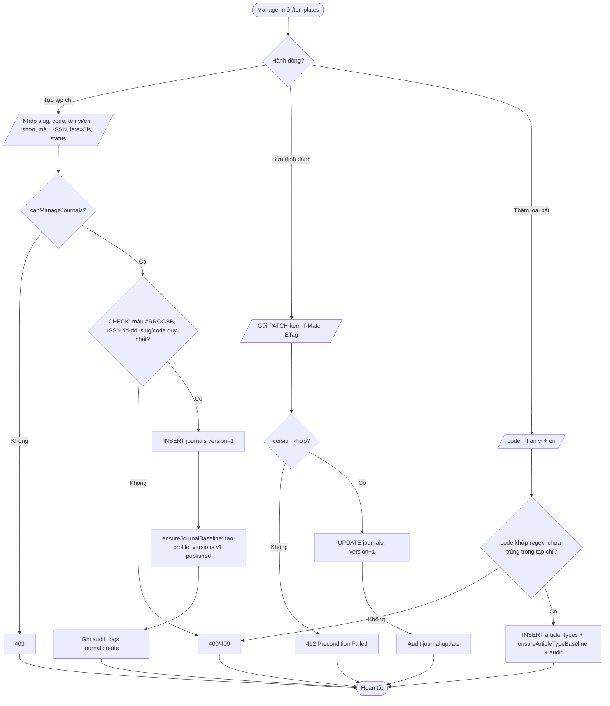
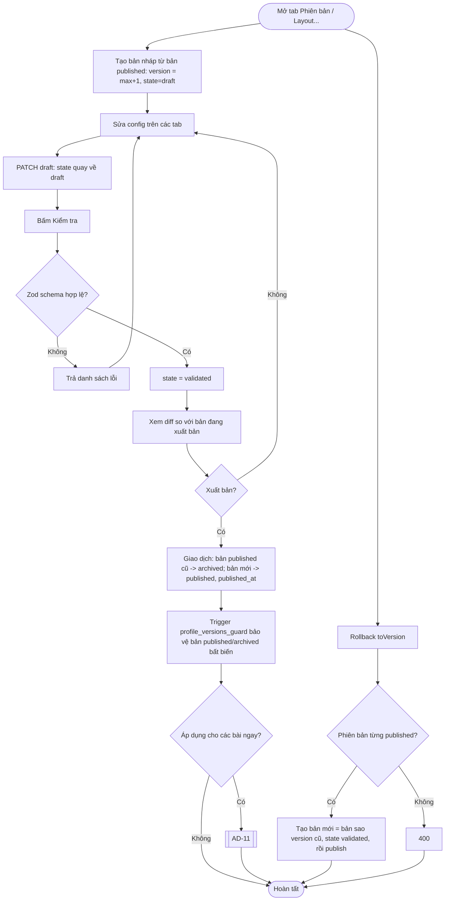
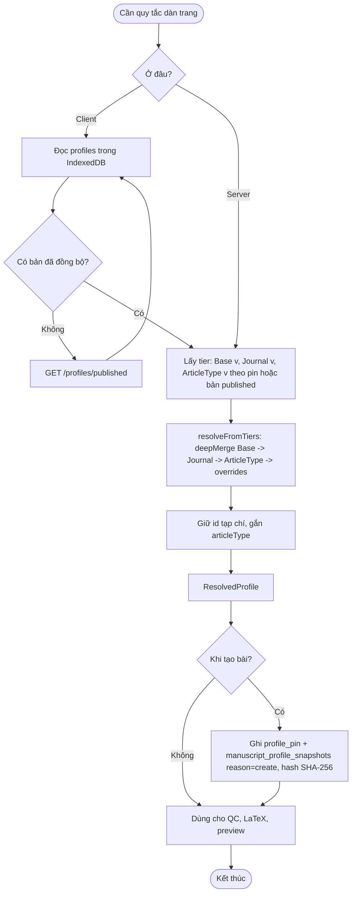
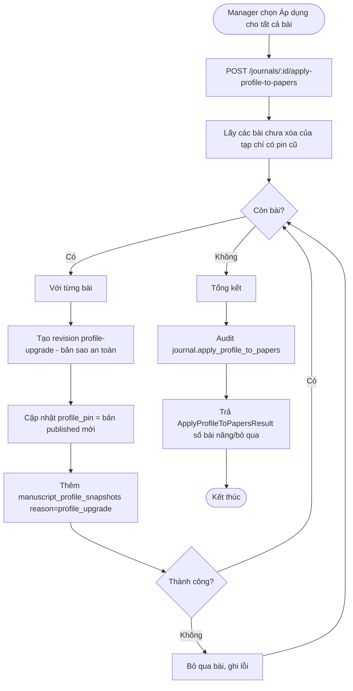
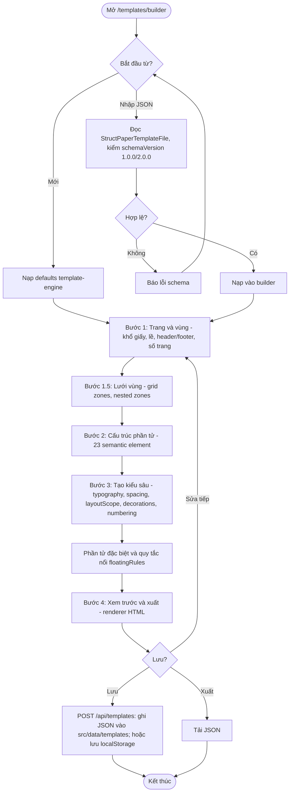

# 2.2.2 Activity – Tạp chí, Profile, Template (AD-08 … AD-12)

Sequence tương ứng: [2.3.2](../2.3-Sequence/02-journals-profiles.md).

## AD-08 Tạo tạp chí & loại bài (UC-JRN-04/05/07/08)

## AD-09 Vòng đời Profile: nháp → kiểm tra → xuất bản → rollback (UC-JRN-09…14)

## AD-10 Resolve profile & ghim profile cho bài (UC-JRN-03, UC-PAP-01)

## AD-11 Áp dụng profile mới cho các bài (UC-JRN-15)

## AD-12 Template Builder (UC-JRN-17)

