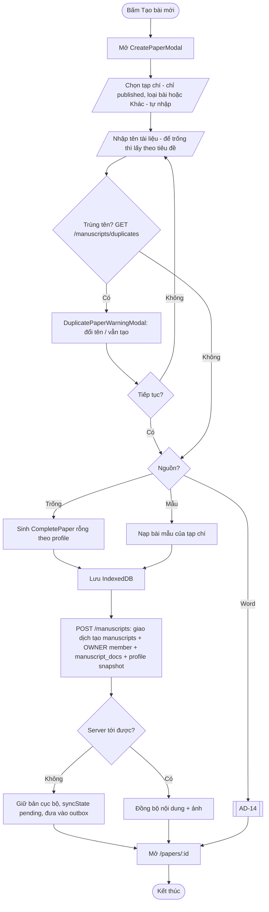
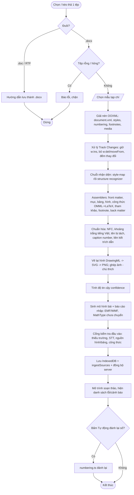
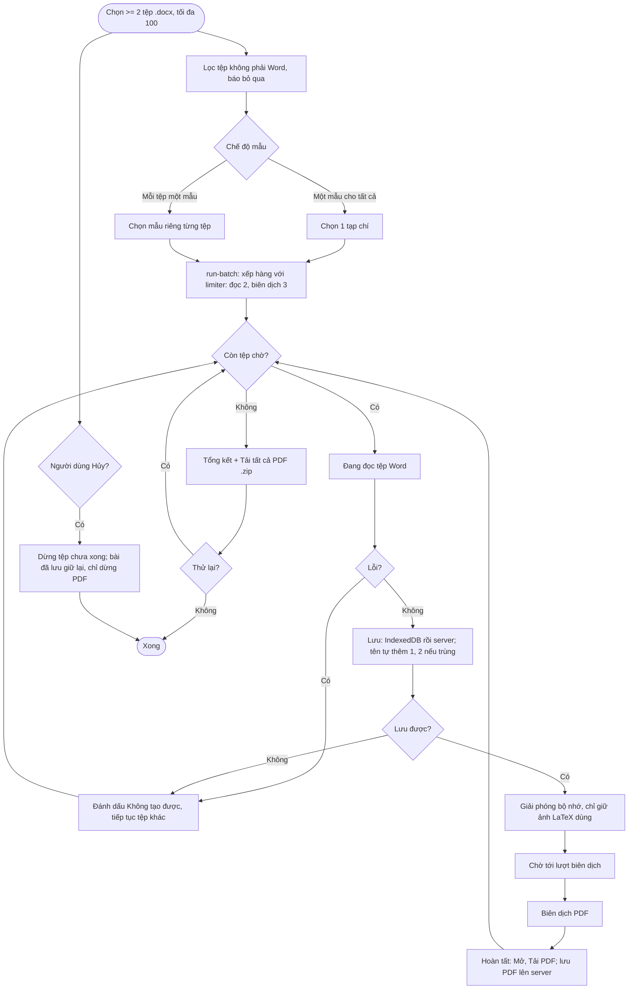
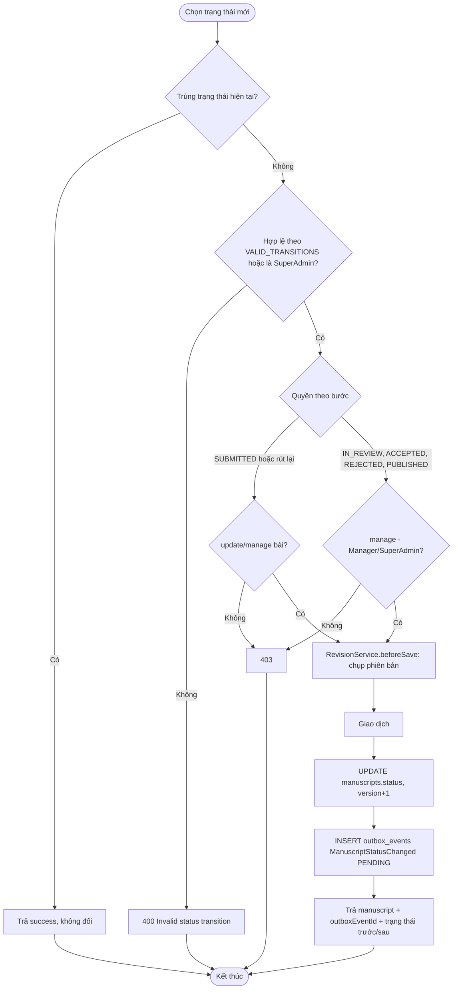
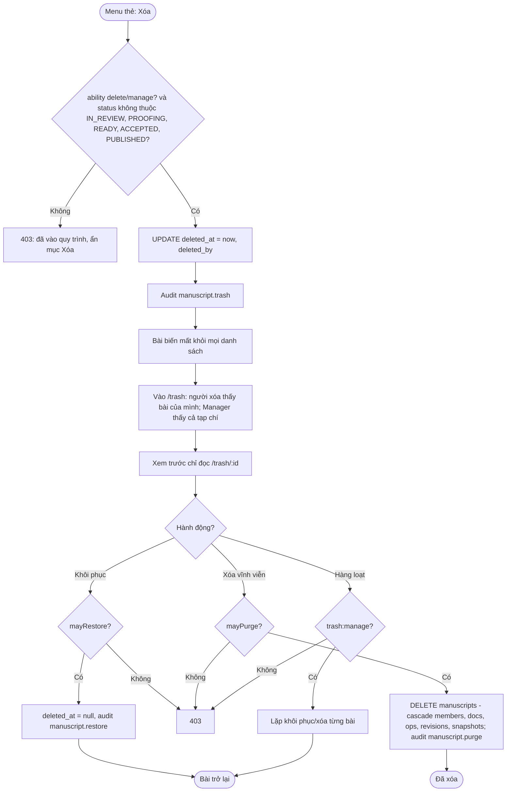
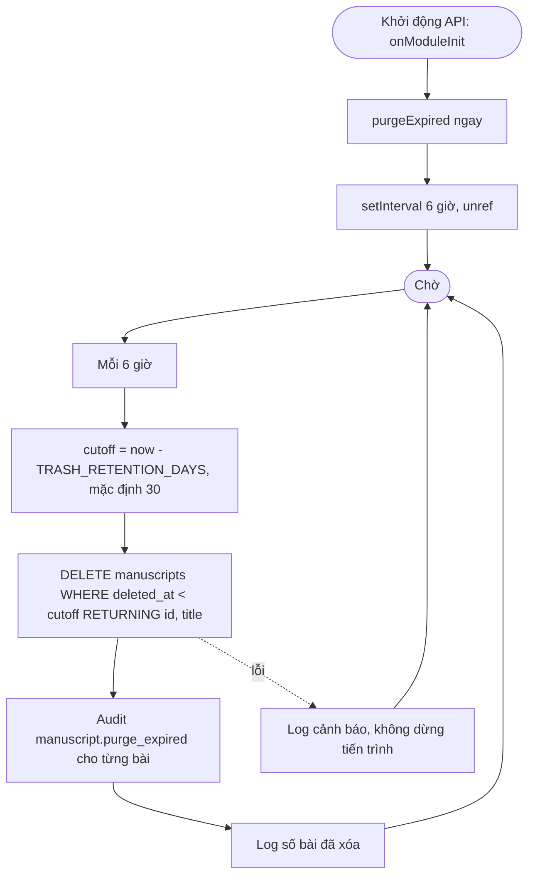
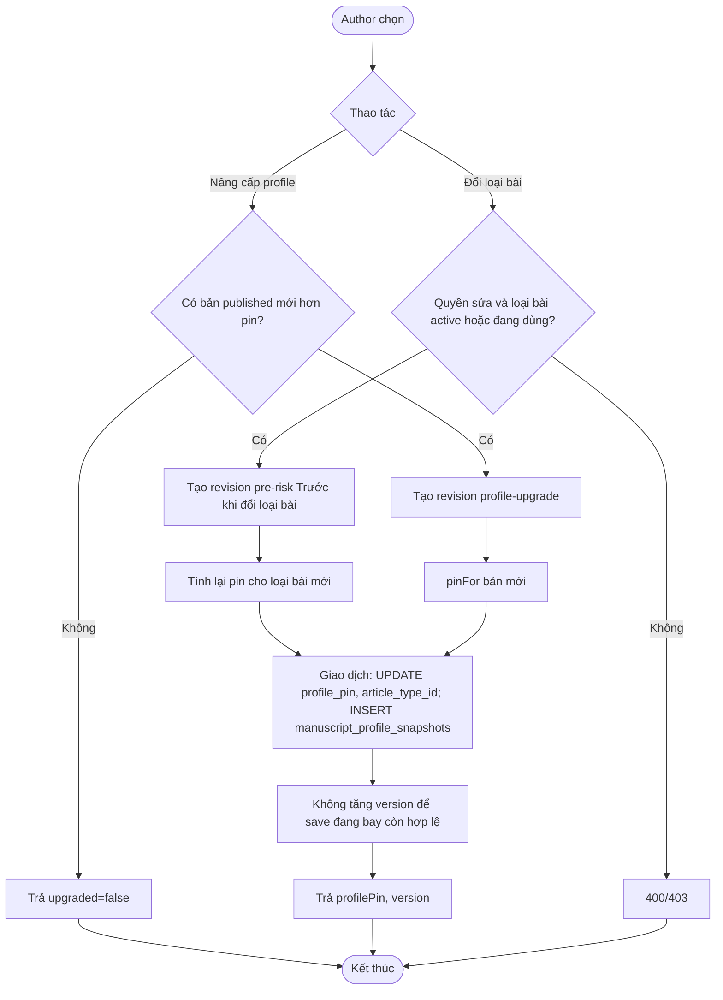

# 2.2.3 Activity – Bài báo, nhập Word, workflow, thùng rác (AD-13 … AD-19)

Sequence tương ứng: [2.3.3](../2.3-Sequence/03-papers-ingest.md).

## AD-13 Tạo bài mới (UC-PAP-01/02/07)

## AD-14 Nhập một tệp Word (UC-PAP-03, UC-EDT-15)

## AD-15 Nhập hàng loạt (UC-PAP-04)

## AD-16 Đổi trạng thái workflow (UC-PAP-10)

## AD-17 Xóa bài → Thùng rác → Khôi phục / Xóa vĩnh viễn (UC-PAP-09, UC-TRS-01…05)

## AD-18 Tự động dọn thùng rác (UC-TRS-06)

## AD-19 Đổi loại bài & nâng cấp profile của bài (UC-PAP-11/12)

