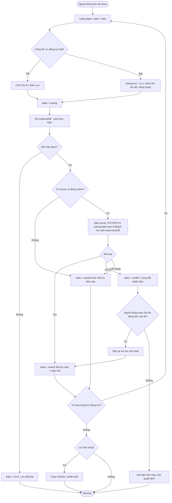
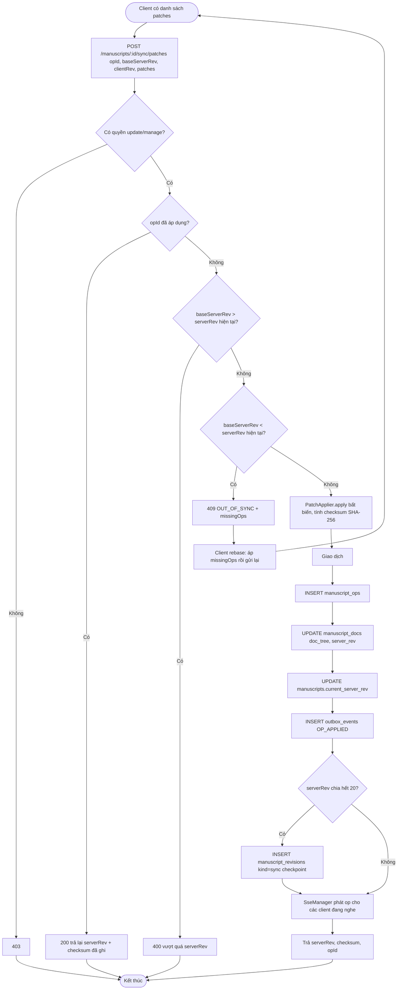
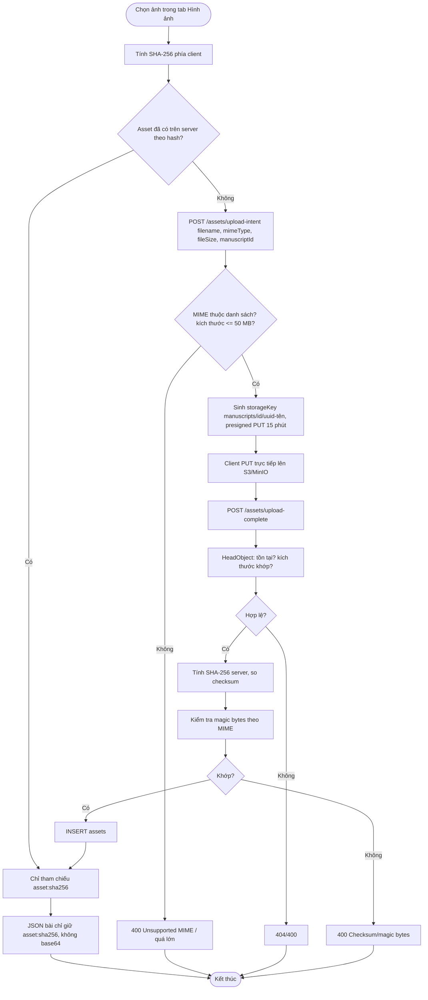
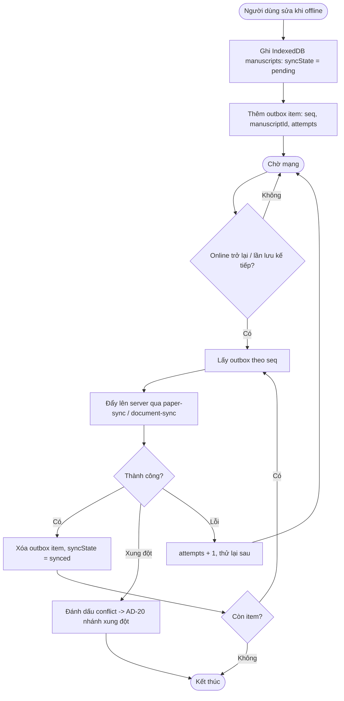
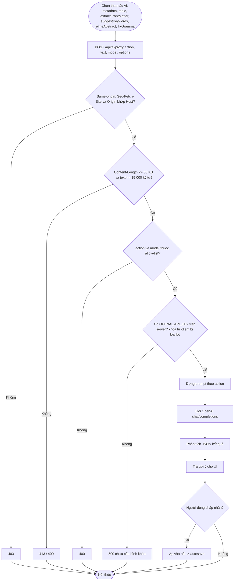

# 2.2.4 Activity – Soạn thảo, đồng bộ, tài nguyên, AI (AD-20 … AD-24)

Sequence tương ứng: [2.3.4](../2.3-Sequence/04-editing-sync.md).

## AD-20 Tự động lưu & lưu thủ công (UC-EDT-11/12/19, UC-SYN-06)

## AD-21 Gửi patch thời gian thực & xung đột (UC-SYN-01…04)

## AD-22 Tải ảnh lên (UC-AST-01/02, UC-EDT-06)

## AD-23 Đồng bộ hàng đợi offline (UC-SYN-05, UC-PLT-03)

## AD-24 Trợ lý AI (UC-EDT-17)

