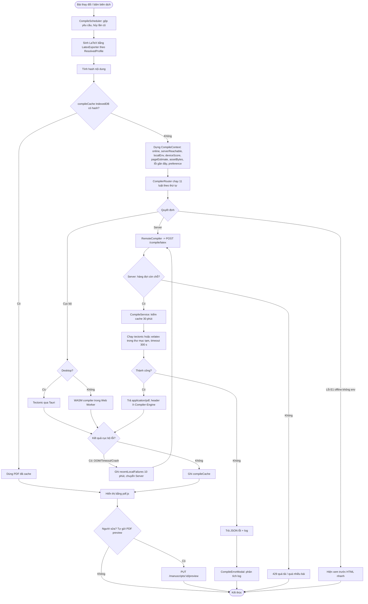
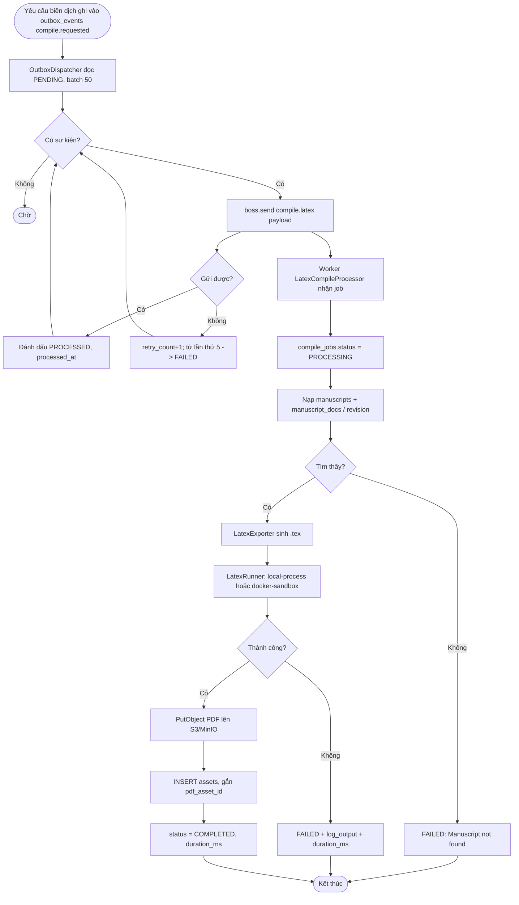
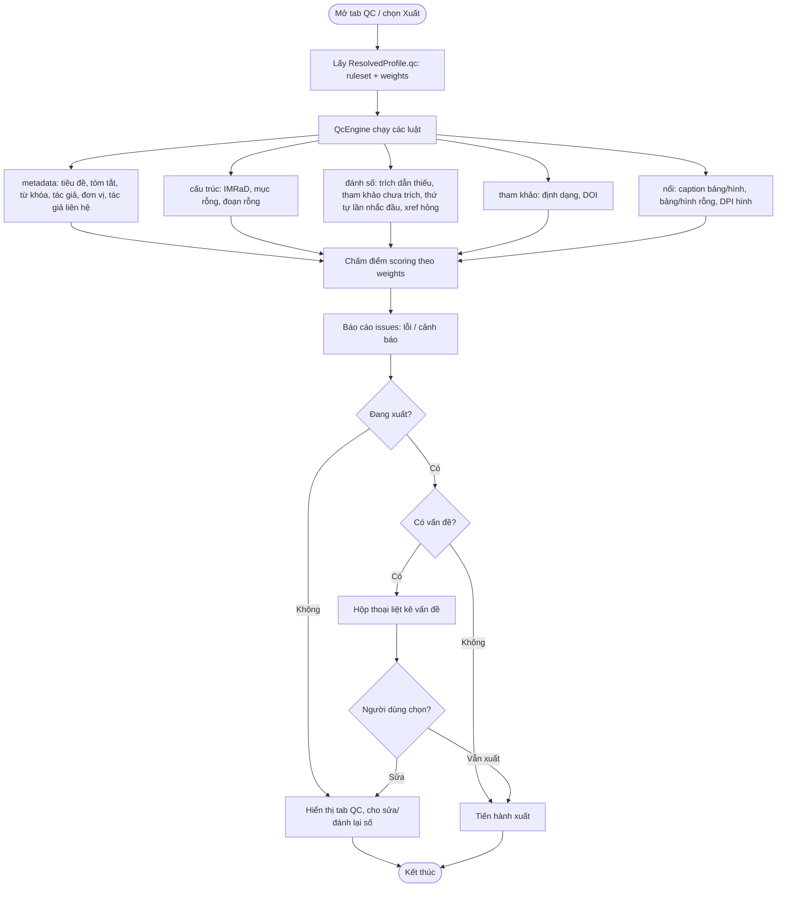
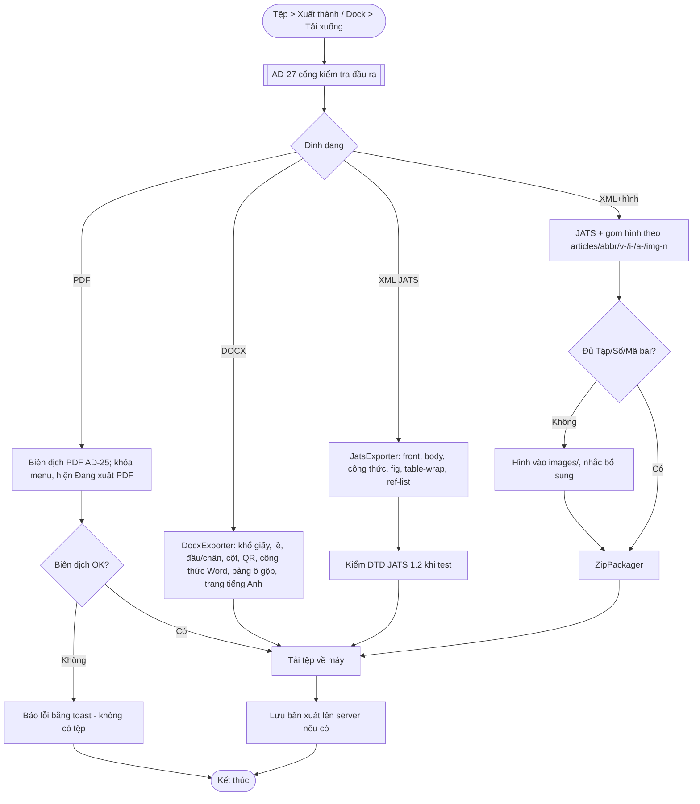
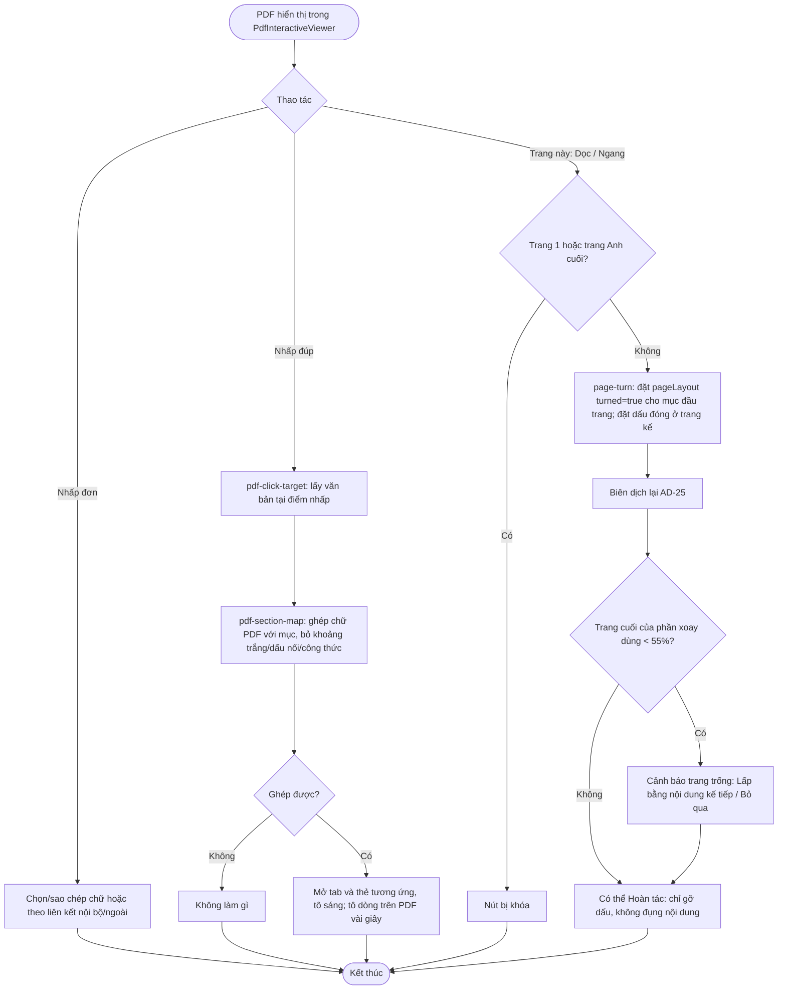

# 2.2.5 Activity – Biên dịch, QC, xuất bản (AD-25 … AD-29)

Sequence tương ứng: [2.3.5](../2.3-Sequence/05-compile-export.md).

## AD-25 Biên dịch PDF với bộ định tuyến compiler (UC-PRV-02, UC-CMP-01/04)

## AD-26 Biên dịch nền bằng Worker & outbox (UC-CMP-03, UC-PLT-05)

## AD-27 Kiểm tra chất lượng & cổng xuất (UC-EDT-14/15, UC-EXP-05)

## AD-28 Xuất PDF / DOCX / JATS / XML+hình (UC-EXP-01…04)

## AD-29 Tương tác PDF & xoay trang (UC-PRV-03/04/05)

