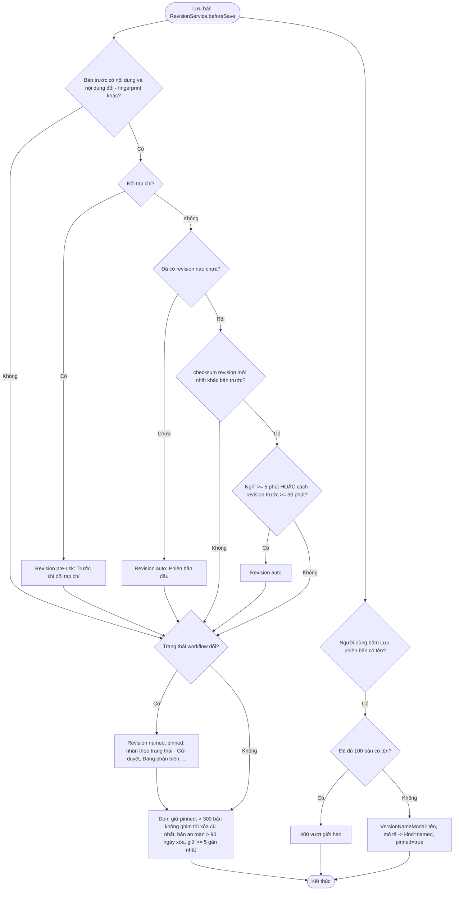
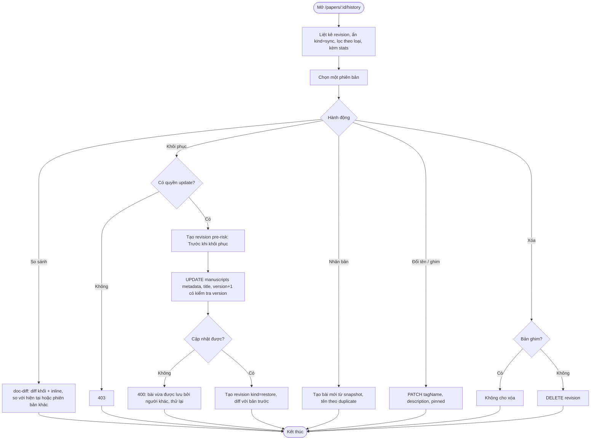
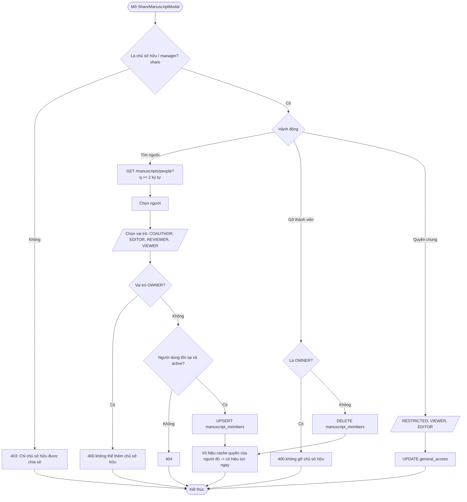
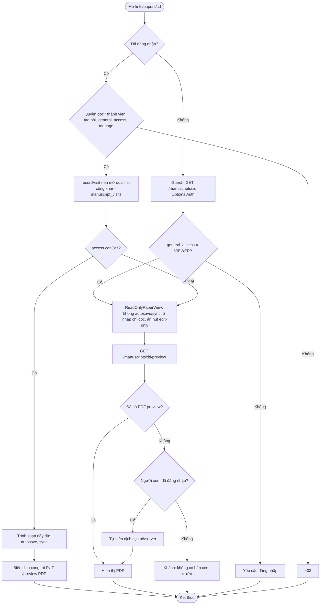
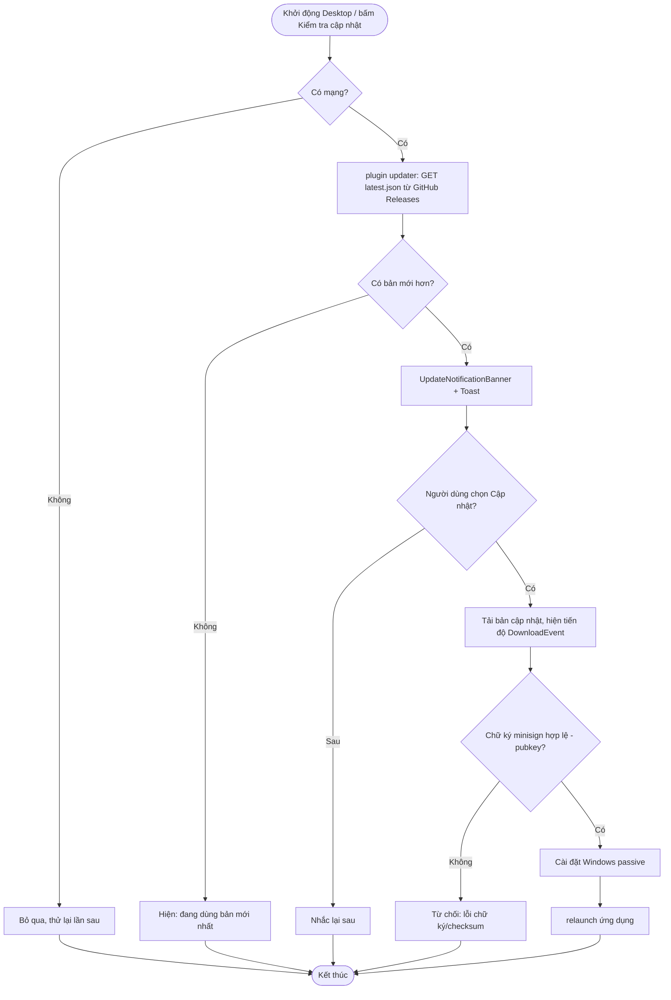

# 2.2.6 Activity – Lịch sử, chia sẻ, chế độ chỉ xem, cập nhật Desktop (AD-30 … AD-34)

Sequence tương ứng: [2.3.6](../2.3-Sequence/06-history-sharing-platform.md).

## AD-30 Tạo phiên bản tự động & phiên bản có tên (UC-HIS-02, UC-HIS-09)

## AD-31 Xem, so sánh, khôi phục, nhân bản phiên bản (UC-HIS-01,03,04,05,08)

## AD-32 Chia sẻ bài (UC-SHR-01…05)

## AD-33 Mở bài chỉ xem, khách xem bằng link, PDF preview (UC-PAP-13, UC-SHR-07…10)

## AD-34 Kiểm tra & cập nhật tự động bản Desktop (UC-PLT-02)

