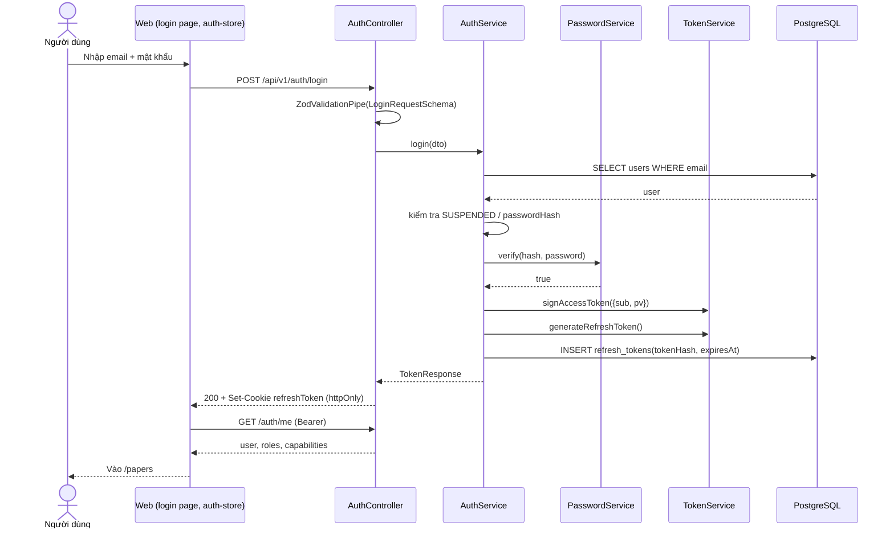
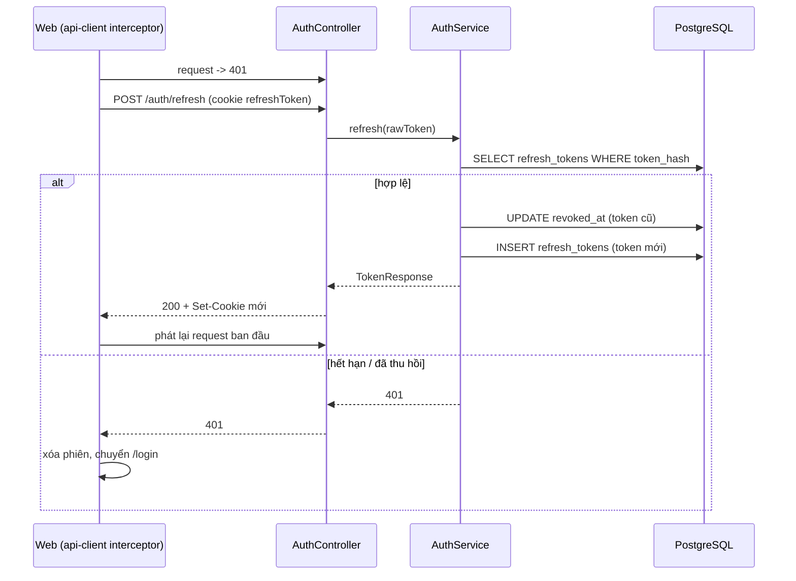
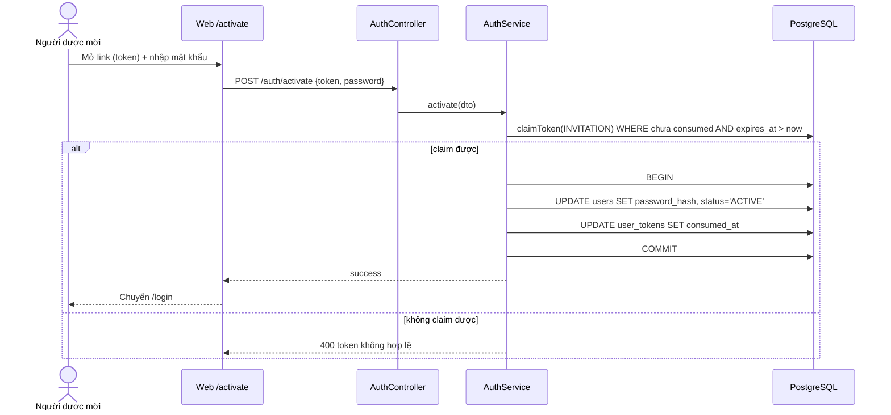
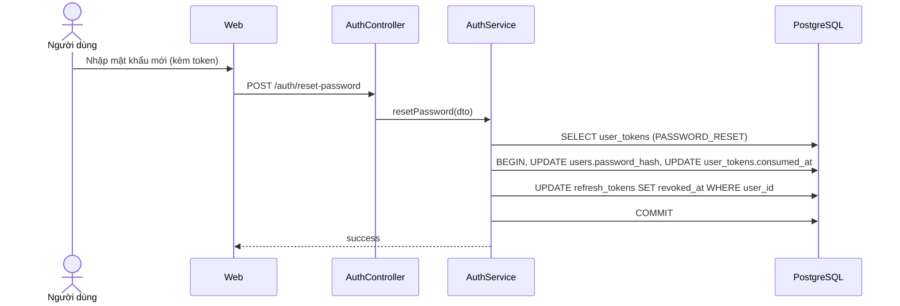
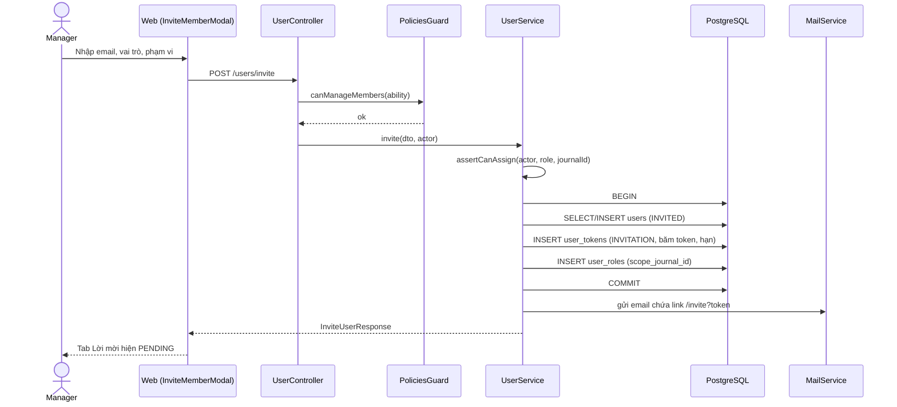
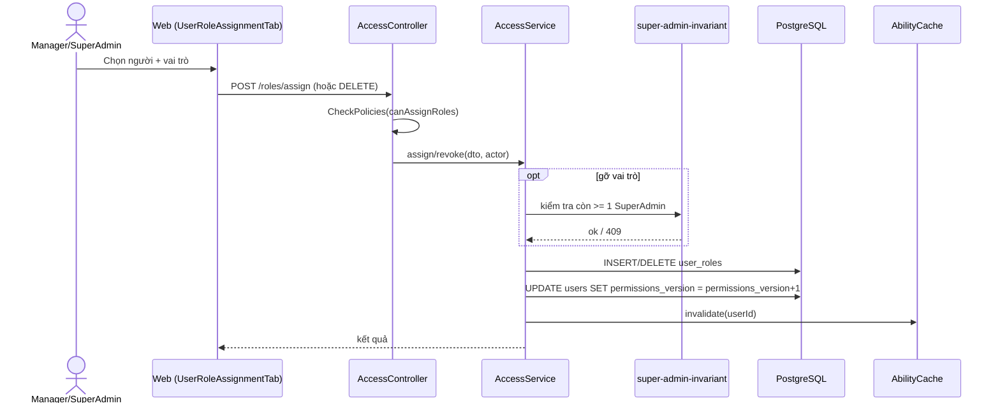
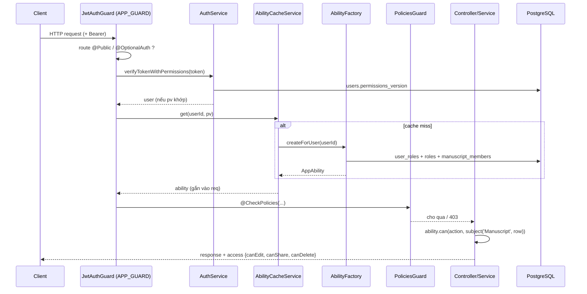

# 2.3.1 Sequence – Danh tính, thành viên, phân quyền (SD-01 … SD-07)

Activity tương ứng: [2.2.1](../2.2-Activity/01-identity-access.md).

## SD-01 Đăng nhập

## SD-02 Làm mới phiên

## SD-03 Kích hoạt tài khoản

## SD-04 Đặt lại mật khẩu

## SD-05 Mời thành viên

## SD-06 Gán / gỡ vai trò

## SD-07 Kiểm tra quyền mỗi request

