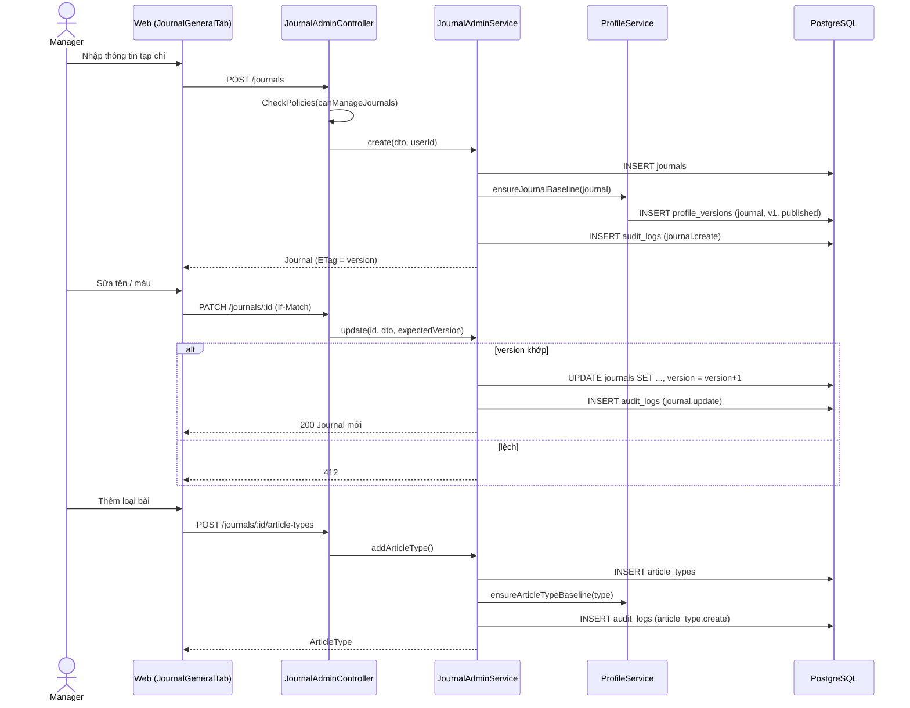
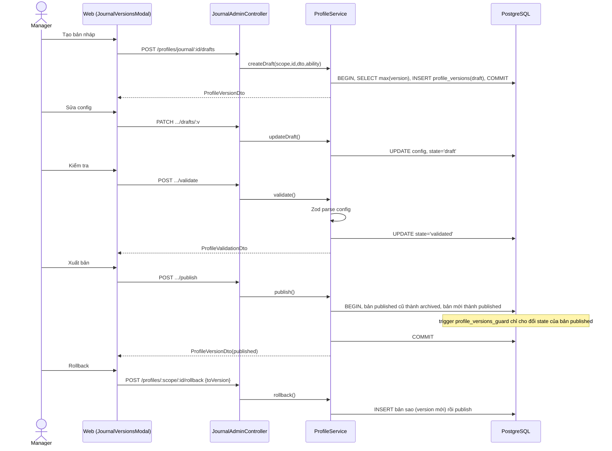
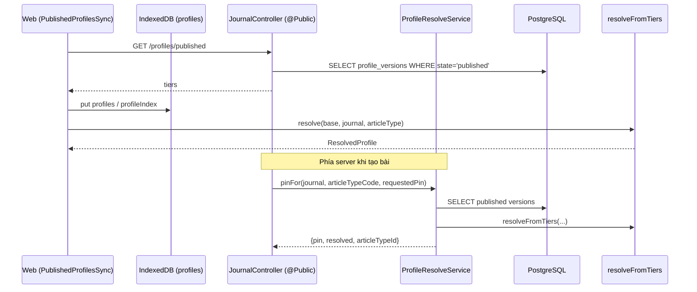
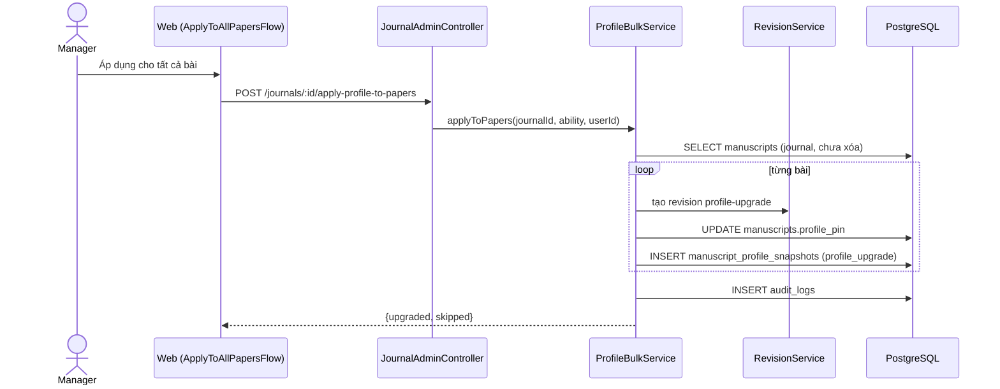
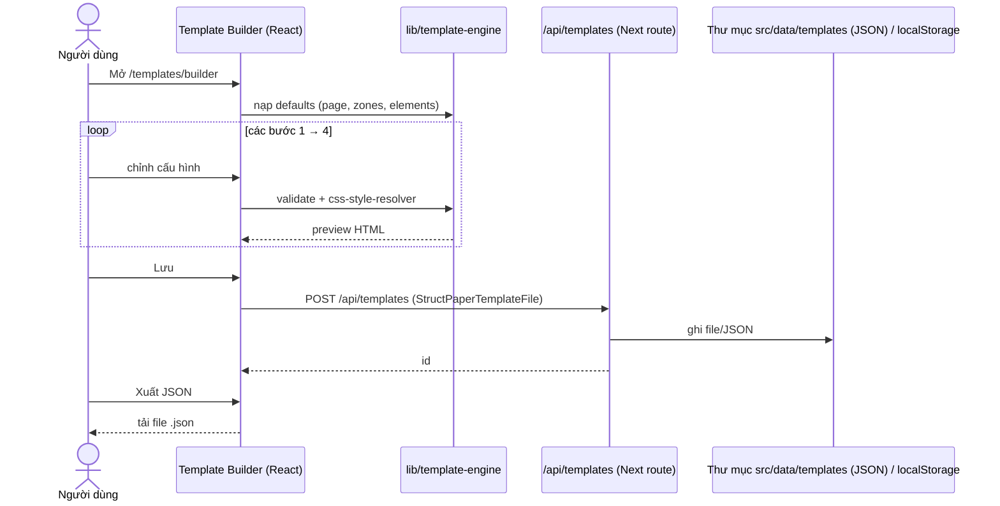

# 2.3.2 Sequence – Tạp chí, Profile, Template (SD-08 … SD-12)

Activity tương ứng: [2.2.2](../2.2-Activity/02-journals-profiles.md).

## SD-08 Tạo tạp chí / sửa định danh / thêm loại bài

## SD-09 Vòng đời Profile

## SD-10 Resolve & ghim profile

## SD-11 Áp dụng profile mới cho các bài

## SD-12 Template Builder

