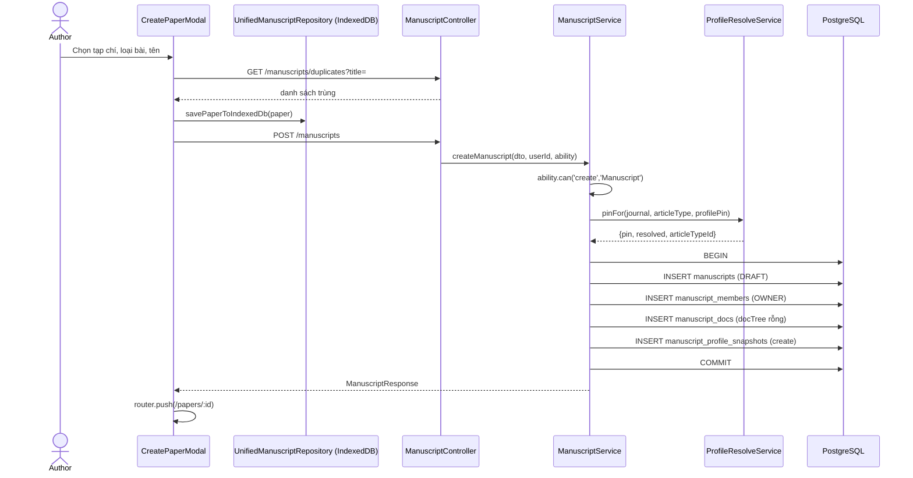
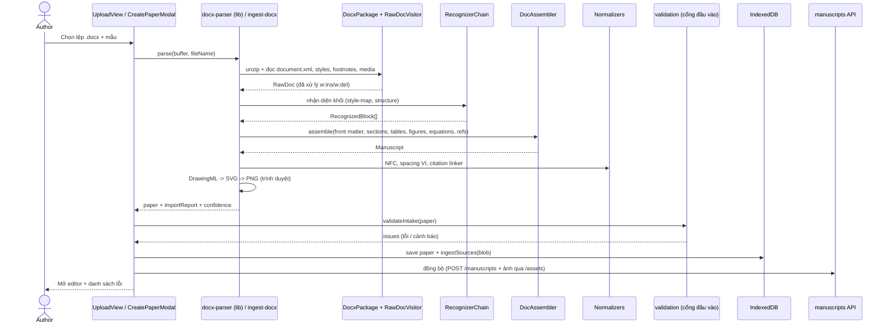
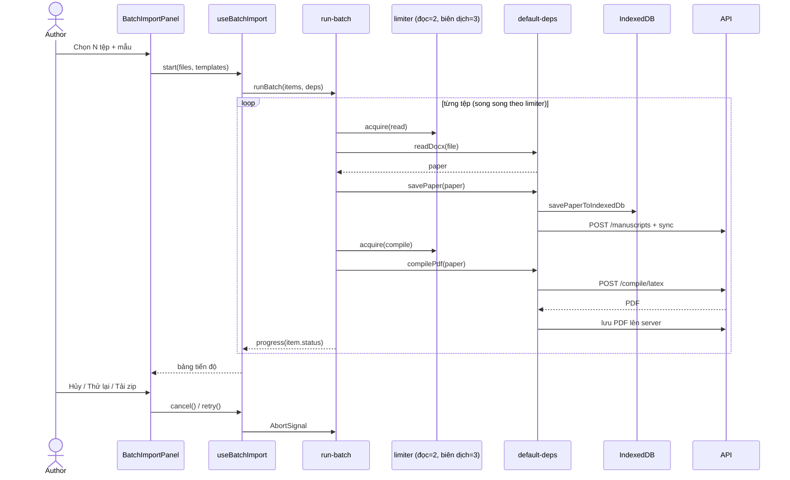
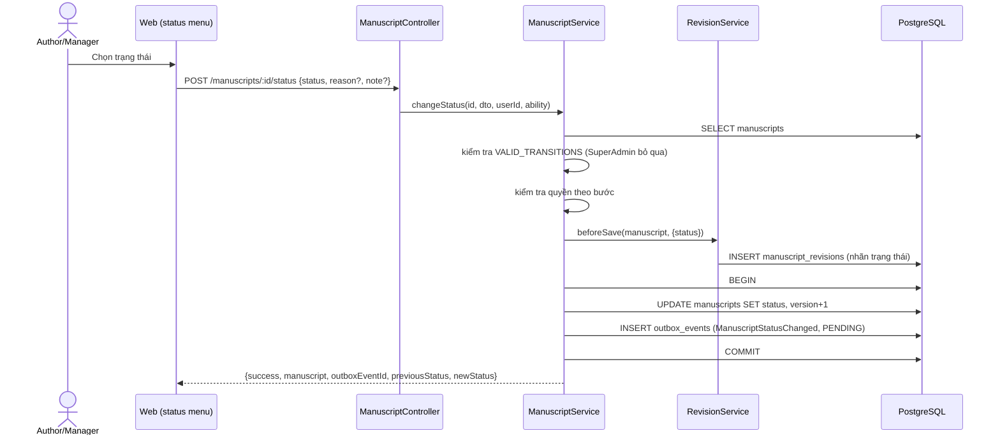
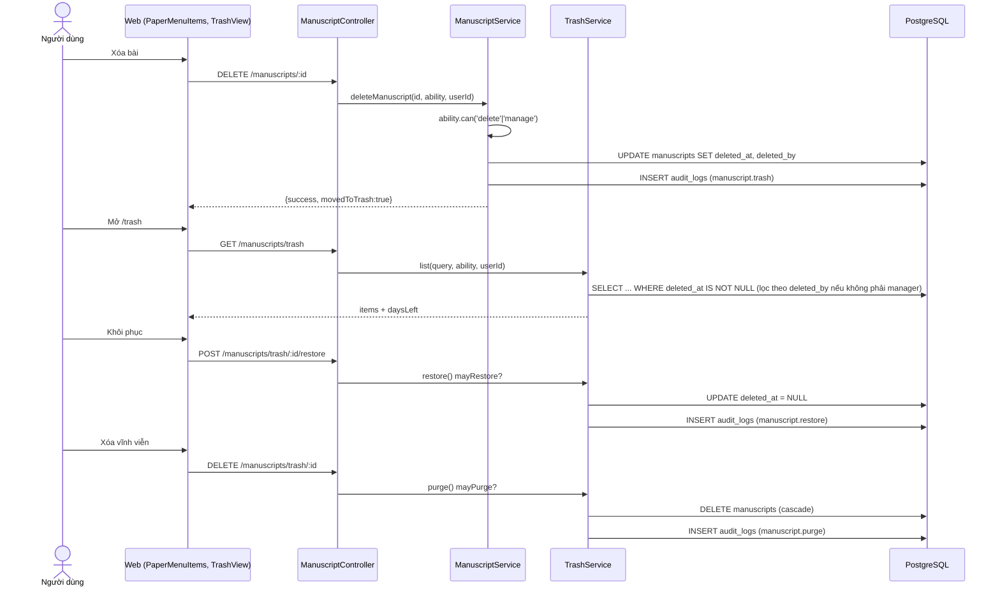
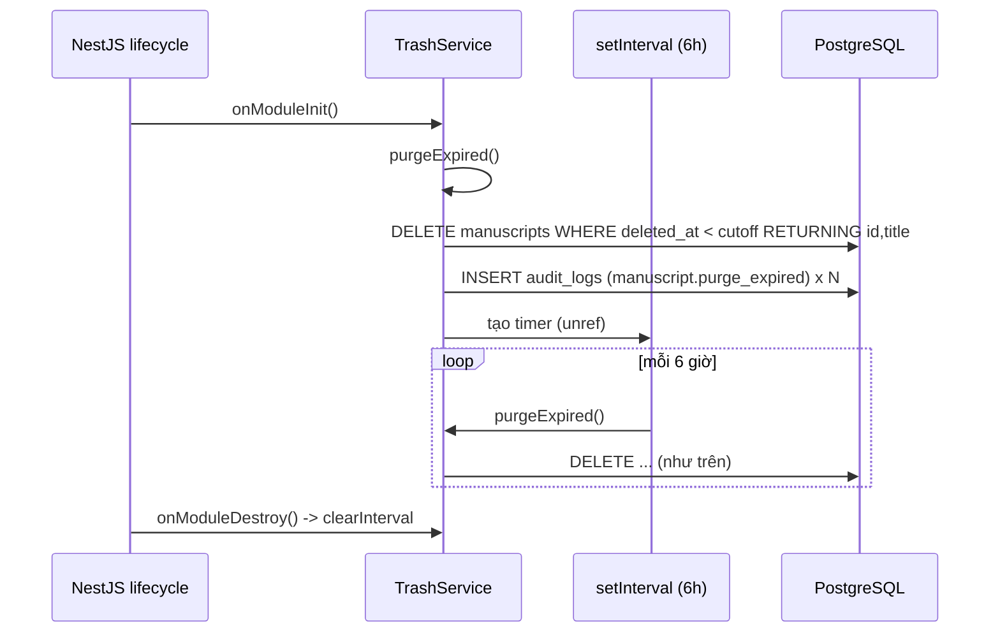
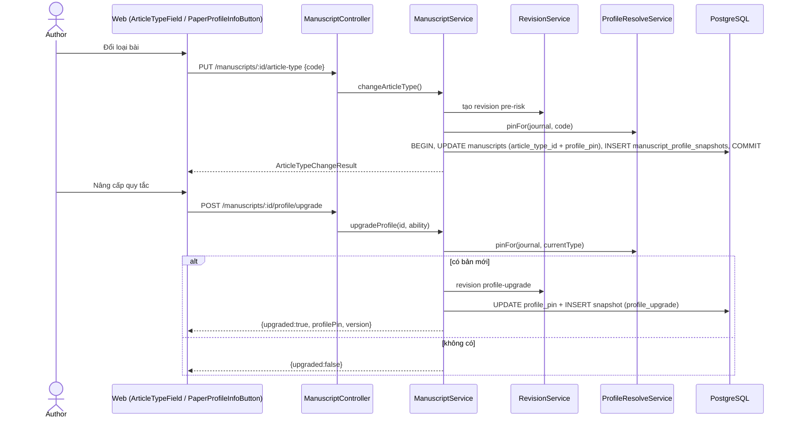

# 2.3.3 Sequence – Bài báo, nhập Word, workflow, thùng rác (SD-13 … SD-19)

Activity tương ứng: [2.2.3](../2.2-Activity/03-papers-ingest.md).

## SD-13 Tạo bài mới

## SD-14 Nhập một tệp Word

## SD-15 Nhập hàng loạt

## SD-16 Đổi trạng thái workflow

## SD-17 Xóa → Thùng rác → Khôi phục / Xóa vĩnh viễn

## SD-18 Tự động dọn thùng rác

## SD-19 Đổi loại bài & nâng cấp profile

