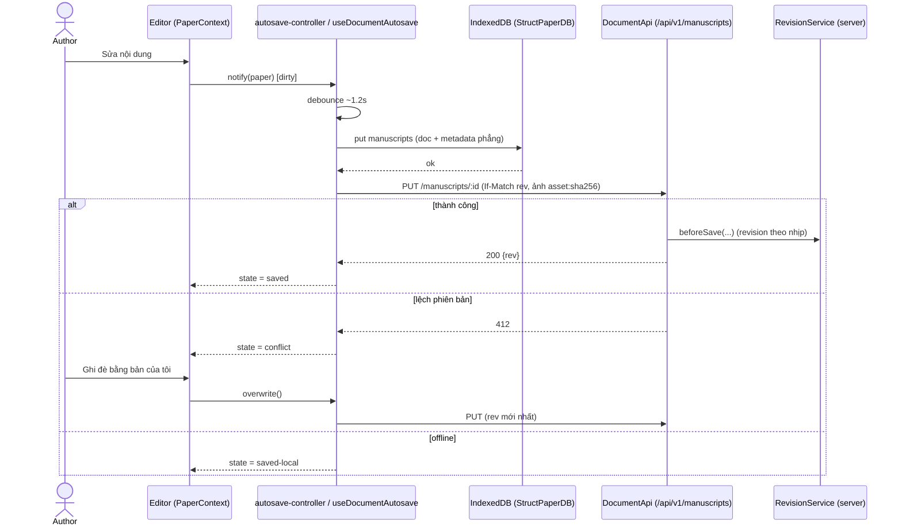
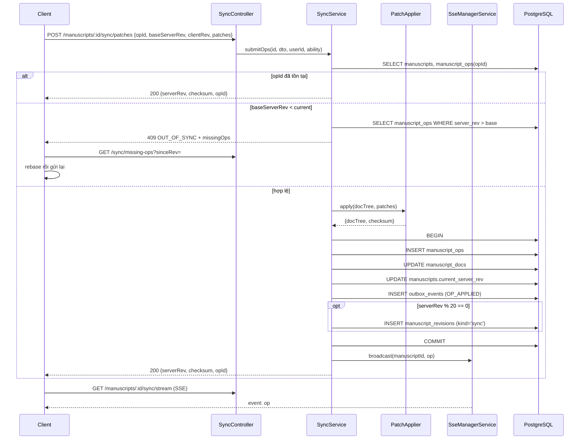
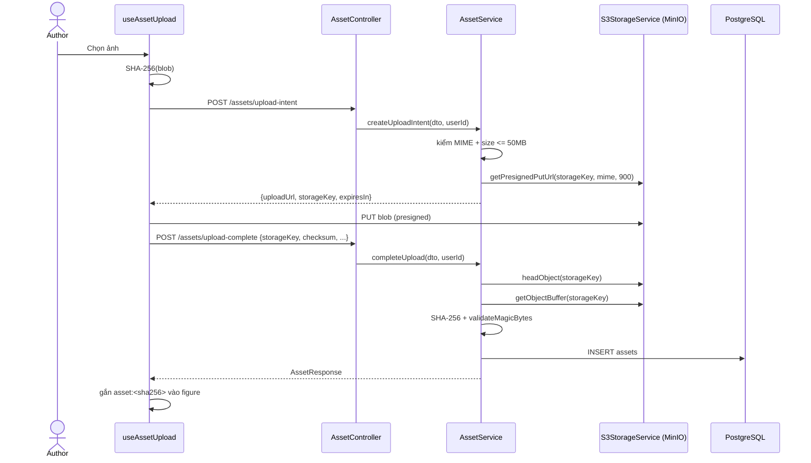
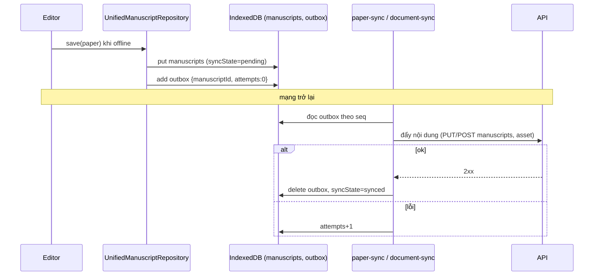
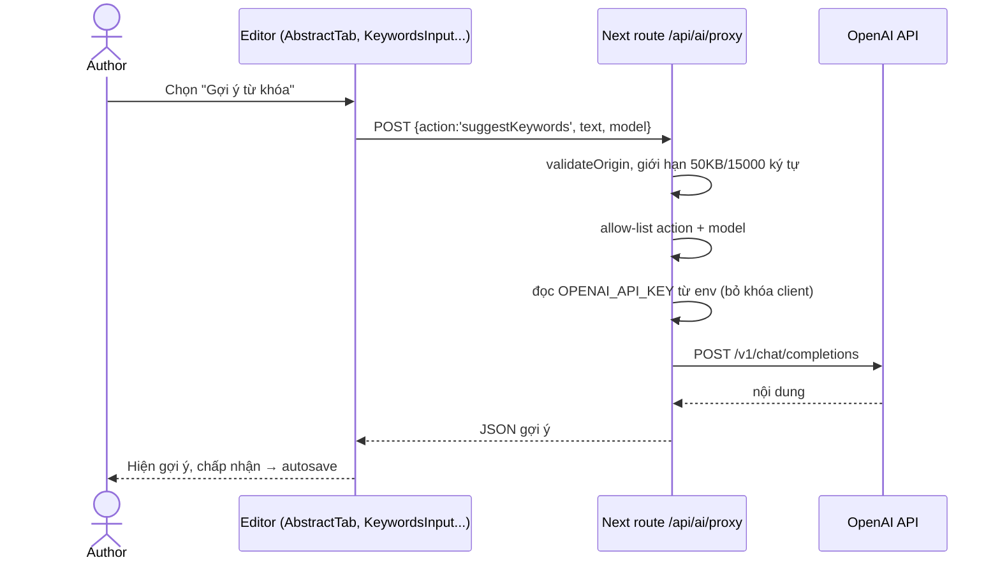

# 2.3.4 Sequence – Soạn thảo, đồng bộ, tài nguyên, AI (SD-20 … SD-24)

Activity tương ứng: [2.2.4](../2.2-Activity/04-editing-sync.md).

## SD-20 Tự động lưu

## SD-21 Gửi patch & xung đột

## SD-22 Tải ảnh lên

## SD-23 Đồng bộ outbox offline

## SD-24 Trợ lý AI

