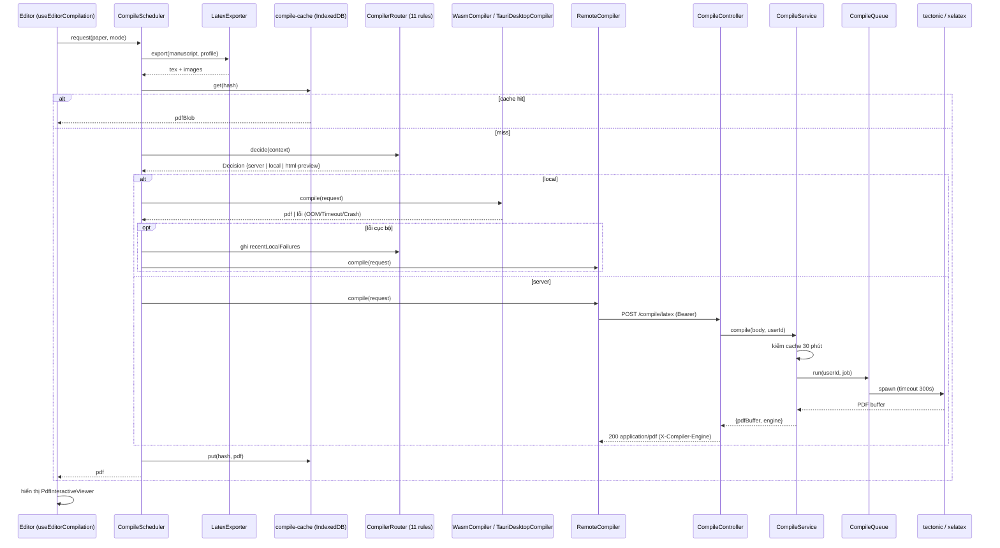
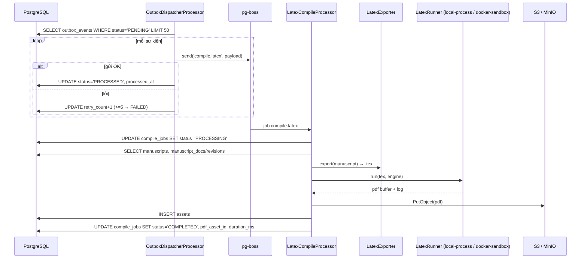
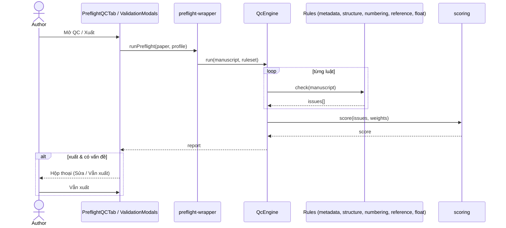
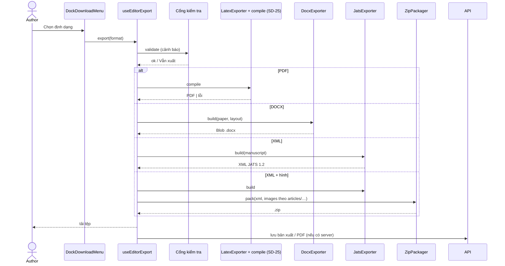
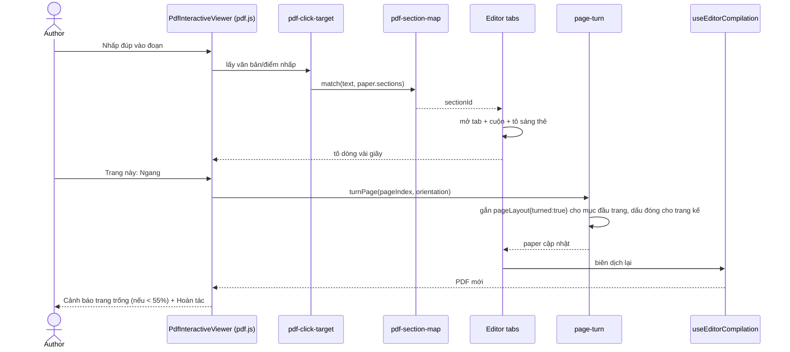

# 2.3.5 Sequence – Biên dịch, QC, xuất bản (SD-25 … SD-29)

Activity tương ứng: [2.2.5](../2.2-Activity/05-compile-export.md).

## SD-25 Biên dịch PDF với router

## SD-26 Worker biên dịch nền & outbox

## SD-27 QC & cổng xuất

## SD-28 Xuất PDF / DOCX / JATS / zip

## SD-29 Tương tác PDF & xoay trang

