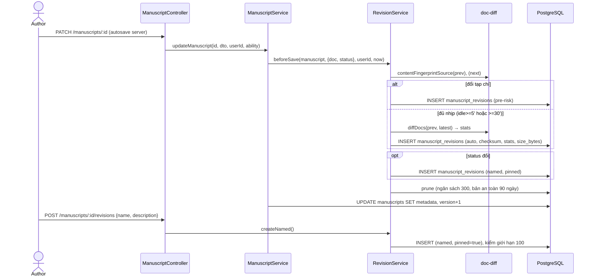
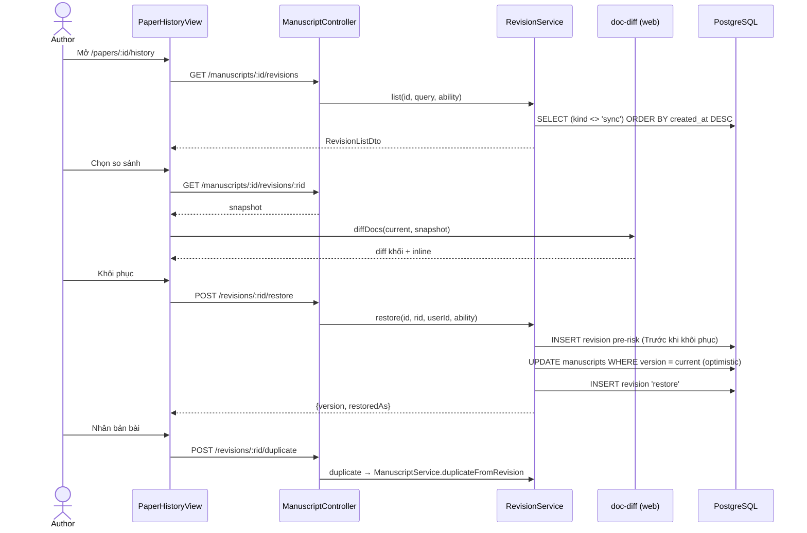
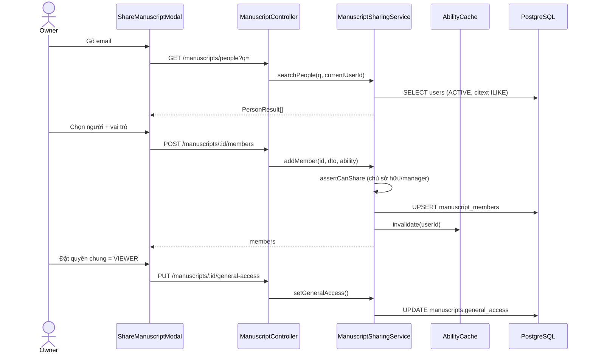
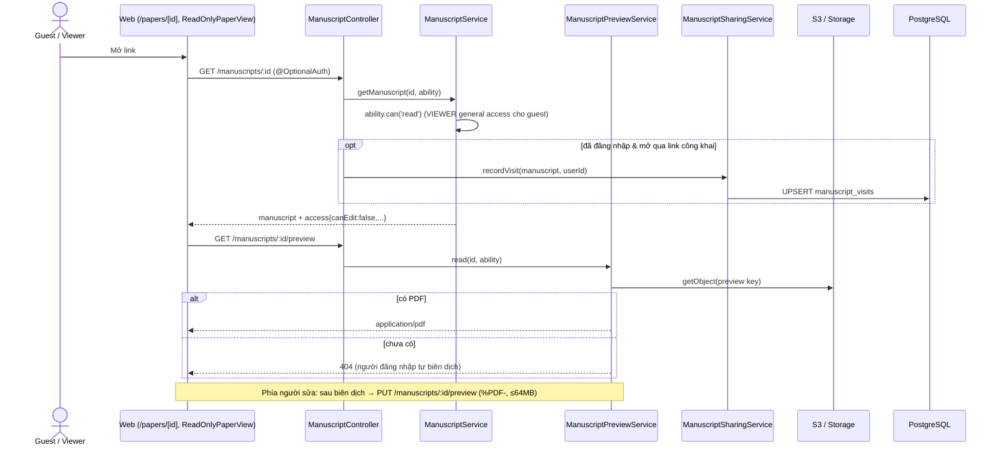
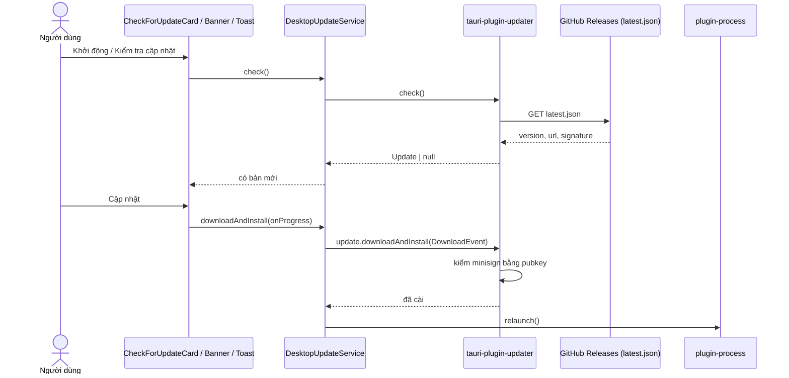

# 2.3.6 Sequence – Lịch sử, chia sẻ, chỉ xem, cập nhật Desktop (SD-30 … SD-34)

Activity tương ứng: [2.2.6](../2.2-Activity/06-history-sharing-platform.md).

## SD-30 Phiên bản tự động & có tên

## SD-31 Khôi phục, so sánh, nhân bản phiên bản

## SD-32 Chia sẻ bài

## SD-33 Chỉ xem, khách & PDF preview

## SD-34 Cập nhật tự động Desktop

