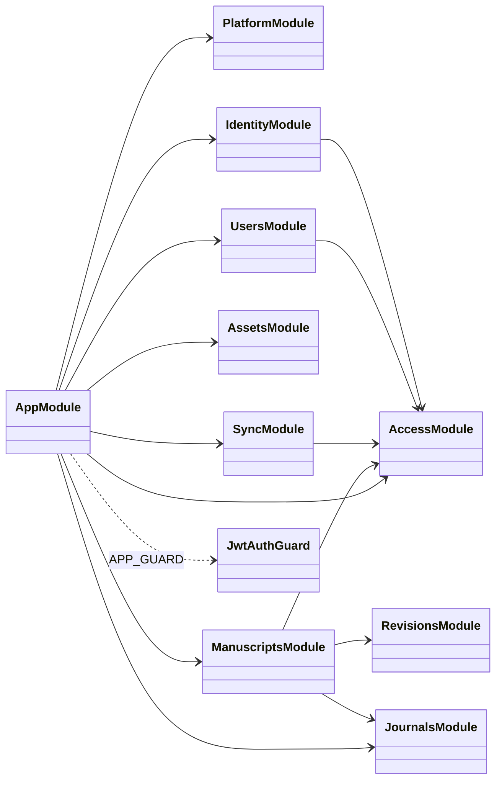
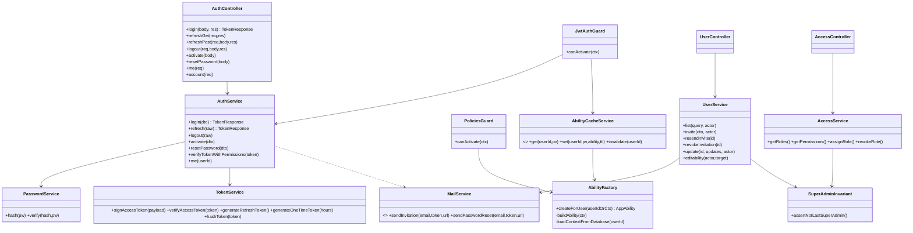
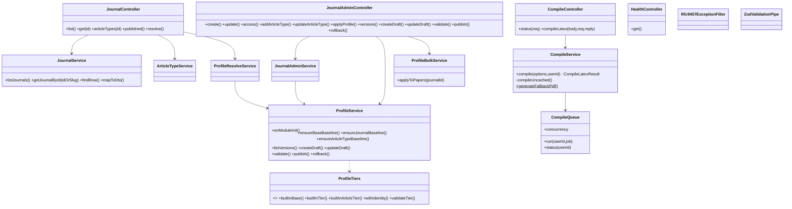
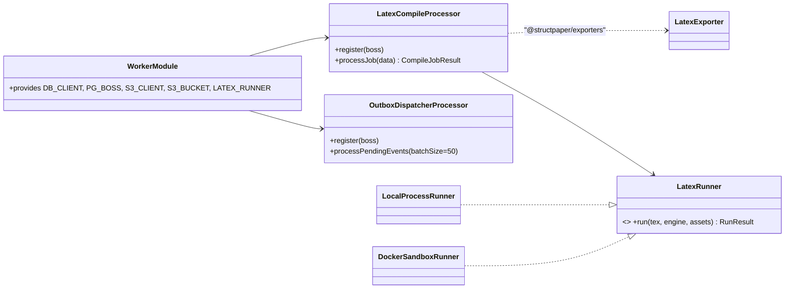

# 2.4.1 Class diagram – Backend API (`apps/api`) & Worker (`apps/worker`)

> Chữ ký phương thức được **rút gọn**; tên class/phương thức chính đã đối chiếu với mã nguồn. `<<abstract>>` = abstract class dùng làm token DI (`domain/*.ts`), triển khai ở `infrastructure/`.

Backend là **NestJS 10 + Fastify**; mỗi module chia 3 lớp: `presentation` (controller, guard, decorator) → `application` (service/use case) → `domain` (quy tắc thuần) + `infrastructure` (adapter S3, mail, cache). Dữ liệu qua **Drizzle ORM** (`@structpaper/db`, token DI `DRIZZLE`).

## Module và phụ thuộc

## Identity & Access

## Manuscripts, Revisions, Sync, Assets

```mermaid
classDiagram
    direction TB
    class ManuscriptController
    class ManuscriptService {
      +createManuscript(dto,userId,ability)
      +listManuscripts(query,ability,userId)
      +getManuscript(id,ability)
      +updateManuscript(id,dto,userId,ability)
      +deleteManuscript(id,ability,userId)
      +changeStatus(id,dto,userId,ability)
      +changeArticleType()
      +upgradeProfile()
      +duplicateFromRevision()
    }
    class RevisionService {
      +beforeSave(manuscript,next,userId,now)
      +list() +get() +createNamed() +update() +remove()
      +restore(id,rid,userId,ability)
      +snapshotCurrent(kind,label)
    }
    class TrashService {
      +list() +preview() +restore() +purge() +bulk()
      +purgeExpired(now)
    }
    class ManuscriptSharingService {
      +getMembers() +addMember() +removeMember()
      +setGeneralAccess() +searchPeople() +recordVisit()
    }
    class ManuscriptPreviewService { +save(id,body,ability) +read(id,ability) }
    class ManuscriptDuplicatesService { +findByTitle(title,userId) }
    class ProfileResolveService { +getPublished() +resolve(journalRef,typeCode,pin) +pinFor(journal,articleType,pin) }
    class SyncController
    class SyncService {
      +submitOps(id,dto,userId,ability)
      +findMissingOps(id,sinceRev)
      +getDoc(id)
    }
    class PatchApplier { <<static>> +apply(docTree,patches) docTree+checksum }
    class SseManagerService { <<abstract>> +addClient(id,reply,req) +removeClient(id,client) +broadcast(id,event,data) +getConnectedCount(id) }
    class AssetController
    class AssetService {
      +createUploadIntent(dto,userId)
      +completeUpload(dto,userId)
      +getAssetById(id)
      -validateMagicBytes(buf,mime)
    }
    class StorageService { <<abstract>> +getPresignedPutUrl() +headObject() +getObjectBuffer() +putObject() +deleteObject() }
    class S3StorageService
    class ManuscriptAccess { <<function>> accessOf(ability,manuscript) }
    ManuscriptController --> ManuscriptService
    ManuscriptController --> RevisionService
    ManuscriptController --> TrashService
    ManuscriptController --> ManuscriptSharingService
    ManuscriptController --> ManuscriptPreviewService
    ManuscriptController --> ManuscriptDuplicatesService
    ManuscriptService --> RevisionService
    ManuscriptService --> ProfileResolveService
    ManuscriptService ..> ManuscriptAccess
    SyncController --> SyncService
    SyncService --> PatchApplier
    SyncService --> SseManagerService
    AssetController --> AssetService
    AssetService --> StorageService
    S3StorageService ..|> StorageService
    ManuscriptPreviewService --> StorageService
```

## Journals & Profiles, Platform

## Worker (`apps/worker`)

