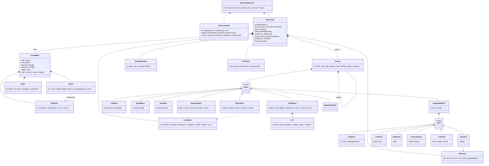
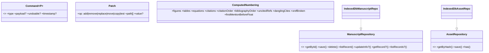
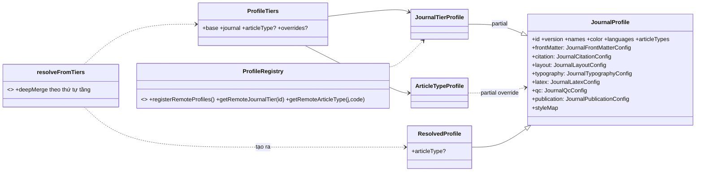
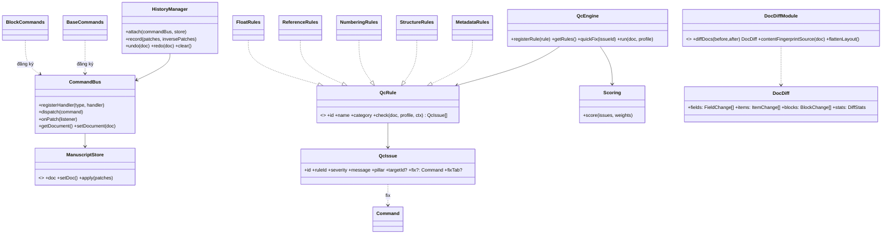
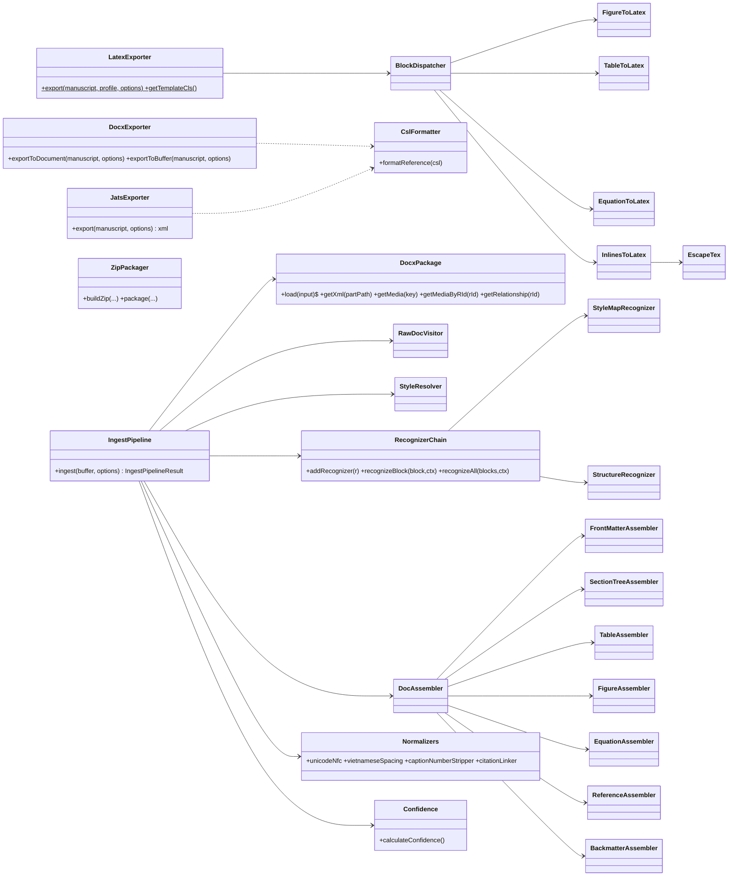

# 2.4.2 Class diagram – Các package lõi (`packages/*`)

Các package thuần TypeScript, không phụ thuộc framework, dùng chung cho web, api, worker.

## `@structpaper/doc-model` – Mô hình tài liệu bài báo (Canonical Schema v2)

Hỗ trợ trong `doc-model`: `schemas/*` (Zod), `adapters/migrate-v1-to-v2` ↔ `adapt-v2-to-v1` (giữa `CompletePaper` v1 của UI và `Manuscript` v2), `numbering/compute-numbering` (`ComputedNumbering`), `interfaces/{command,repository}`.

## `@structpaper/journal-profiles` – Profile 3 tầng

## `@structpaper/editor-core`, `@structpaper/qc-engine`, `@structpaper/doc-diff`

## `@structpaper/exporters` & `@structpaper/ingest-docx`

> Lưu ý: luồng nhập Word đang chạy trong web chủ yếu qua `apps/web/src/lib/docx-*.ts` (bộ đọc cũ v1, `CompletePaper`); `packages/ingest-docx` là pipeline v2 đăng ký bộ đọc cũ làm fallback (`registerLegacyFallbackParser`).
