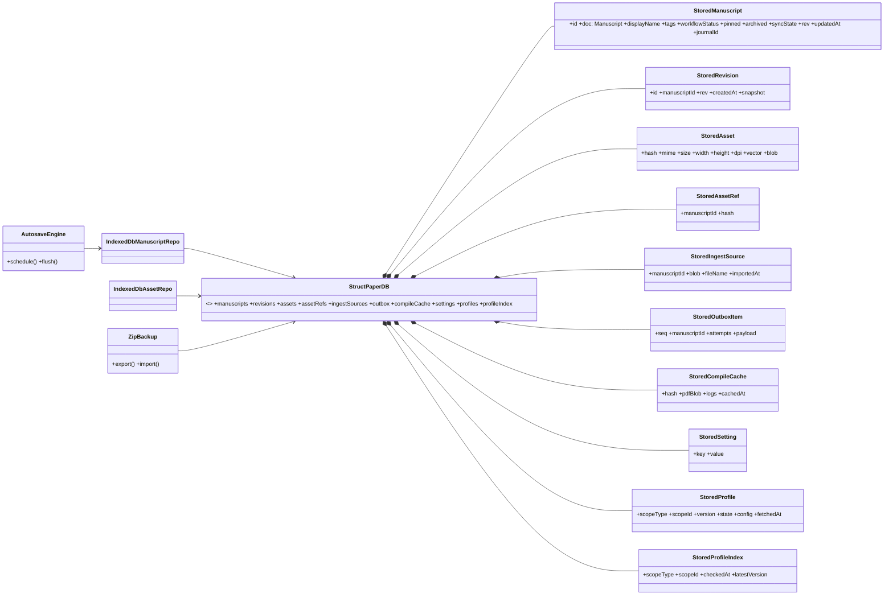
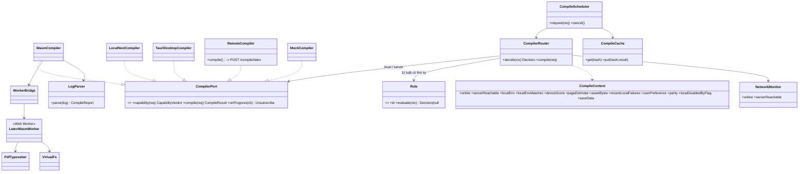
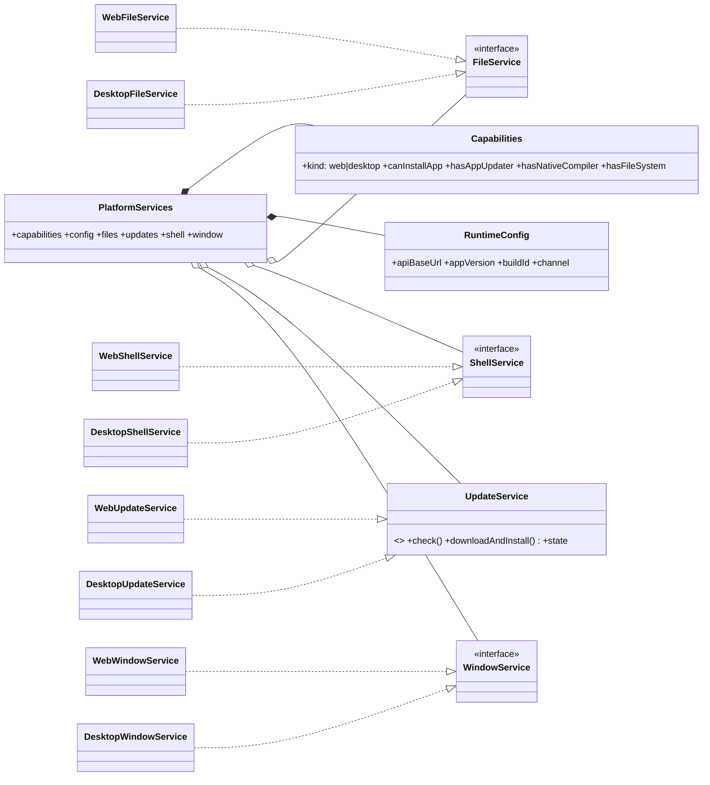
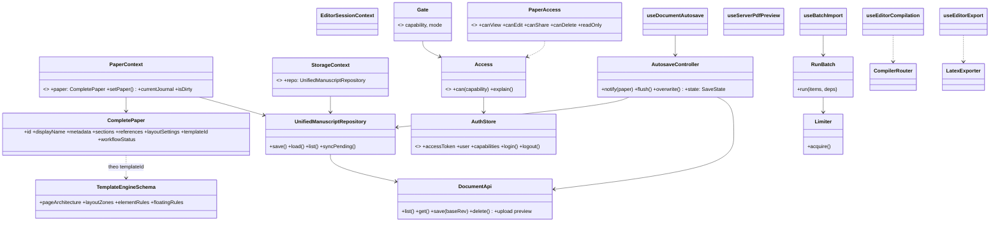

# 2.4.3 Class diagram – Client: storage, compiler, platform, web app

## `@structpaper/storage` – kho cục bộ IndexedDB (Dexie)

## `@structpaper/compiler-client` – biên dịch đa môi trường

Thứ tự 11 luật (`router/rules`): 01 final→server · 02 kill-switch · 03 prefer-server · 04 offline+local ready→local · 05 offline không env→E1 (HTML nhanh) · 06 substitute fonts · 07 env chưa sẵn sàng→server · 08 thiết bị yếu→server · 09 quá lớn (>40 MB)→server · 10 lỗi cục bộ gần đây (10 phút)→server · 11 mặc định→local.

## `@structpaper/platform*` – trừu tượng hóa nền tảng

## Ứng dụng web (`apps/web`) – các lớp chính

> Mô hình UI hiện tại là `CompletePaper` (v1, `apps/web/src/types/paper.ts`); chuyển đổi hai chiều với `Manuscript` v2 qua `migrateV1toV2` / `adaptV2toV1`.
