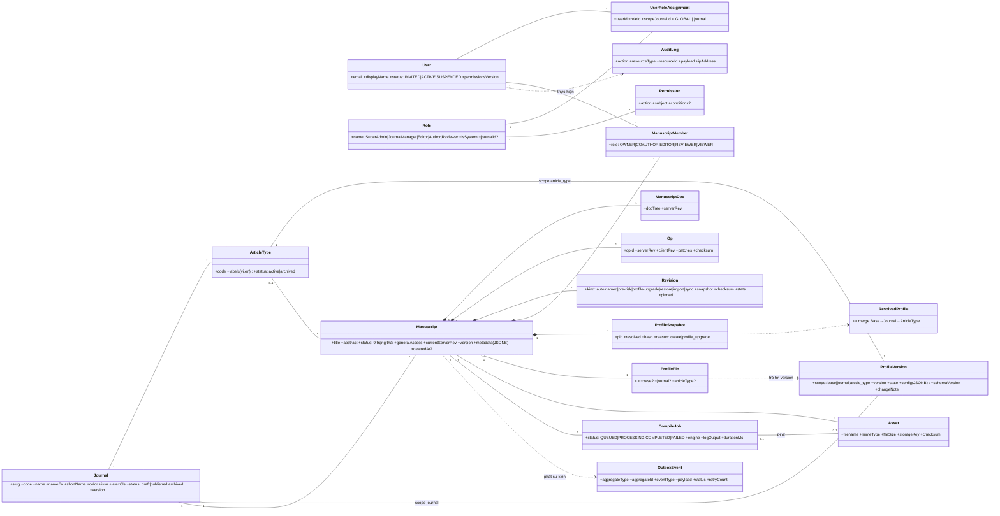

# 2.5.1 Domain model & Bounded contexts

## Bản đồ bounded context

```mermaid
flowchart LR
    subgraph IAM["Identity & Access (IAM)"]
        U[User]
        R[Role]
        P[Permission]
        UR[UserRole - scope tạp chí]
        T[UserToken / RefreshToken]
    end
    subgraph JNL["Journal & Profile (Publishing Rules)"]
        J[Journal]
        AT[ArticleType]
        PV[ProfileVersion - Base/Journal/ArticleType]
    end
    subgraph MSC["Manuscript (Core)"]
        M[Manuscript]
        MM[ManuscriptMember]
        MD[ManuscriptDoc + Ops]
        RV[Revision]
        PS[ProfileSnapshot]
        VS[Visit]
    end
    subgraph TYP["Typesetting & Export"]
        CJ[CompileJob]
        EX[Exporter: LaTeX / DOCX / JATS]
        QC[QC Ruleset]
    end
    subgraph AST["Assets"]
        A[Asset - content-addressed]
    end
    subgraph PLT["Platform"]
        OB[OutboxEvent]
        ID[IdempotencyKey]
        AU[AuditLog]
    end
    IAM -- "ai là ai, được làm gì" --> MSC
    JNL -- "quy tắc dàn trang (ghim version)" --> MSC
    MSC -- "nội dung + profile đã resolve" --> TYP
    MSC -- "ảnh, PDF" --> AST
    TYP -- "PDF" --> AST
    MSC -- "sự kiện" --> PLT
    JNL -- "audit" --> PLT
    IAM -- "role theo journal" --> JNL
```

| Context | Trách nhiệm | Aggregate root | Mã nguồn |
|---|---|---|---|
| IAM | Người dùng, vai trò, quyền (CASL), phiên | `User`, `Role` | `modules/identity`, `users`, `access` |
| Journal & Profile | Danh mục tạp chí, loại bài, quy tắc dàn trang có phiên bản | `Journal` (kèm `ArticleType`), `ProfileVersion` | `modules/journals`, `packages/journal-profiles` |
| Manuscript | Bản thảo, thành viên, workflow, lịch sử, đồng bộ | `Manuscript` | `modules/manuscripts`, `sync`, `packages/doc-model` |
| Typesetting & Export | Sinh LaTeX/DOCX/JATS, biên dịch PDF, QC | `CompileJob` | `packages/exporters`, `qc-engine`, `compiler-client`, `apps/worker` |
| Assets | Tệp nhị phân (ảnh, PDF) | `Asset` | `modules/assets` |
| Platform | Outbox, idempotency, audit, health | `OutboxEvent` | `modules/platform`, `db/schema/outbox.ts` |

## Mô hình miền (thực thể, quan hệ, giá trị)

## Quy tắc miền (invariants) quan trọng

| # | Quy tắc | Thực thi ở |
|---|---|---|
| I1 | Luôn còn ≥ 1 SuperAdmin hoạt động; không ai tự đổi trạng thái của mình | `super-admin-invariant.ts`, `UserService` |
| I2 | Mỗi scope có tối đa 1 `ProfileVersion` published; bản published/archived **bất biến** và không xóa | unique index + trigger `profile_versions_guard` |
| I3 | Bài **ghim** phiên bản profile khi tạo; chỉ nâng khi tác giả yêu cầu hoặc manager áp dụng hàng loạt | `profile_pin`, `manuscript_profile_snapshots` |
| I4 | Chủ sở hữu luôn có toàn quyền; không thêm/gỡ OWNER qua chia sẻ | `ManuscriptSharingService` |
| I5 | Không xóa bài ở `IN_REVIEW`, `PROOFING`, `READY`, `ACCEPTED`, `PUBLISHED` (trừ manager) | `NON_DELETABLE_STATUSES` |
| I6 | Chuyển trạng thái chỉ theo `VALID_TRANSITIONS`; quyết định biên tập cần quyền `manage`; mọi chuyển trạng thái ghi outbox cùng giao dịch | `ManuscriptService.changeStatus` |
| I7 | Mỗi `opId` chỉ áp dụng một lần; `baseServerRev` phải bằng `serverRev` hiện tại | `SyncService.submitOps` |
| I8 | Bài xóa mềm bị ẩn khắp nơi; quá `TRASH_RETENTION_DAYS` (30) thì xóa vĩnh viễn | `TrashService` |
| I9 | Phiên bản có tên được ghim, không bị dọn; tối đa 100 / bài | `HISTORY_CONFIG` |
| I10 | Asset chỉ nhận MIME cho phép, ≤ 50 MB, SHA-256 + magic-bytes khớp | `AssetService` |
| I11 | Không tự bịa DOI/tập/số/trang/ngày khi nhập Word; để trống và cảnh báo | `lib/docx-parser.ts`, QC |
| I12 | Giao diện chỉ hỏi capability, không so sánh tên vai trò; ẩn nút không phải bảo mật (API luôn kiểm lại) | `lib/access`, `capabilities.ts` |

## Ngôn ngữ chung (Glossary)

| Thuật ngữ | Nghĩa trong hệ thống |
|---|---|
| **Manuscript / Bản thảo / Bài báo** | Một bài báo đang chế bản (`manuscripts`) |
| **Journal / Tạp chí** | Một tạp chí VNUHCM (STD, HS, SSH, EBL, ET, EES, ARNS) |
| **Article type / Loại bài** | Research, Review, Case report… quy định riêng theo tạp chí |
| **Profile** | Bộ quy tắc dàn trang/nội dung/QC của tạp chí; 3 tầng Base → Journal → ArticleType |
| **Pin** | Cặp phiên bản profile mà bài được viết theo |
| **Revision / Phiên bản** | Bản chụp nội dung bài để xem lại/khôi phục |
| **Op / Patch** | Phép sửa nhỏ trên cây tài liệu, đồng bộ qua `sync/patches` |
| **Outbox** | Bảng sự kiện ghi cùng giao dịch, worker phát đi sau |
| **General access** | Quyền chung kiểu Google Docs: RESTRICTED / VIEWER / EDITOR |
| **Capability** | Khả năng nghiệp vụ gửi cho UI (`member:manage`…) |
| **Cổng kiểm tra đầu vào/đầu ra** | Bộ kiểm tra sau khi nhập Word / trước khi xuất (không chặn) |
| **JATS** | Chuẩn XML bài báo (v1.2) |
| **Tectonic** | Bộ biên dịch XeTeX tự chứa dùng để sinh PDF |
