# 2.5.2 State machine (vòng đời các thực thể)

## Workflow bản thảo (`manuscripts.status`)

Bảng chuyển trạng thái (`VALID_TRANSITIONS`, `ManuscriptService.changeStatus`). **SuperAdmin có thể bỏ qua bảng**. Chuyển tới `IN_REVIEW`, `ACCEPTED`, `REJECTED`, `PUBLISHED` yêu cầu quyền `manage` (JournalManager/SuperAdmin); `SUBMITTED` và rút lại về `DRAFT` cần quyền sửa.

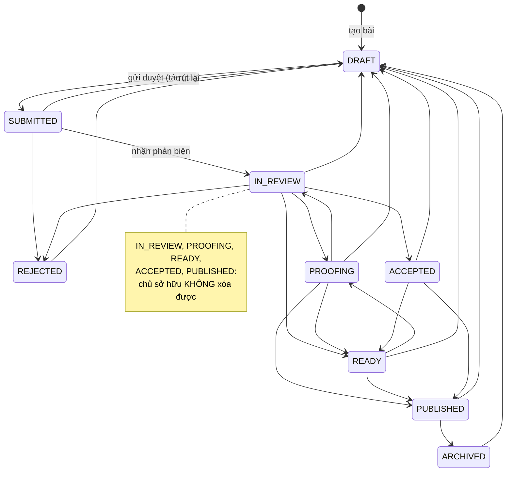

Trạng thái ở UI (`workflowStatus` của `ManuscriptInfo`, cục bộ): `draft | in-review | proofing | ready | published` – tương ứng gần đúng với `DRAFT/IN_REVIEW/PROOFING/READY/PUBLISHED` phía server.

## Xóa mềm bản thảo

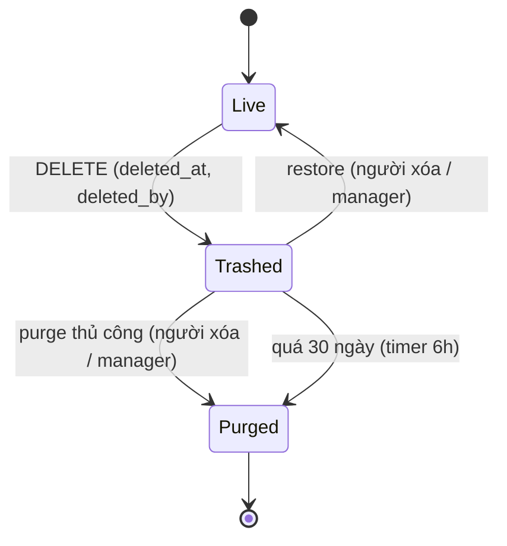

## Profile version (`profile_versions.state`)

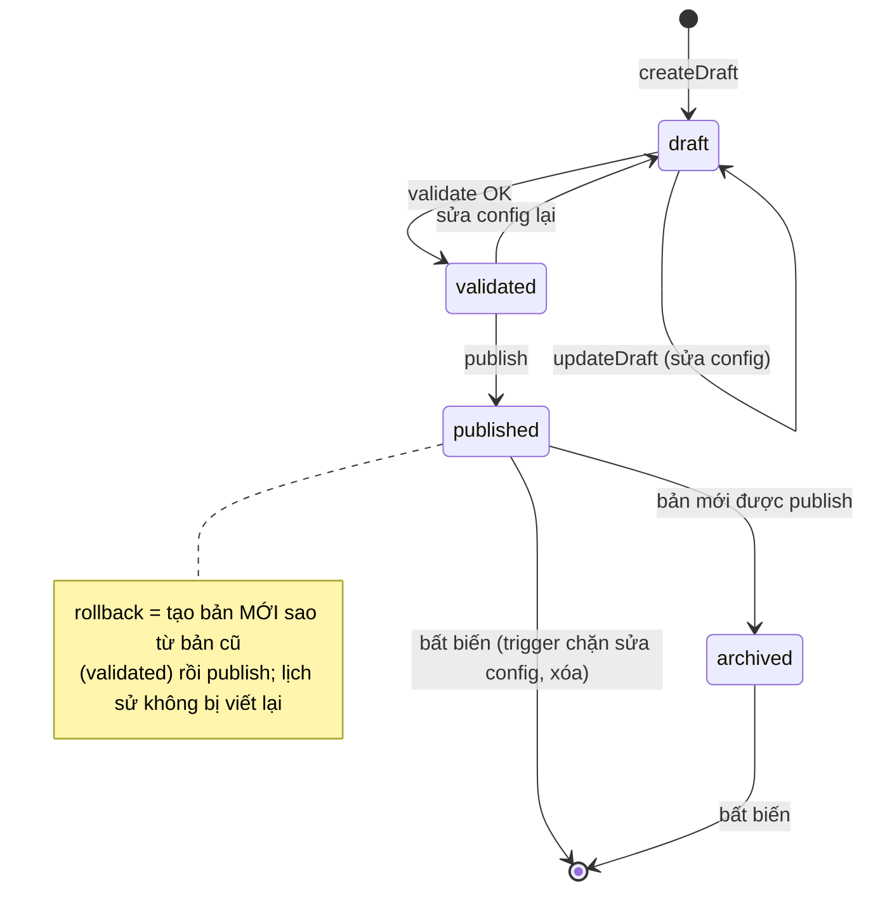

## Tài khoản người dùng (`users.status`)

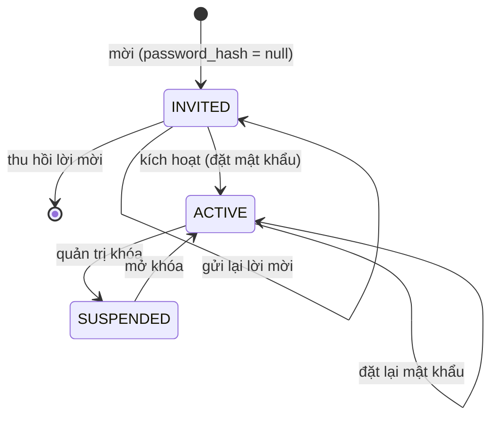

## Token một lần & refresh token

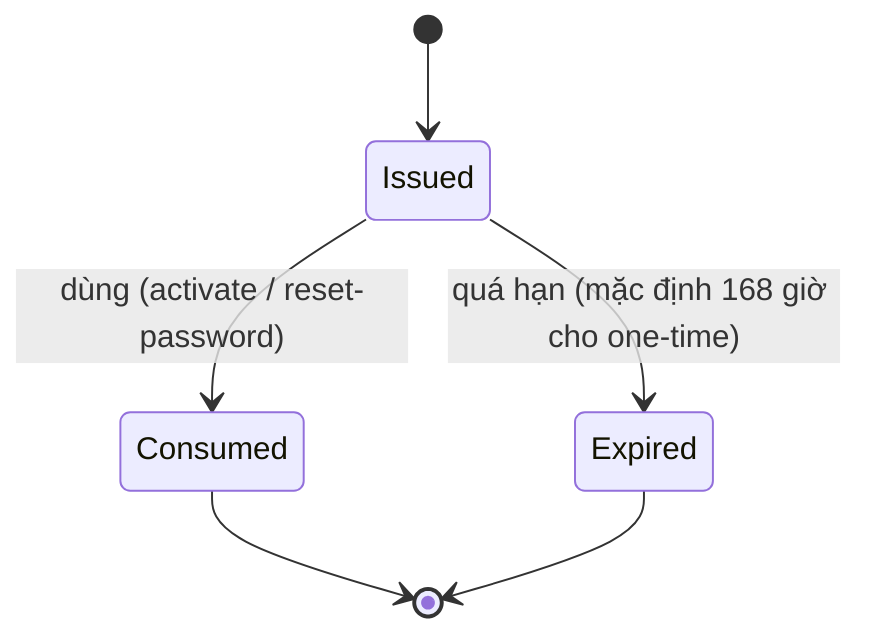

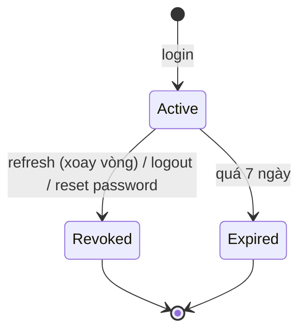

## Revision (`manuscript_revisions.kind`)

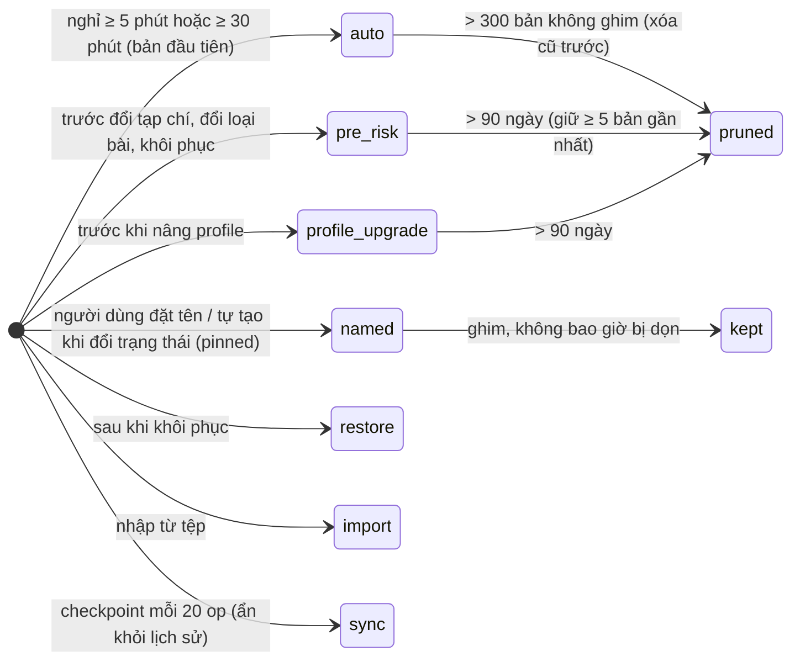

## Compile job (`compile_jobs.status`) & Outbox (`outbox_events.status`)

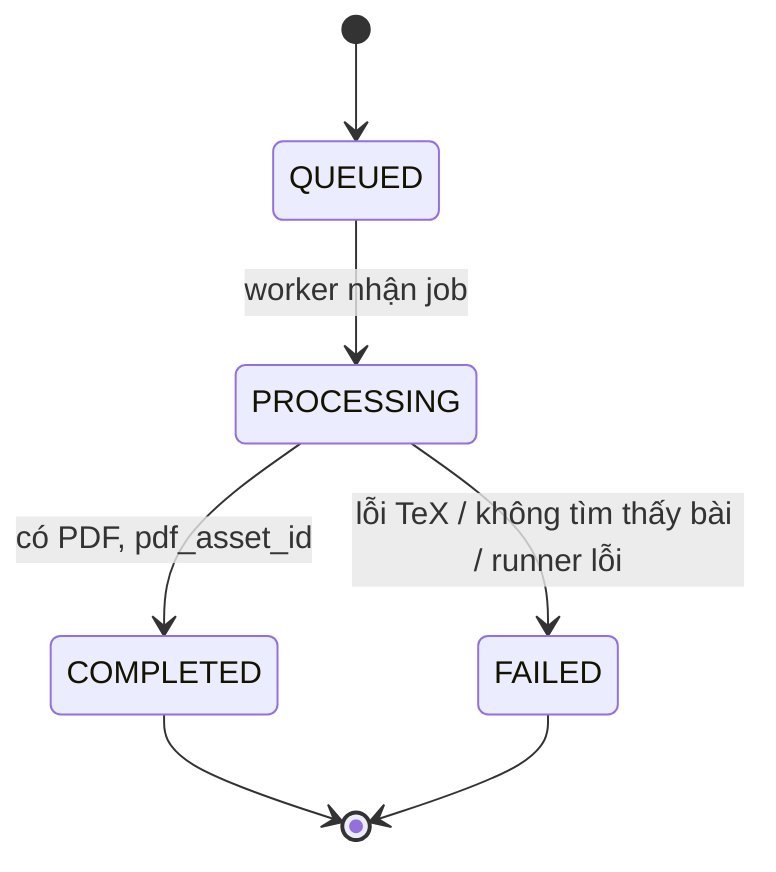

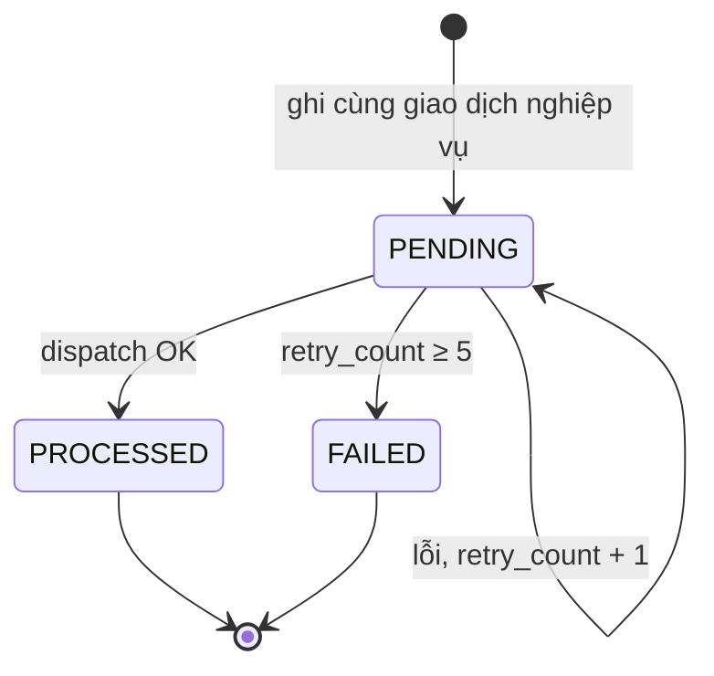

## Trạng thái lưu của trình soạn (client – `SaveState`)

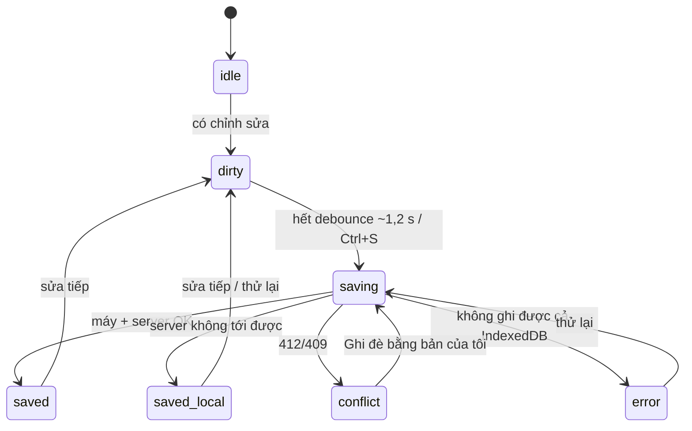

## Journal (`journals.status`) & Article type

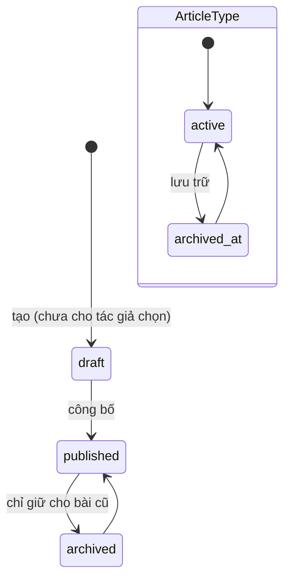
