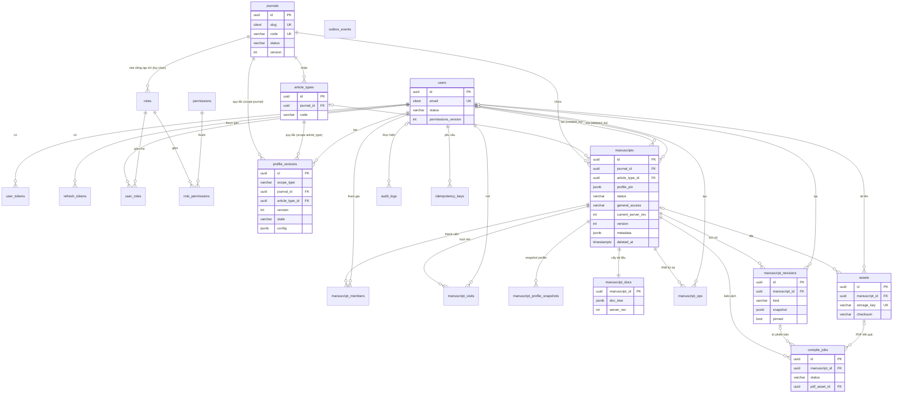

# 3.1 ERD tổng thể

## Sơ đồ quan hệ (22 bảng)

## Danh mục bảng

| # | Bảng | Nhóm | Mục đích ngắn | Khóa chính | Chi tiết |
|---|---|---|---|---|---|
| 1 | `users` | IAM | Tài khoản người dùng | `id` | [02](02-identity-access.md) |
| 2 | `user_tokens` | IAM | Token một lần: mời, đặt lại mật khẩu | `id` | [02](02-identity-access.md) |
| 3 | `refresh_tokens` | IAM | Refresh token (băm) | `id` | [02](02-identity-access.md) |
| 4 | `roles` | IAM | Vai trò (5 hệ thống + tùy chỉnh theo tạp chí) | `id` | [02](02-identity-access.md) |
| 5 | `permissions` | IAM | Quyền (action, subject, điều kiện) | `id` | [02](02-identity-access.md) |
| 6 | `user_roles` | IAM | Gán vai trò theo phạm vi | `(user_id, role_id, scope_journal_id)` | [02](02-identity-access.md) |
| 7 | `role_permissions` | IAM | Vai trò ↔ quyền | `(role_id, permission_id)` | [02](02-identity-access.md) |
| 8 | `journals` | Journal | Danh tính tạp chí | `id` | [03](03-journals-profiles.md) |
| 9 | `article_types` | Journal | Loại bài mỗi tạp chí nhận | `id` | [03](03-journals-profiles.md) |
| 10 | `profile_versions` | Journal | Quy tắc dàn trang có phiên bản (Base/Journal/ArticleType) | `id` | [03](03-journals-profiles.md) |
| 11 | `manuscripts` | Manuscript | Bản thảo (bảng trung tâm) | `id` | [04](04-manuscripts.md) |
| 12 | `manuscript_members` | Manuscript | Thành viên & vai trò trên bài | `(manuscript_id, user_id)` | [04](04-manuscripts.md) |
| 13 | `manuscript_visits` | Manuscript | "Được chia sẻ với tôi" | `(user_id, manuscript_id)` | [04](04-manuscripts.md) |
| 14 | `manuscript_profile_snapshots` | Manuscript | Profile đã resolve tại thời điểm ghim | `id` | [04](04-manuscripts.md) |
| 15 | `manuscript_docs` | Sync | Cây tài liệu hiện tại (1-1 với bài) | `manuscript_id` | [05](05-sync-revisions.md) |
| 16 | `manuscript_ops` | Sync | Nhật ký op/patch | `id` (`op_id` UK) | [05](05-sync-revisions.md) |
| 17 | `manuscript_revisions` | Sync | Lịch sử phiên bản nội dung | `id` | [05](05-sync-revisions.md) |
| 18 | `assets` | Assets | Metadata tệp nhị phân trên S3 | `id` | [06](06-assets-compile-platform.md) |
| 19 | `compile_jobs` | Compile | Công việc biên dịch nền | `id` | [06](06-assets-compile-platform.md) |
| 20 | `audit_logs` | Platform | Nhật ký kiểm toán | `id` | [06](06-assets-compile-platform.md) |
| 21 | `outbox_events` | Platform | Outbox sự kiện | `id` | [06](06-assets-compile-platform.md) |
| 22 | `idempotency_keys` | Platform | Khóa idempotency cho request | `key` | [06](06-assets-compile-platform.md) |

## Quy ước chung

| Mục | Quy ước |
|---|---|
| Khóa chính | `uuid` mặc định `gen_random_uuid()` (Drizzle `defaultRandom`) |
| Email/slug | kiểu `citext` (không phân biệt hoa thường) – cần extension `citext` |
| Thời gian | `timestamptz`, `created_at` mặc định `now()`; `updated_at` do ứng dụng cập nhật |
| Trạng thái | `varchar` + `CHECK` hoặc kiểm tra ở ứng dụng; giá trị viết HOA (user/manuscript/compile) hoặc thường (journal/profile/revision) |
| Khóa lạc quan | `journals.version` (ETag), `manuscripts.version`, `manuscripts.current_server_rev` + `manuscript_ops.server_rev` (đồng bộ) |
| Xóa mềm | chỉ `manuscripts.deleted_at/deleted_by`; các bảng khác xóa cứng |
| Tìm kiếm | extension `pg_trgm`, `unaccent` (khởi tạo ở `docker/postgres/init-extensions.sql`) |
| Hàng đợi | schema riêng `pgboss` do pg-boss tự quản |

## Hành vi khi xóa (FK)

| Bảng con → cha | ON DELETE |
|---|---|
| `user_tokens`, `refresh_tokens`, `user_roles`, `manuscript_members`, `manuscript_visits`, `idempotency_keys` → `users` | CASCADE |
| `profile_versions.created_by`, `manuscripts.deleted_by`, `manuscript_ops/revisions/assets.created_by`, `audit_logs.user_id` → `users` | SET NULL |
| `manuscripts.created_by` → `users` | **RESTRICT** (không xóa user đang là người tạo bài) |
| `article_types`, `profile_versions`, `manuscripts`, `roles(journal)` → `journals` | CASCADE |
| `manuscripts.article_type_id` → `article_types` | SET NULL |
| `manuscript_*`, `assets.manuscript_id`, `compile_jobs.manuscript_id` → `manuscripts` | CASCADE |
| `compile_jobs.revision_id`, `compile_jobs.pdf_asset_id` | SET NULL |
| `role_permissions`, `user_roles` → `roles`/`permissions` | CASCADE |

> `profile_versions` đã `published`/`archived` **không xóa được** dù cascade từ `journals` (trigger `profile_versions_guard` ném lỗi) – nghĩa là không thể xóa cứng một tạp chí đã có profile xuất bản; hãy chuyển trạng thái `archived`.
