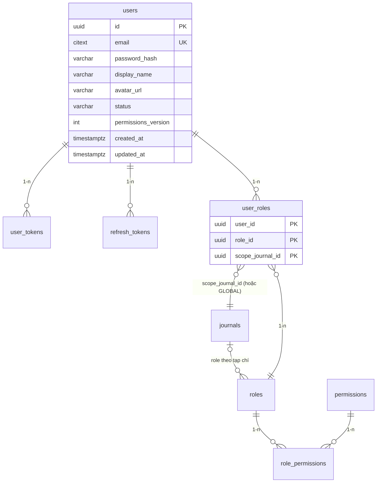

# 3.2 Nhóm Identity & Access (7 bảng)

Nguồn: `packages/db/src/schema/users.ts`, `access.ts`. Dùng bởi `modules/identity`, `users`, `access` (CASL).

## `users` – Tài khoản người dùng

**Mục đích:** lưu danh tính đăng nhập. Một dòng ứng với một người; có thể ở trạng thái `INVITED` (mới được mời, chưa có mật khẩu). `permissions_version` được nhúng vào JWT (`pv`) để vô hiệu hóa token/cache quyền ngay khi quyền thay đổi.

| Cột | Kiểu | Null | Mặc định | Ý nghĩa |
|---|---|---|---|---|
| `id` | uuid | ✗ | `gen_random_uuid()` | PK |
| `email` | citext | ✗ | | Email đăng nhập, **duy nhất**, không phân biệt hoa/thường |
| `password_hash` | varchar(255) | ✓ | | Băm **Argon2id** (memory 64 MB, time 3) do `PasswordService` tạo; định dạng cũ `scrypt:<salt>:<key>` (do seed tạo) vẫn xác thực được; `NULL` khi chưa kích hoạt |
| `display_name` | varchar(255) | ✓ | | Tên hiển thị |
| `avatar_url` | varchar(1024) | ✓ | | Ảnh đại diện |
| `status` | varchar(50) | ✗ | `'INVITED'` | `INVITED` · `ACTIVE` · `SUSPENDED` |
| `permissions_version` | integer | ✗ | `1` | Tăng mỗi khi vai trò/thành viên đổi → vô hiệu cache quyền và JWT cũ |
| `created_at` / `updated_at` | timestamptz | ✗ | `now()` | |

**Ràng buộc/chỉ mục:** UNIQUE(`email`). **Quan hệ:** 1-n tới `user_tokens`, `refresh_tokens`, `user_roles`, `manuscript_members`, `manuscripts(created_by/deleted_by)`.

## `user_tokens` – Token dùng một lần

**Mục đích:** token cho luồng **mời** (`INVITATION`) và **đặt lại mật khẩu** (`PASSWORD_RESET`). Chỉ lưu băm, không lưu token thô.

| Cột | Kiểu | Null | Mặc định | Ý nghĩa |
|---|---|---|---|---|
| `id` | uuid | ✗ | random | PK |
| `user_id` | uuid | ✗ | | FK → `users.id` (CASCADE) |
| `type` | varchar(50) | ✗ | | `INVITATION` \| `PASSWORD_RESET` |
| `token_hash` | varchar(255) | ✗ | | Băm SHA-256 của token |
| `expires_at` | timestamptz | ✗ | | Hạn (mặc định one-time token 168 giờ) |
| `consumed_at` | timestamptz | ✓ | | Đã dùng lúc nào; `NULL` = chưa dùng |
| `created_at` | timestamptz | ✗ | `now()` | |

**Cách dùng:** `claimToken` cập nhật `consumed_at` có điều kiện `consumed_at IS NULL AND expires_at > now()` để tránh dùng lại (chống race). Lời mời "hết hạn" (`EXPIRED`) được suy ra từ `expires_at`.

## `refresh_tokens` – Phiên làm việc

**Mục đích:** lưu phiên đăng nhập dài hạn (7 ngày). Xoay vòng mỗi lần refresh: token cũ bị `revoked_at`, token mới được tạo.

| Cột | Kiểu | Null | Ý nghĩa |
|---|---|---|---|
| `id` | uuid | ✗ | PK |
| `user_id` | uuid | ✗ | FK → `users` (CASCADE) |
| `token_hash` | varchar(255) | ✗ | Băm refresh token (cookie `refreshToken`, httpOnly) |
| `expires_at` | timestamptz | ✗ | Hết hạn (7 ngày) |
| `revoked_at` | timestamptz | ✓ | Thời điểm thu hồi (logout/refresh/reset mật khẩu) |
| `created_at` | timestamptz | ✗ | |

## `roles` – Vai trò

**Mục đích:** danh mục vai trò. 5 vai trò hệ thống (`is_system = true`) được seed: **SuperAdmin**, **JournalManager**, **Editor**, **Author**, **Reviewer**. `journal_id` cho phép vai trò gắn riêng một tạp chí (hiện chủ yếu dùng `user_roles.scope_journal_id`).

| Cột | Kiểu | Null | Mặc định | Ý nghĩa |
|---|---|---|---|---|
| `id` | uuid | ✗ | random | PK |
| `journal_id` | uuid | ✓ | | FK → `journals` (CASCADE); `NULL` = vai trò toàn cục |
| `name` | varchar(100) | ✗ | | Tên vai trò |
| `description` | text | ✓ | | Mô tả |
| `is_system` | boolean | ✗ | `false` | Vai trò hệ thống (không xóa/sửa) |
| `created_at` | timestamptz | ✗ | `now()` | |

| Vai trò | Quyền theo `AbilityFactory` |
|---|---|
| SuperAdmin | `manage all`; bất biến luôn còn ≥ 1 |
| JournalManager | Toàn cục: `manage Manuscript/Journal/Role`. Theo tạp chí: `manage Manuscript {journalId}`, `read/update Journal {id}`, `manage Role {journalId}` |
| Editor | `read Journal` (toàn cục hoặc 1 tạp chí), `create Manuscript`; không đọc bài người khác chỉ vì vai trò |
| Author | `create Manuscript` |
| Reviewer | Không có quyền theo vai trò; quyền đến từ `manuscript_members` |

## `permissions` – Quyền tùy biến

**Mục đích:** quyền động kiểu CASL (`action`, `subject`, `conditions`) nạp thêm vào ability (`context.permissions`). Hiện quyền cốt lõi nằm cứng trong `AbilityFactory`; bảng này là điểm mở rộng cho ma trận quyền.

| Cột | Kiểu | Null | Ý nghĩa |
|---|---|---|---|
| `id` | uuid | ✗ | PK |
| `action` | varchar(100) | ✗ | `manage`/`create`/`read`/`update`/`delete`/`share`… |
| `subject` | varchar(100) | ✗ | `Manuscript`/`Journal`/`Role`/`User`/`all` |
| `conditions` | jsonb | ✓ | Điều kiện kiểu MongoDB (vd `{"journalId":"…"}`) |
| `created_at` | timestamptz | ✗ | |

## `role_permissions` – Vai trò ↔ Quyền (n-n)

| Cột | Kiểu | Ý nghĩa |
|---|---|---|
| `role_id` | uuid | PK, FK → `roles` (CASCADE) |
| `permission_id` | uuid | PK, FK → `permissions` (CASCADE) |

## `user_roles` – Gán vai trò theo phạm vi

**Mục đích:** ai giữ vai trò gì **ở đâu**. `scope_journal_id = GLOBAL_SCOPE_ID` (`00000000-0000-0000-0000-000000000000`) nghĩa là toàn hệ thống; ngược lại là id một tạp chí. Dùng uuid "không" thay vì `NULL` để khóa chính kép hợp lệ.

| Cột | Kiểu | Null | Mặc định | Ý nghĩa |
|---|---|---|---|---|
| `user_id` | uuid | ✗ | | PK, FK → `users` (CASCADE) |
| `role_id` | uuid | ✗ | | PK, FK → `roles` (CASCADE) |
| `scope_journal_id` | uuid | ✗ | GLOBAL | PK; phạm vi tạp chí (không có FK cứng để chứa giá trị GLOBAL) |

## Luồng dữ liệu liên quan

1. Mời: `users(INVITED, password_hash NULL)` + `user_tokens(INVITATION)` + `user_roles`.
2. Kích hoạt: `users.password_hash` đặt, `status → ACTIVE`, `user_tokens.consumed_at`.
3. Đăng nhập: JWT `{sub, pv}` + `refresh_tokens`.
4. Gán/gỡ vai trò hoặc thêm thành viên bài: `users.permissions_version + 1` và xóa `AbilityCache` ⇒ hiệu lực ngay.
