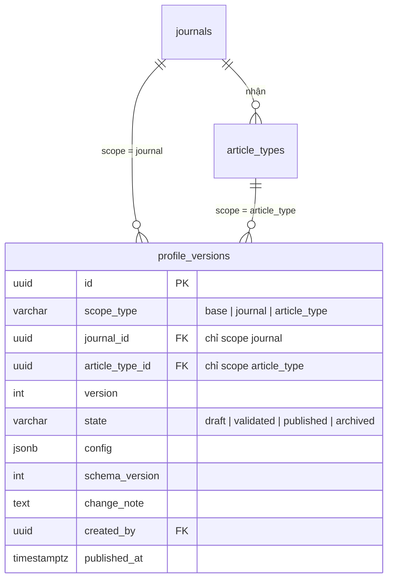

# 3.3 Nhóm Journal & Profile (3 bảng)

Nguồn: `packages/db/src/schema/journals.ts`, trigger trong `drizzle/0000_init.sql`. Dùng bởi `modules/journals`, `packages/journal-profiles`.

**Mô hình hai nửa:** danh tính tạp chí (`journals`, `article_types`) tách khỏi **quy tắc dàn trang có phiên bản** (`profile_versions`). Đổi tên/màu/ISSN không cần phiên bản profile mới (được phủ lên quy tắc khi phục vụ).

## `journals` – Danh tính tạp chí

| Cột | Kiểu | Null | Mặc định | Ý nghĩa |
|---|---|---|---|---|
| `id` | uuid | ✗ | random | PK |
| `slug` | citext | ✗ | | Địa chỉ trong URL, **duy nhất** (vd `vnuhcm-hs`; "key" = slug bỏ tiền tố `vnuhcm-`) |
| `code` | varchar(40) | ✗ | | Mã in ở đầu trang, **duy nhất** (vd `VNUHCM-HS`) |
| `name` | varchar(255) | ✗ | | Tên tiếng Việt |
| `name_en` | varchar(255) | ✓ | | Tên tiếng Anh |
| `short_name` | varchar(20) | ✗ | | Viết tắt (`HS`) |
| `color` | varchar(7) | ✗ | | Màu thương hiệu `#RRGGBB` |
| `issn` | varchar(9) | ✓ | | ISSN `dddd-ddd[dXx]` |
| `latex_cls` | varchar(100) | ✗ | `structpaper-std.cls` | Lớp LaTeX dùng để dàn trang PDF |
| `status` | varchar(20) | ✗ | `draft` | `draft` (chưa cho tác giả chọn) · `published` · `archived` (chỉ cho bài cũ) |
| `sort_order` | integer | ✗ | `0` | Thứ tự hiển thị |
| `version` | integer | ✗ | `1` | Tăng mỗi lần sửa định danh; làm **ETag** (`If-Match` → 412) |
| `created_at`/`updated_at` | timestamptz | ✗ | `now()` | |

**CHECK:** `chk_journals_status`, `chk_journals_color` (`^#[0-9A-Fa-f]{6}$`), `chk_journals_issn`. **Index:** `idx_journals_sort(sort_order)`. **Seed:** 7 tạp chí (STD, HS, SSH, EBL, ET, EES, ARNS – ARNS `draft`).

## `article_types` – Loại bài của từng tạp chí

| Cột | Kiểu | Null | Mặc định | Ý nghĩa |
|---|---|---|---|---|
| `id` | uuid | ✗ | random | PK |
| `journal_id` | uuid | ✗ | | FK → `journals` (CASCADE) |
| `code` | varchar(50) | ✗ | | Mã (`research`, `case-report`…); regex `^[a-z][a-z0-9-]{1,49}$` |
| `labels` | jsonb | ✗ | | `{ "vi": "...", "en": "..." }` |
| `status` | varchar(20) | ✗ | `active` | `active` \| `archived` |
| `sort_order` | integer | ✗ | `0` | Thứ tự |
| `created_at` | timestamptz | ✗ | `now()` | |

**Unique:** `uq_article_types_code(journal_id, code)`. **Seed:** 9 mã loại bài (research, review, editorial, commentary, letter, correction, methodology, case-report, special-topic); mỗi tạp chí nhận một tập con 3 loại (vd HS: research/review/case-report).

## `profile_versions` – Quy tắc dàn trang có phiên bản (3 tầng)

**Mục đích:** lưu **từng phiên bản** của tầng quy tắc: `base` (mọi tạp chí), `journal` (riêng tạp chí), `article_type` (riêng loại bài). `ResolvedProfile = deepMerge(base, journal, articleType)`. Một phiên bản đã `published` **không bao giờ đổi**, nên bài ghim phiên bản N luôn dàn trang đúng như lúc viết.

| Cột | Kiểu | Null | Mặc định | Ý nghĩa |
|---|---|---|---|---|
| `id` | uuid | ✗ | random | PK |
| `scope_type` | varchar(20) | ✗ | | `base` \| `journal` \| `article_type` |
| `journal_id` | uuid | ✓ | | FK → `journals` (CASCADE); chỉ khi scope `journal` |
| `article_type_id` | uuid | ✓ | | FK → `article_types` (CASCADE); chỉ khi scope `article_type` |
| `version` | integer | ✗ | | Số phiên bản, duy nhất trong từng scope |
| `state` | varchar(20) | ✗ | `draft` | `draft` → `validated` → `published` → `archived` |
| `config` | jsonb | ✗ | | Nội dung quy tắc (xem [07](07-jsonb-structures.md)) |
| `schema_version` | integer | ✗ | `1` | Phiên bản schema của `config` |
| `change_note` | text | ✓ | | Ghi chú thay đổi |
| `created_by` | uuid | ✓ | | FK → `users` (SET NULL) |
| `created_at` | timestamptz | ✗ | `now()` | |
| `published_at` | timestamptz | ✓ | | Lúc xuất bản |

**Ràng buộc:**

| Tên | Quy tắc |
|---|---|
| `chk_profile_scope_type`, `chk_profile_state` | giá trị hợp lệ |
| `chk_profile_scope` | base ⇒ cả hai FK null; journal ⇒ chỉ `journal_id`; article_type ⇒ chỉ `article_type_id` |
| `uq_profile_version_{journal,article_type,base}` | `version` duy nhất trong mỗi scope (partial unique index) |
| `uq_profile_published_{journal,article_type,base}` | **tối đa 1 bản `published`** mỗi scope |
| `idx_profile_versions_journal(journal_id, version)` | tra cứu lịch sử |
| Trigger `trg_profile_versions_guard` (BEFORE UPDATE/DELETE) | bản `published`/`archived`: cấm đổi `config`, `scope_type`, `journal_id`, `article_type_id`, `version`, `schema_version`; cấm xóa. Chỉ `state` (published → archived) được đổi |

**Khởi tạo:** `ProfileService.onModuleInit` tự publish `base v1` từ quy tắc dựng sẵn trong code nếu DB chưa có; mỗi journal/article type mới được `ensure…Baseline` (v1 published).
