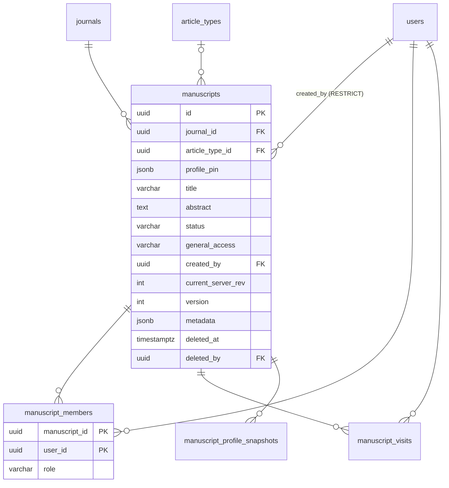

# 3.4 Nhóm Manuscript (4 bảng)

Nguồn: `packages/db/src/schema/manuscripts.ts`, migration `0002_manuscript_trash`. Dùng bởi `modules/manuscripts`.

## `manuscripts` – Bản thảo (bảng trung tâm)

**Mục đích:** một dòng = một bài báo. Giữ metadata nghiệp vụ (tạp chí, loại bài, trạng thái workflow, quyền chung, phiên bản) và **toàn bộ nội dung bài dạng JSON** ở `metadata` (bản `CompletePaper` do UI soạn, bọc/ phẳng – xem `doc-diff/stored.ts`). Cây op-based đồng bộ nằm riêng ở `manuscript_docs`.

| Cột | Kiểu | Null | Mặc định | Ý nghĩa |
|---|---|---|---|---|
| `id` | uuid | ✗ | random | PK |
| `journal_id` | uuid | ✗ | | FK → `journals` (CASCADE). Nếu client gửi slug/key, API quy đổi sang uuid; không có thì dùng tạp chí đầu tiên |
| `article_type_id` | uuid | ✓ | | FK → `article_types` (SET NULL) |
| `profile_pin` | jsonb | ✗ | `{}` | `{ base?, journal?, articleType? }` – phiên bản profile đã ghim khi tạo; chỉ đổi khi nâng cấp. CHECK là object |
| `title` | varchar(500) | ✗ | | Tiêu đề |
| `abstract` | text | ✓ | | Tóm tắt (bản sao thuận tiện cho danh sách) |
| `status` | varchar(50) | ✗ | `DRAFT` | `DRAFT, SUBMITTED, IN_REVIEW, PROOFING, READY, ACCEPTED, REJECTED, PUBLISHED, ARCHIVED` |
| `general_access` | varchar(20) | ✗ | `RESTRICTED` | Quyền chung: `RESTRICTED` · `VIEWER` · `EDITOR` |
| `created_by` | uuid | ✗ | | FK → `users` (**RESTRICT**) – chủ sở hữu gốc |
| `current_server_rev` | integer | ✗ | `0` | Số op đã áp dụng (đồng bộ thời gian thực) |
| `version` | integer | ✗ | `1` | Phiên bản khóa lạc quan, làm **ETag**; tăng khi đổi nội dung/trạng thái |
| `metadata` | jsonb | ✗ | `{}` | Nội dung bài (`CompletePaper` wrapped/flat), `templateId`… |
| `created_at`/`updated_at` | timestamptz | ✗ | `now()` | |
| `deleted_at` | timestamptz | ✓ | | Xóa mềm: đặt khi vào thùng rác; `NULL` = bài đang sống |
| `deleted_by` | uuid | ✓ | | FK → `users` (SET NULL) – người xóa |

**Index:** `idx_manuscripts_journal(journal_id)`, `idx_manuscripts_deleted_at(deleted_at)`. **CHECK:** `chk_manuscripts_profile_pin`.

**Quy tắc:** mọi truy vấn danh sách lọc `deleted_at IS NULL`; trang `/trash` lọc `deleted_at IS NOT NULL` (và `deleted_by = user` nếu không phải manager). Không xóa mềm khi `status ∈ {IN_REVIEW, PROOFING, READY, ACCEPTED, PUBLISHED}` (trừ manager).

## `manuscript_members` – Thành viên bài

**Mục đích:** ACL theo bài (kiểu Google Docs). Quyền được `AbilityFactory` suy ra: `OWNER` (xem/sửa/chia sẻ/xóa), `COAUTHOR` & `EDITOR` (xem + sửa), `REVIEWER` & `VIEWER` (chỉ xem).

| Cột | Kiểu | Null | Ý nghĩa |
|---|---|---|---|
| `manuscript_id` | uuid | ✗ | PK, FK → `manuscripts` (CASCADE) |
| `user_id` | uuid | ✗ | PK, FK → `users` (CASCADE) |
| `role` | varchar(50) | ✗ | `OWNER` \| `COAUTHOR` \| `EDITOR` \| `REVIEWER` \| `VIEWER` |
| `created_at` | timestamptz | ✗ | |

Khi tạo bài, tác giả được thêm làm `OWNER`. Không thêm `OWNER` thứ hai và không gỡ `OWNER` qua chia sẻ.

## `manuscript_visits` – "Được chia sẻ với tôi"

**Mục đích:** ghi người dùng đã đăng nhập vừa mở bài **qua liên kết công khai** (không phải thành viên) để hiện trong tab "Được chia sẻ với tôi" (`GET /manuscripts?scope=shared`).

| Cột | Kiểu | Null | Mặc định | Ý nghĩa |
|---|---|---|---|---|
| `user_id` | uuid | ✗ | | PK, FK → `users` (CASCADE) |
| `manuscript_id` | uuid | ✗ | | PK, FK → `manuscripts` (CASCADE) |
| `last_opened_at` | timestamptz | ✗ | `now()` | Lần mở gần nhất |

## `manuscript_profile_snapshots` – Ảnh chụp profile đã resolve

**Mục đích:** lưu `ResolvedProfile` đúng như lúc ghim, kể cả nếu sau này có dọn `profile_versions`, bài vẫn dàn trang lại được. Một dòng cho mỗi lần ghim/nâng.

| Cột | Kiểu | Null | Ý nghĩa |
|---|---|---|---|
| `id` | uuid | ✗ | PK |
| `manuscript_id` | uuid | ✗ | FK → `manuscripts` (CASCADE) |
| `pin` | jsonb | ✗ | `{ base?, journal?, articleType? }` |
| `resolved` | jsonb | ✗ | Profile đã gộp 3 tầng |
| `hash` | varchar(64) | ✗ | SHA-256 của `resolved` (phát hiện thay đổi/dedup) |
| `reason` | varchar(30) | ✗ | `create` \| `profile_upgrade` |
| `created_at` | timestamptz | ✗ | |

**Index:** `idx_profile_snapshots_ms(manuscript_id, created_at)`.

## Quan hệ nghiệp vụ

* 1 bài ↔ 1 `manuscript_docs` (cây op), n `manuscript_ops`, n `manuscript_revisions`, n `manuscript_members`, n `manuscript_profile_snapshots`, n `assets`, n `compile_jobs`.
* Đổi trạng thái ghi `outbox_events` (`ManuscriptStatusChanged`) và một `manuscript_revisions(kind=named)`.
* Mọi thao tác thùng rác ghi `audit_logs` (`manuscript.trash/restore/purge/purge_expired`).
