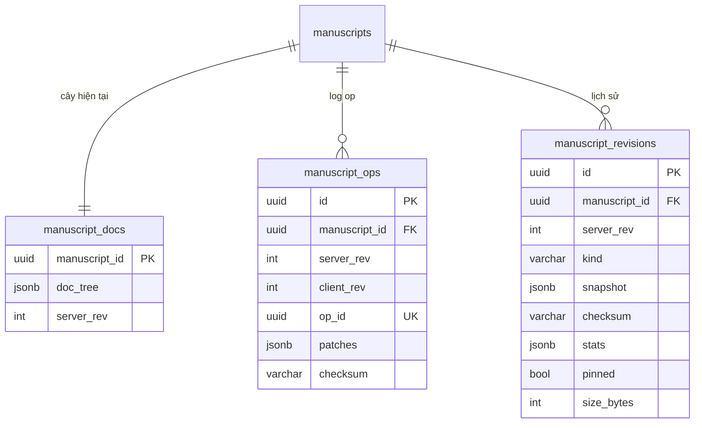

# 3.5 Nhóm Sync & Revision (3 bảng)

Nguồn: `packages/db/src/schema/sync.ts`, migration `0001_manuscript_revision_history`. Dùng bởi `modules/sync`, `modules/manuscripts/application/revision.service.ts`.

> Có **hai kênh lưu nội dung** song song: (1) **Op log** (`manuscript_docs` + `manuscript_ops`) cho đồng bộ thời gian thực/offline; (2) **`manuscripts.metadata`** (bài dạng `CompletePaper`) cho autosave kiểu tài liệu + lịch sử (`manuscript_revisions.snapshot`). Web hiện tại lưu **chỉ qua kênh (2)** (`PATCH/PUT /manuscripts/:id`); kênh (1) có API đầy đủ (`/manuscripts/:id/sync/*`, có test) nhưng **chưa có mã web nào gọi** (đã grep `apps/web/src`).

## `manuscript_docs` – Cây tài liệu hiện tại

| Cột | Kiểu | Null | Mặc định | Ý nghĩa |
|---|---|---|---|---|
| `manuscript_id` | uuid | ✗ | | PK + FK → `manuscripts` (CASCADE) – quan hệ 1-1 |
| `doc_tree` | jsonb | ✗ | | Cây tài liệu (`{ type:'doc', content:[…] }`), kết quả áp mọi op |
| `server_rev` | integer | ✗ | `0` | Số op đã áp (khớp `manuscripts.current_server_rev`) |
| `updated_at` | timestamptz | ✗ | `now()` | |

Khởi tạo cùng bài với `doc_tree = { type:'doc', content:[] }`.

## `manuscript_ops` – Nhật ký op/patch

**Mục đích:** ghi từng lần client gửi patch; phục vụ idempotency (theo `op_id`), phát lại op còn thiếu khi client lệch (`missing-ops`) và kiểm tra checksum.

| Cột | Kiểu | Null | Ý nghĩa |
|---|---|---|---|
| `id` | uuid | ✗ | PK |
| `manuscript_id` | uuid | ✗ | FK → `manuscripts` (CASCADE) |
| `server_rev` | integer | ✗ | Số thứ tự op trên server sau khi áp (tăng dần mỗi bài) |
| `client_rev` | integer | ✗ | Số phiên bản phía client lúc gửi |
| `op_id` | uuid | ✗ | **UNIQUE** – khóa idempotency do client sinh |
| `patches` | jsonb (mảng) | ✗ | Danh sách `{op: add|remove|replace|move|copy|test, path[], value?}` |
| `checksum` | varchar(64) | ✓ | SHA-256 xác định của cây sau khi áp |
| `created_by` | uuid | ✓ | FK → `users` (SET NULL) |
| `created_at` | timestamptz | ✗ | |

**Quy tắc áp (`SyncService.submitOps`):** `baseServerRev == current_server_rev` mới áp; nhỏ hơn ⇒ 409 `OUT_OF_SYNC` + `missingOps`; lớn hơn ⇒ 400. Cứ 20 op ghi một checkpoint `manuscript_revisions(kind='sync')`. Mỗi op phát `outbox_events(OP_APPLIED)`.

## `manuscript_revisions` – Lịch sử phiên bản nội dung

**Mục đích:** các bản chụp toàn bộ bài để xem lại, so sánh, khôi phục (giống lịch sử phiên bản Google Docs).

| Cột | Kiểu | Null | Mặc định | Ý nghĩa |
|---|---|---|---|---|
| `id` | uuid | ✗ | random | PK |
| `manuscript_id` | uuid | ✗ | | FK → `manuscripts` (CASCADE) |
| `server_rev` | integer | ✗ | | Mốc `server_rev` lúc chụp |
| `tag_name` | varchar(255) | ✓ | | Tên phiên bản (named) hoặc nhãn tự động ("Trước khi đổi loại bài") |
| `description` | text | ✓ | | Mô tả (vd "Tự tạo khi bài chuyển trạng thái.") |
| `kind` | varchar(30) | ✗ | `auto` | `auto` · `named` · `pre-risk` · `profile-upgrade` · `restore` · `import` · `sync` |
| `snapshot` | jsonb | ✗ | | Toàn bộ bài lúc đó (dạng `metadata.doc`) |
| `checksum` | varchar(64) | ✓ | | Dấu vân tay nội dung (SHA-256 của `contentFingerprintSource`) – hai bản trùng checksum là cùng văn bản |
| `stats` | jsonb | ✗ | `{}` | Thay đổi so với bản trước: `blocksAdded/Removed/Modified/Moved`, `wordsDelta`, `refsDelta`, `fieldsChanged`, `itemsChanged`, `layoutChanged` |
| `pinned` | boolean | ✗ | `false` | Bản có tên/ghim: không bị dọn |
| `size_bytes` | integer | ✗ | `0` | Kích thước snapshot (theo dõi ngân sách) |
| `created_by` | uuid | ✓ | | FK → `users` (SET NULL) |
| `created_at` | timestamptz | ✗ | `now()` | |

**Index:** `idx_revisions_ms_created(manuscript_id, created_at)`.

| `kind` | Khi nào tạo | Hiển thị trong lịch sử? | Dọn dẹp |
|---|---|---|---|
| `auto` | Nghỉ ≥ 5 phút hoặc ≥ 30 phút từ revision trước; "Phiên bản đầu" | ✔ | > 300 bản không ghim thì xóa cũ nhất |
| `named` | Người dùng đặt tên; hoặc tự tạo khi đổi trạng thái workflow (ghim) | ✔ | Không bao giờ (≤ 100/bài) |
| `pre-risk` | Trước đổi tạp chí/loại bài, trước khôi phục | ✔ | > 90 ngày, giữ ≥ 5 bản mới nhất |
| `profile-upgrade` | Trước nâng profile | ✔ | như trên |
| `restore` | Sau khi khôi phục | ✔ | như `auto` |
| `import` | Nhập từ tệp | ✔ | như `auto` |
| `sync` | Checkpoint mỗi 20 op | ✗ (ẩn) | – |
