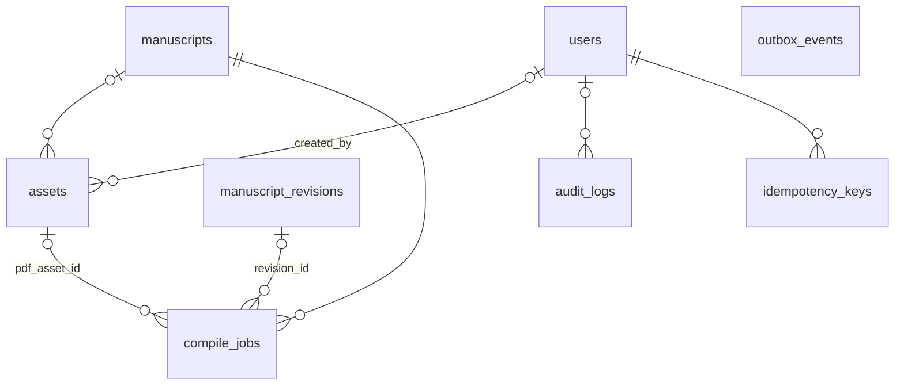

# 3.6 Nhóm Assets, Compile & Platform (5 bảng)

Nguồn: `packages/db/src/schema/assets.ts`, `compile.ts`, `audit.ts`, `outbox.ts`.

## `assets` – Tệp nhị phân (metadata)

**Mục đích:** bản ghi cho mỗi tệp lưu trên S3/MinIO (ảnh bài, PDF biên dịch…). Nội dung tệp **không** nằm trong DB; chỉ có `storage_key`.

| Cột | Kiểu | Null | Ý nghĩa |
|---|---|---|---|
| `id` | uuid | ✗ | PK |
| `manuscript_id` | uuid | ✓ | FK → `manuscripts` (CASCADE); `NULL` = tệp chưa gắn bài (`uploads/…`) |
| `filename` | varchar(255) | ✗ | Tên tệp (đã làm sạch ký tự lạ thành `_`) |
| `file_size` | integer | ✗ | Số byte (từ `HeadObject`) |
| `mime_type` | varchar(100) | ✗ | MIME đã kiểm tra allow-list (jpeg, png, webp, gif, svg+xml, tiff, pdf, docx…) |
| `storage_key` | varchar(500) | ✗ | **UNIQUE**. Khóa trong bucket: `manuscripts/<manuscriptId>/<uuid>-<tên>` hoặc `uploads/<uuid>-<tên>` |
| `checksum` | varchar(64) | ✗ | SHA-256 hex (đối chiếu khi `upload-complete`) |
| `created_by` | uuid | ✓ | FK → `users` (SET NULL) |
| `created_at` | timestamptz | ✗ | |

Giới hạn: ≤ 50 MB; kiểm tra magic-bytes theo MIME. Client dùng **content-addressing**: JSON bài chỉ chứa tham chiếu `asset:<sha256>`.

## `compile_jobs` – Công việc biên dịch nền

**Mục đích:** theo dõi job `compile.latex` do worker xử lý (biên dịch PDF phía server theo hàng đợi pg-boss).

| Cột | Kiểu | Null | Mặc định | Ý nghĩa |
|---|---|---|---|---|
| `id` | uuid | ✗ | random | PK |
| `manuscript_id` | uuid | ✗ | | FK → `manuscripts` (CASCADE) |
| `revision_id` | uuid | ✓ | | FK → `manuscript_revisions` (SET NULL) – biên dịch từ phiên bản nào |
| `server_rev` | integer | ✗ | `0` | Mốc op khi yêu cầu |
| `status` | varchar(50) | ✗ | `QUEUED` | `QUEUED` → `PROCESSING` → `COMPLETED` \| `FAILED` |
| `engine` | varchar(50) | ✗ | `XELATEX` | Engine yêu cầu |
| `log_output` | text | ✓ | | Log biên dịch / lỗi |
| `pdf_asset_id` | uuid | ✓ | | FK → `assets` (SET NULL) – PDF kết quả |
| `duration_ms` | integer | ✓ | | Thời gian xử lý |
| `created_at` | timestamptz | ✗ | `now()` | |

> Biên dịch tương tác từ giao diện (`POST /compile/latex`) **không** ghi bảng này – chỉ dùng hàng đợi trong bộ nhớ (`CompileQueue`) + cache 30 phút. Phía `apps/api` hiện **không** có đoạn mã nào tạo `compile_jobs` hay phát sự kiện `compile.requested`; bảng chỉ được worker cập nhật khi nhận job `compile.latex` (hạ tầng sẵn sàng, chưa có producer).

## `audit_logs` – Nhật ký kiểm toán

| Cột | Kiểu | Null | Ý nghĩa |
|---|---|---|---|
| `id` | uuid | ✗ | PK |
| `user_id` | uuid | ✓ | FK → `users` (SET NULL); `NULL` = hệ thống |
| `action` | varchar(100) | ✗ | Hiện có: `journal.create`, `journal.update`, `journal.apply_profile_to_papers`, `article_type.create`, `article_type.update`, `manuscript.trash`, `manuscript.restore`, `manuscript.purge`, `manuscript.purge_expired` |
| `resource_type` | varchar(100) | ✗ | `journal`, `article_type`, `manuscript`… |
| `resource_id` | varchar(255) | ✓ | Id đối tượng |
| `payload` | jsonb | ✓ | Chi tiết (tiêu đề, journalId, thay đổi…) |
| `ip_address` | varchar(45) | ✓ | IPv4/IPv6 |
| `created_at` | timestamptz | ✗ | |

Chưa có màn hình xem nhật ký trên giao diện.

## `outbox_events` – Outbox sự kiện (transactional outbox)

**Mục đích:** ghi sự kiện **cùng giao dịch** với thay đổi nghiệp vụ; `OutboxDispatcherProcessor` đọc `PENDING` (batch 50) rồi đẩy sang hàng đợi.

| Cột | Kiểu | Null | Mặc định | Ý nghĩa |
|---|---|---|---|---|
| `id` | uuid | ✗ | random | PK |
| `aggregate_type` | varchar(100) | ✗ | | `manuscript` / `MANUSCRIPT` |
| `aggregate_id` | uuid | ✗ | | Id gốc (bài) |
| `event_type` | varchar(100) | ✗ | | `ManuscriptStatusChanged`, `OP_APPLIED`, `compile.requested`/`compile.latex` |
| `payload` | jsonb | ✗ | | Nội dung sự kiện |
| `status` | varchar(50) | ✗ | `PENDING` | `PENDING` → `PROCESSED` \| `FAILED` (sau 5 lần) |
| `retry_count` | integer | ✗ | `0` | Số lần thử lại |
| `created_at` | timestamptz | ✗ | `now()` | |
| `processed_at` | timestamptz | ✓ | | Lúc xử lý xong |

Hiện chỉ `compile.requested`/`compile.latex` được chuyển tiếp sang pg-boss; các sự kiện khác (`ManuscriptStatusChanged`, `OP_APPLIED`) được đánh `PROCESSED` mà chưa có consumer. API hiện chỉ **sinh** `ManuscriptStatusChanged` và `OP_APPLIED`.

## `idempotency_keys` – Khóa idempotency request

| Cột | Kiểu | Null | Ý nghĩa |
|---|---|---|---|
| `key` | varchar(255) | ✗ | PK – khóa do client gửi |
| `user_id` | uuid | ✗ | FK → `users` (CASCADE) |
| `request_hash` | varchar(64) | ✗ | Băm nội dung request (phát hiện dùng lại key với nội dung khác) |
| `response_body` | jsonb | ✓ | Phản hồi đã lưu để phát lại |
| `status_code` | integer | ✓ | Mã trạng thái đã trả |
| `expires_at` | timestamptz | ✗ | Hạn dọn |
| `created_at` | timestamptz | ✗ | |

Bảng và schema đã có; **chưa có mã nào trong `apps/api`/`apps/worker` đọc/ghi bảng này** (đã grep) – ghi nhận để triển khai.
