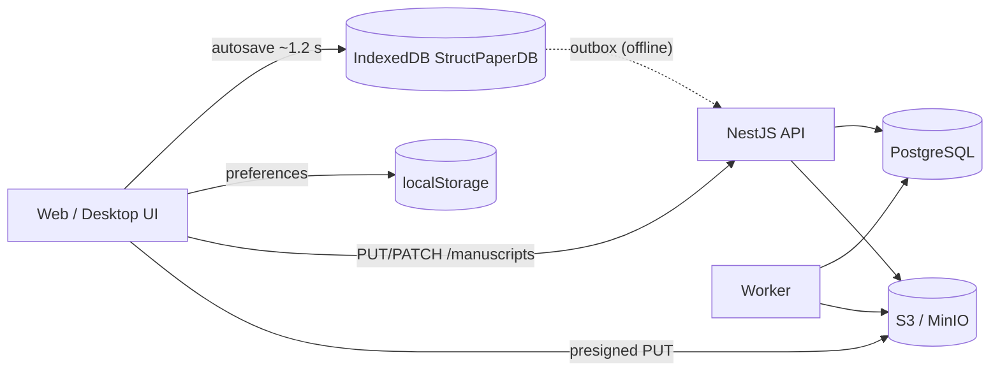

# 3.8 Lưu trữ phía client & Object Storage

## 1. IndexedDB `StructPaperDB` (Dexie, version 2) – `packages/storage`

Kho **offline-first**: dữ liệu luôn ghi vào đây trước, rồi đồng bộ server khi có thể. 10 object store:

| Store | Khóa & chỉ mục (v2) | Bản ghi | Mục đích |
|---|---|---|---|
| `manuscripts` | `id`, `[journalId+updatedAt]`, `workflowStatus`, `displayName`, `*tags`, `pinned`, `archived`, `syncState`, `updatedAt` | `StoredManuscript` (`doc` + metadata phẳng: `displayName`, `tags`, `workflowStatus`, `syncState`, `rev`) | Bài báo trên máy (danh sách, tab, dashboard) |
| `revisions` | `id`, `[manuscriptId+rev]`, `manuscriptId`, `rev`, `createdAt` | `StoredRevision` | Lịch sử bản chụp cục bộ |
| `assets` | `hash`, `mime`, `size`, `width`, `height`, `dpi`, `vector` | `StoredAsset` (Blob) | Ảnh theo SHA-256 (chống trùng) |
| `assetRefs` | `[manuscriptId+hash]`, `manuscriptId`, `hash` | `StoredAssetRef` | Quan hệ n-n bài ↔ ảnh (dọn rác ảnh) |
| `ingestSources` | `manuscriptId` | `StoredIngestSource` (`blob`, `fileName`, `importedAt`) | Giữ tệp Word gốc đã nhập |
| `outbox` | `++seq`, `manuscriptId`, `attempts` | `StoredOutboxItem` | Hàng đợi đồng bộ khi offline |
| `compileCache` | `hash`, `cachedAt` | `StoredCompileCache` (`pdfBlob`, `logs`) | Cache PDF biên dịch theo hash nội dung |
| `settings` | `key` | `StoredSetting` | Cài đặt cục bộ key-value |
| `profiles` | `[scopeType+scopeId+version]`, `scopeType`, `scopeId`, `version`, `state`, `fetchedAt` | `StoredProfile` | Cache profile 3 tầng đã xuất bản |
| `profileIndex` | `[scopeType+scopeId]`, `scopeType`, `scopeId`, `checkedAt` | `StoredProfileIndex` | Theo dõi phiên bản mới nhất của profile |

**Nâng cấp v1 → v2:** thêm `profiles`, `profileIndex`, đổi chỉ mục `manuscripts`, và bù `displayName`, `workflowStatus='draft'`, `pinned=false`, `archived=false`, `tags=[]`, `createdAt/updatedAt` cho dữ liệu cũ.

`syncState` của `StoredManuscript` cho biết bản trên máy đã đồng bộ với server hay chưa (`pending/synced/conflict`…); `outbox` giữ các thay đổi chờ đẩy.

## 2. localStorage / sessionStorage (web)

| Khóa | Nội dung | Nguồn |
|---|---|---|
| `structpaper_managed_journals` | Danh sách `ManagedJournalProfile[]` (7 tạp chí mặc định + tùy chỉnh) | `lib/templates/journal-storage.ts` |
| `structpaper_authoring_papers_v1` | `CompletePaper[]` cho Authoring Hub (đường cũ) | `lib/authoring/paper-storage.ts` |
| Token truy cập | trong bộ nhớ (`auth-store`); refresh token ở cookie `refreshToken` (httpOnly, 7 ngày) | `lib/auth-store.ts` |
| Tùy chọn autosave, trạng thái tab, bản sao bài khi chuyển trang | `lib/editor/autosave-preferences.ts`, `tab-view-state-store.ts`, `sessionStorage` | |

## 3. Object Storage S3 / MinIO

Bucket cấu hình bằng `S3_BUCKET` (dev: `structpaper-dev`), endpoint `S3_ENDPOINT` (MinIO `http://localhost:9000`). Truy cập bằng AWS SDK v3, **presigned URL** cho tải lên trực tiếp từ client.

| Đối tượng | Khóa (key) | Người ghi | Bảng DB liên quan |
|---|---|---|---|
| Ảnh/tệp tải lên gắn bài | `manuscripts/<manuscriptId>/<uuid>-<tênTệp>` | Client qua presigned PUT, API xác nhận | `assets.storage_key` |
| Tệp tải lên chưa gắn bài | `uploads/<uuid>-<tênTệp>` | Client | `assets` (`manuscript_id` null) |
| PDF biên dịch nền | `manuscripts/<manuscriptId>/compiles/<jobId>.pdf` | Worker | `assets` + `compile_jobs.pdf_asset_id` |
| PDF xem trước cho người chỉ xem | `previews/<manuscriptId>.pdf` | API (`PUT /manuscripts/:id/preview`) | (không có bảng; khóa suy ra từ id bài) |

Giới hạn: tệp ≤ 50 MB (`assets`), preview ≤ 64 MB và phải bắt đầu bằng `%PDF-`. Presigned PUT hết hạn sau 900 s.

## 4. Cache & hàng đợi khác

| Thành phần | Nơi | Ghi chú |
|---|---|---|
| Cache biên dịch server | Bộ nhớ tiến trình API (`CompileService`) | 50 mục, TTL 30 phút, khóa = băm (tex + ảnh + engine) |
| Hàng đợi biên dịch server | Bộ nhớ (`CompileQueue`) | `COMPILE_CONCURRENCY` (mặc định min(4, cores/2)), `COMPILE_MAX_QUEUE`=60, `COMPILE_MAX_PER_USER`=12; vượt ⇒ 429 |
| Cache quyền (`AbilityCache`) | Bộ nhớ | khóa `(userId, permissions_version)` |
| Hàng đợi nền `compile.latex`, `outbox.dispatch` | PostgreSQL schema `pgboss` (pg-boss) | worker tiêu thụ |
| Kết nối SSE | Bộ nhớ (`SseManagerService`) | theo `manuscriptId` |
