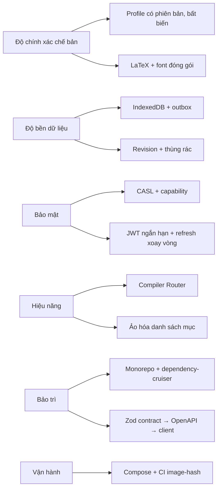

# 4.2.1 Giới thiệu & mục tiêu

## Mục đích hệ thống

StructPaper (tên mã *Cheban* – "chế bản") giúp tòa soạn các tạp chí **ĐHQG-HCM** biến bài báo Word thành bản chế bản đạt chuẩn:

1. **Nhập** bài DOCX (kể cả hàng loạt) → mô hình cấu trúc hóa;
2. **Biên tập** theo từng phần (thông tin, tác giả, tóm tắt, nội dung, bảng, hình, công thức, tham khảo) với kiểm tra chất lượng (QC);
3. **Dàn trang** theo quy định của từng tạp chí/loại bài (profile có phiên bản);
4. **Xuất** PDF (LaTeX), DOCX, XML JATS; quản lý lịch sử, chia sẻ, workflow, thùng rác.

## Phạm vi

| Trong phạm vi | Ngoài phạm vi (hiện tại) |
|---|---|
| Web + Desktop (Windows/macOS) | Ứng dụng di động |
| 7 tạp chí VNUHCM, 9 loại bài | Nhận bài từ tác giả bên ngoài (submission system) |
| Nhập DOCX, xuất PDF/DOCX/JATS | Nhận .doc/RTF, hình EMF/WMF/TIFF/EPS, MathType OLE |
| Phân quyền theo vai trò & theo bài | Bình luận/giao việc trên bản proof, API/webhook cho bên thứ ba |
| Lịch sử, chia sẻ, thùng rác | Dựng "số tạp chí", PDF/X, CrossMark |

## Bên liên quan

| Bên liên quan | Mối quan tâm |
|---|---|
| Biên tập viên/kỹ thuật viên chế bản (Author/Editor) | Tốc độ nhập–sửa–xuất, đúng mẫu, không mất dữ liệu, dùng được offline |
| Quản lý tạp chí (JournalManager) | Quản lý mẫu/quy tắc có phiên bản, kiểm soát thành viên, áp quy tắc mới |
| Quản trị hệ thống (SuperAdmin) | Phân quyền an toàn, vận hành |
| Phản biện/khách (Reviewer/Viewer/Guest) | Xem bài/PDF nhanh qua liên kết |
| Đội phát triển | Dễ bảo trì, kiểm thử, ranh giới package rõ |
| Vận hành (Ops) | Triển khai lặp lại, giám sát, sao lưu |

## Ràng buộc

| Loại | Ràng buộc |
|---|---|
| Công nghệ | Node 20/22, pnpm 9.15.4, TypeScript; PostgreSQL 16; S3 tương thích (MinIO); LaTeX bằng Tectonic |
| Pháp lý/nội dung | Font có bản quyền (Times New Roman/Palatino…) phải có sẵn trong image biên dịch; không tự bịa DOI/tập/số/ngày |
| Chuẩn xuất bản | JATS 1.2 (kiểm DTD), mẫu từng tạp chí (PDF/Word/`.dotx` trong `docs/Yêu cầu phần mềm…`) |
| Ngôn ngữ | Giao diện và nội dung tiếng Việt (IME, Unicode NFC), có phần tiếng Anh |
| Nền tảng | Bản desktop dùng bản xuất tĩnh Next.js ⇒ không có route server của Next |
| Tổ chức | Nhánh `main ← staging ← dev`; hạ tầng staging qua VPN; image chỉ kéo (không build) trên VM prod |

## Mục tiêu chất lượng (top 6)

| # | Thuộc tính | Mô tả mục tiêu | ASR |
|---|---|---|---|
| 1 | **Độ chính xác chế bản** | PDF/DOCX/JATS khớp mẫu tạp chí; bài cũ không đổi khi quy tắc mới ra | ASR-01, 02 |
| 2 | **Độ bền dữ liệu / sẵn sàng khi offline** | Không mất chỉnh sửa; làm việc khi mất mạng | ASR-03, 04 |
| 3 | **Bảo mật & phân quyền** | Mặc định từ chối; UI/API không lệch quyền; phiên thu hồi được | ASR-05, 06 |
| 4 | **Hiệu năng tương tác** | Gõ/đổi thẻ mượt với bài 150+ mục; biên dịch không treo giao diện | ASR-07, 08 |
| 5 | **Khả năng bảo trì & kiểm thử** | Ranh giới package, hợp đồng dùng chung, guardrail tự động | ASR-09, 10 |
| 6 | **Vận hành lặp lại** | Triển khai bằng image, migrate/seed tự động, health check | ASR-11 |

## Sơ đồ phụ thuộc giữa các mối quan tâm

