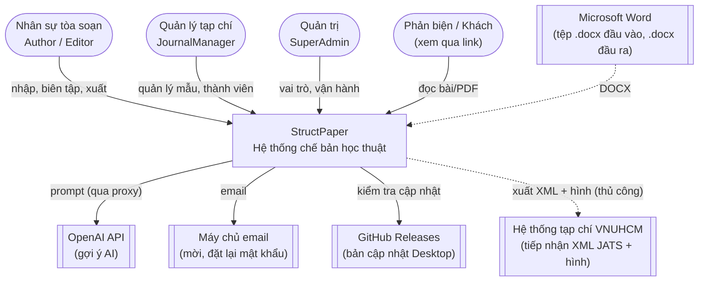
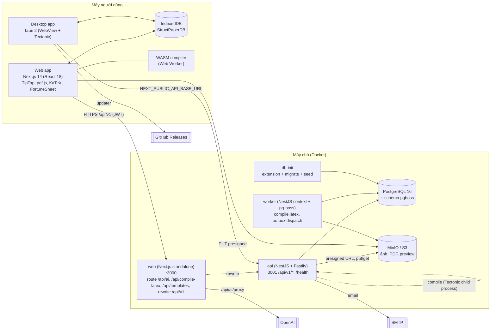

# 4.2.2 View ngữ cảnh & container (C4 mức 1–2)

## Mức 1 – Ngữ cảnh hệ thống

## Mức 2 – Container

| Container | Công nghệ | Trách nhiệm | Cổng | Trạng thái |
|---|---|---|---|---|
| **web** | Next.js 14.2 App Router, React 18, Tailwind 3, zustand, TanStack Query | Giao diện, route server nhẹ (AI proxy, compile proxy, templates, rewrite `/api/v1`) | 3000 | Stateless |
| **api** | NestJS 10, Fastify 4, Drizzle, CASL, Zod, AWS SDK v3, Argon2 | REST API `/api/v1`, xác thực/phân quyền, biên dịch LaTeX đồng bộ (Tectonic/XeLaTeX qua child process, hàng đợi trong bộ nhớ), SSE | 3001 (mặc định `PORT` 4000 khi chạy tay) | Stateless (cache RAM) |
| **worker** | NestJS ApplicationContext, pg-boss 10 | Hàng đợi nền `compile.latex`, phát outbox | – | Stateless |
| **db-init** | Image Node + `psql` | Tạo extension, migrate, (tùy chọn) seed; chạy xong thì thoát | – | Chạy một lần |
| **PostgreSQL** | 16 (+ `citext`, `pg_trgm`, `unaccent`) | Dữ liệu nghiệp vụ + hàng đợi `pgboss` | 5432 | Stateful |
| **MinIO/S3** | S3 API | Ảnh, PDF biên dịch, PDF preview | 9000/9001 (dev) | Stateful |
| **Desktop** | Tauri 2 (Rust), plugin updater/process | Bản đóng gói web tĩnh, Tectonic đi kèm, lưu cục bộ | – | Cài trên máy |
| **IndexedDB** | Dexie 4 | Kho offline-first | – | Trên trình duyệt/WebView |

## Giao tiếp giữa các container

| Từ → Đến | Giao thức | Xác thực | Ghi chú |
|---|---|---|---|
| Web (trình duyệt) → Next | HTTPS | cookie/Bearer | `/api/v1/*` được **rewrite** sang API (`INTERNAL_API_URL`) |
| Trình duyệt → API | REST/JSON + SSE | `Authorization: Bearer <JWT>` + cookie `refreshToken` | CORS theo `CORS_ORIGIN` |
| Trình duyệt → S3 | HTTPS PUT (presigned) | URL ký, hết hạn 15 phút | API không gánh băng thông ảnh |
| API/Worker → PostgreSQL | TCP (postgres.js) | `DATABASE_URL` | pool 10 |
| API/Worker → S3 | AWS SDK v3 | khóa truy cập | |
| Worker ← PostgreSQL | pg-boss (poll/`LISTEN`) | – | queue `compile.latex`, `outbox.dispatch` |
| Next → OpenAI | HTTPS | `OPENAI_API_KEY` phía server | allow-list, giới hạn kích thước |
| Desktop → GitHub | HTTPS | chữ ký minisign | `latest.json` |
