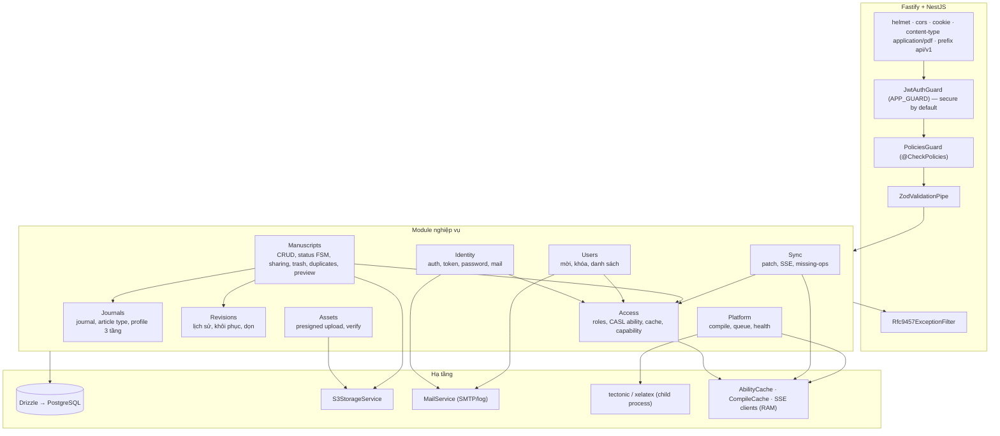
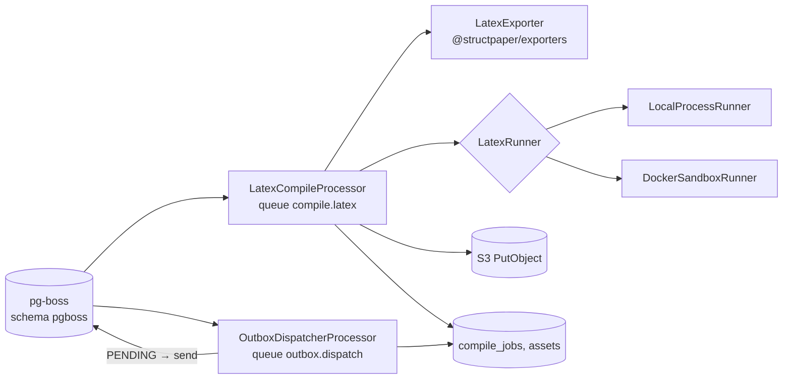
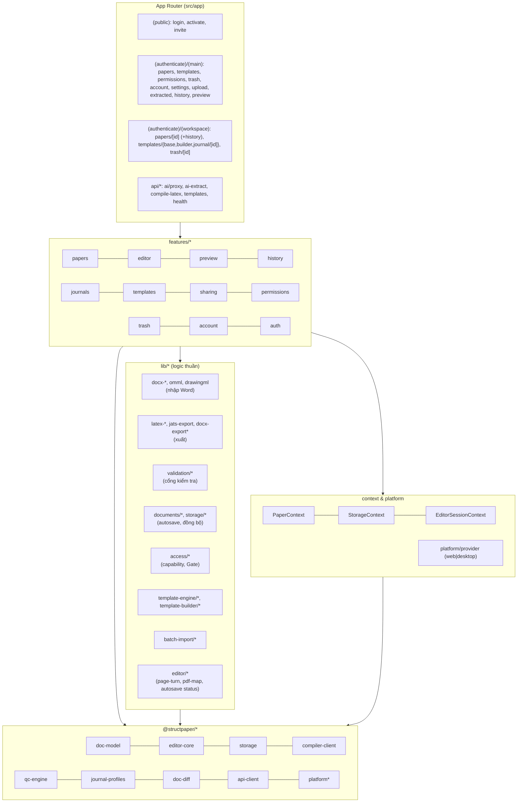
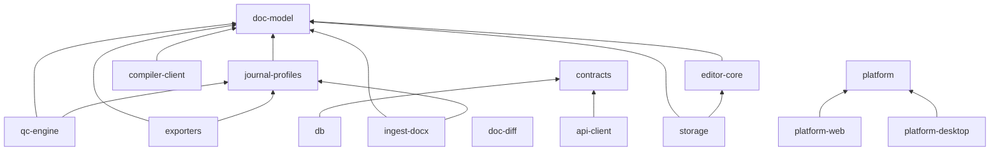

# 4.2.3 View thành phần (C4 mức 3)

## API (`apps/api`)

| Module | Trách nhiệm chính | Điểm kiến trúc đáng chú ý |
|---|---|---|
| Identity | Đăng nhập, refresh, kích hoạt, đặt lại mật khẩu | Argon2id + đọc scrypt cũ; token một lần băm SHA-256 |
| Users | Mời/khóa/sửa thành viên | `assertCanAssign`, bất biến SuperAdmin; giao dịch mời + gán vai trò |
| Access | Vai trò, ability CASL, capability | Cùng hàm điều kiện cho guard và `/auth/me` |
| Journals | Tạp chí, loại bài, profile versions | Trigger DB; `resolveFromTiers` dùng chung client; áp hàng loạt |
| Manuscripts | Bài, trạng thái, chia sẻ, thùng rác | FSM `VALID_TRANSITIONS`; outbox cùng giao dịch; `accessOf()` gửi cờ quyền |
| Revisions | Lịch sử | `beforeSave` không bao giờ ném lỗi (không làm mất lần lưu) |
| Sync | Op/patch + SSE | idempotent `opId`, 409 + `missingOps`, checkpoint 20 op |
| Assets | Upload hai bước | kiểm MIME/size/SHA-256/magic bytes |
| Platform | `/compile/latex`, `/compile/status`, `/health` | `CompileQueue` công bằng theo người dùng, 429 khi quá tải |

## Worker (`apps/worker`)

## Web (`apps/web`)

| Khối | Vai trò |
|---|---|
| `app/` | Định tuyến; nhóm `(public)` không cần đăng nhập, `(authenticate)` bọc `AuthGuard`; `(workspace)` là layout toàn màn hình cho trình soạn/Template |
| `features/` | Mỗi tính năng: `components/`, `hooks/`, đôi khi `access.ts` (chính sách quyền theo nghiệp vụ) |
| `lib/` | Thuần logic (nhập Word, sinh LaTeX/JATS/DOCX, kiểm tra, autosave) – dễ test bằng Vitest |
| `context/` | `PaperContext` (bài đang mở), `StorageContext` (repo hợp nhất IndexedDB+server), `EditorSessionContext` |
| `platform/` | Khởi tạo dịch vụ nền tảng web/desktop theo môi trường |
| `components/` | Layout (`Sidebar`, `BottomNav`, `AuthGuard`), modal chung, toast, UI cơ bản, thẻ cập nhật desktop |

## Các package lõi

Luật được kiểm bằng `pnpm deps:check` (xem [ADR-01](../4.1-ADD/01-decisions-core.md)). `doc-diff` và `contracts` không phụ thuộc package khác; `db` chỉ phụ thuộc `contracts`.
