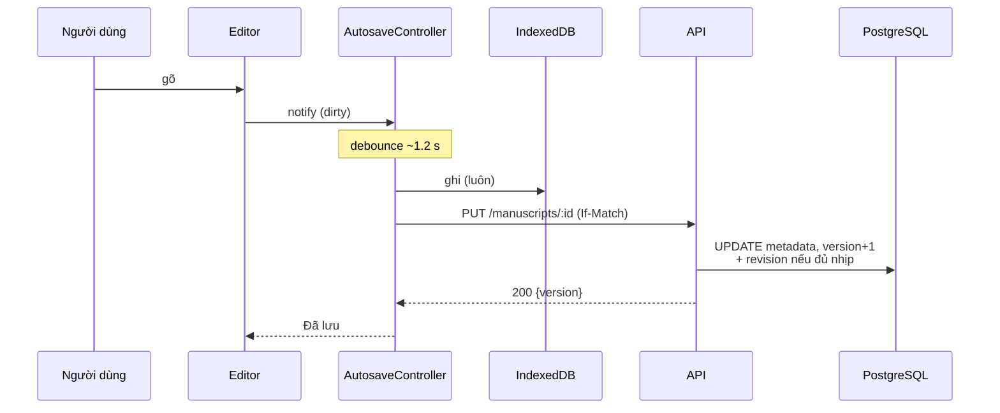
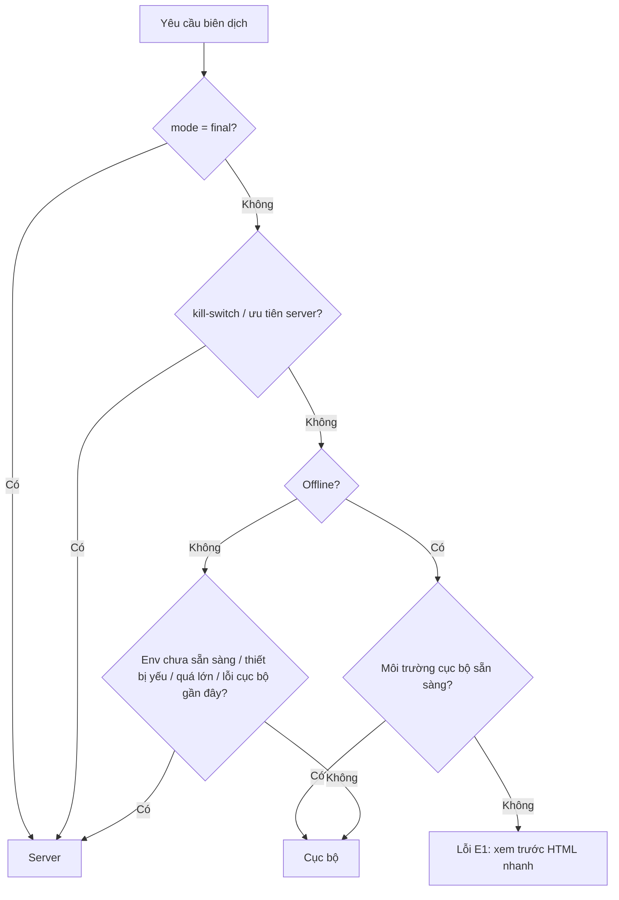

# 4.2.4 View chạy (runtime)

Các kịch bản then chốt; chi tiết từng bước ở [2.2 Activity](../../2-Diagrams/2.2-Activity/README.md) và [2.3 Sequence](../../2-Diagrams/2.3-Sequence/README.md).

| # | Kịch bản | Thành phần tham gia | Tham chiếu |
|---|---|---|---|
| R1 | Đăng nhập & kiểm tra quyền | Web, JwtAuthGuard, AuthService, AbilityFactory/Cache | AD/SD-01, 02, 07 |
| R2 | Nhập Word → mở trình soạn | Web (docx-*), cổng kiểm tra, IndexedDB, API | AD/SD-14 |
| R3 | Soạn & tự động lưu | PaperContext, AutosaveController, IndexedDB, `PUT /manuscripts` | AD/SD-20 |
| R4 | Biên dịch PDF | CompileScheduler, CompilerRouter, WASM/Tauri/Remote, CompileService | AD/SD-25 |
| R5 | Xuất PDF/DOCX/JATS | Cổng kiểm tra, exporters, ZipPackager | AD/SD-27, 28 |
| R6 | Đổi trạng thái → outbox | ManuscriptService, RevisionService, `outbox_events` | AD/SD-16 |
| R7 | Xuất bản profile & ghim | ProfileService, trigger DB, ProfileResolveService | AD/SD-09, 10, 11 |
| R8 | Chia sẻ & xem chỉ đọc | SharingService, AbilityCache, PreviewService | AD/SD-32, 33 |
| R9 | Mất mạng → đồng bộ lại | outbox IndexedDB, paper-sync | AD/SD-23 |
| R10 | Cập nhật Desktop | UpdateService, tauri-plugin-updater | AD/SD-34 |

## R3 – Đường dữ liệu khi gõ (rút gọn)

## R4 – Quyết định nơi biên dịch

## Đồng thời & nhất quán

| Chủ đề | Cơ chế |
|---|---|
| Cập nhật đồng thời một bài | `manuscripts.version` (ETag/`If-Match`) → 412; sync dùng `baseServerRev` → 409 |
| Biên dịch đồng thời | `CompileQueue`: `concurrency` = min(4, cores/2), tối đa 60 chờ, 12/người; xoay vòng theo người dùng (công bằng) |
| Tạo bài/mời/đổi trạng thái | Giao dịch Postgres (`db.transaction`) |
| Phát sự kiện | Outbox cùng giao dịch ⇒ ít nhất một lần (at-least-once) |
| Tắt tiến trình | `TrashService.onModuleDestroy` hủy timer; worker `enableShutdownHooks` |
