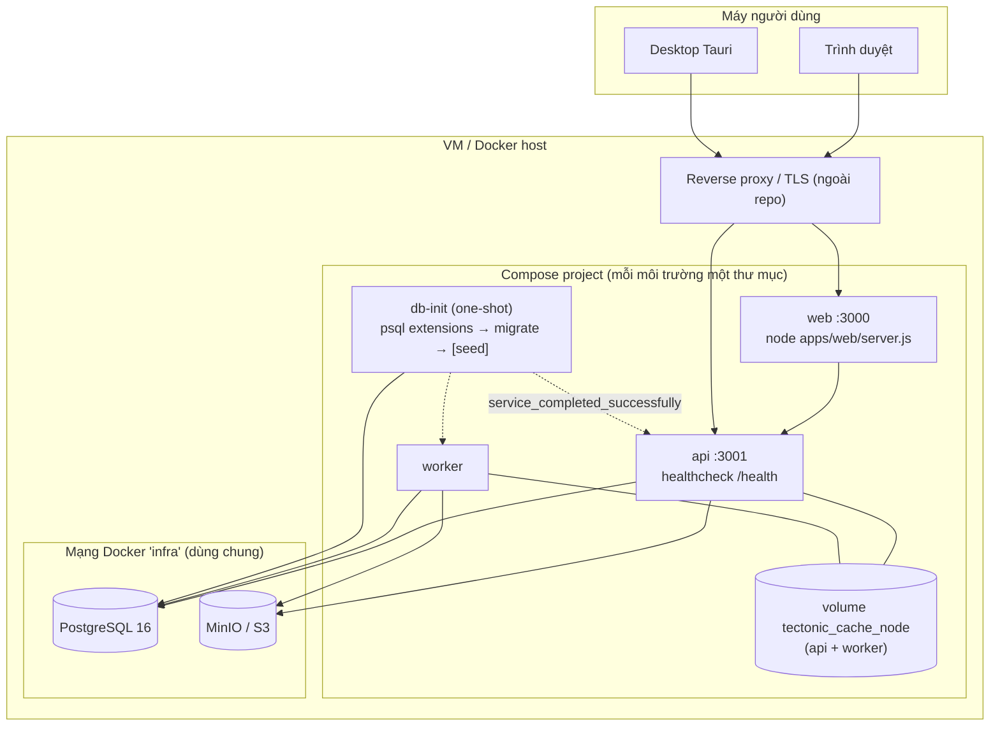
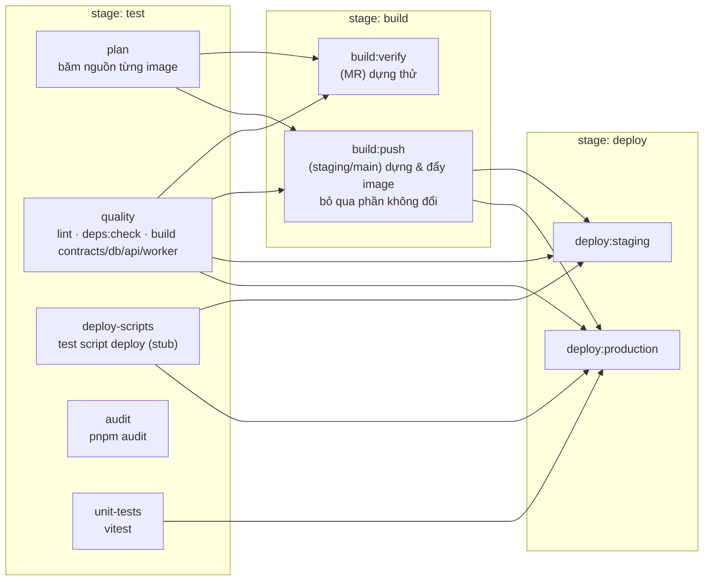

# 4.2.5 View triển khai

## Môi trường

| Môi trường | File | Đặc điểm |
|---|---|---|
| **dev** | `docker-compose.dev.yml` | Tự build `api`+`worker`+`web` từ mã, kèm `postgres:16-alpine`, `minio` (+`minio-init`), `db-init`; cổng `3000` (web), `3001` (api), `5432`, `9000/9001`. Hot-reload qua target `dev` của Dockerfile |
| **staging (VM)** | `docker-compose.staging.yml`, `.env.staging.local` | `api` + `worker` dùng Postgres/MinIO **trên VM qua VPN**; tự migrate + seed; web chạy `pnpm dev:web` cục bộ |
| **production / staging triển khai** | `docker-compose.prod.yml` | **Chỉ kéo image dựng sẵn** (`API_IMAGE`, `WORKER_IMAGE`, `WEB_IMAGE`, `DB_INIT_IMAGE`), dùng Postgres/MinIO dùng chung trên mạng Docker `infra` (external). Mỗi môi trường một thư mục + `.env` riêng (cổng/bí mật khác nhau). Seed chỉ chạy khi `RUN_SEED=true` |
| **desktop** | `apps/web/src-tauri`, `.github/workflows/release.yml` | Bản cài Windows (NSIS) / macOS (DMG) từ bản xuất tĩnh; cập nhật tự động |

## Sơ đồ triển khai (production)

* `api` và `worker` **chỉ khởi động sau khi `db-init` thành công** (`depends_on: condition: service_completed_successfully`).
* `api` có `init: true` (thu dọn tiến trình biên dịch zombie), healthcheck `GET /health` mỗi 15 s; `web` kiểm `GET /`.
* Log `json-file` 10 MB × 3.
* Image `api`/`worker` cài **Tectonic 0.15.0** (kiểm SHA-256) và **font** từ `docker/fonts/` (phải được commit để image CI có font); cache gói Tectonic ở volume `tectonic_cache_node`.
* Cổng `api` bind `BIND_ADDR` (mặc định `127.0.0.1`) – lộ ra ngoài qua reverse proxy.

## Đường ống CI/CD (GitLab)

* `plan` và `quality` là điều kiện cần của job build (`needs`); `audit` (`pnpm audit --prod --audit-level=high`) và `unit-tests` (`pnpm test`) đặt `allow_failure: true` – **không chặn** pipeline, nhưng `deploy:production` có `needs` `unit-tests`.
* `deploy:production` chạy **thủ công** (`when: manual`) trên nhánh `main`.

| Nhánh | Hành vi |
|---|---|
| Merge Request | test + `build:verify` |
| `staging` | test → `build:push` → `deploy:staging` (tự động) |
| `main` | test → `build:push` → `deploy:production` (bấm tay) |
| Tag `v*` (GitHub Actions) | Build & phát hành Desktop (Windows NSIS, macOS arm64 DMG), tạo `latest.json` cho updater |

Script triển khai trên VM: `scripts/deploy/{deploy.sh, validate-and-deploy.sh, pre-deploy.example.sh}` (có test offline `test-deploy-scripts.sh`).

## Dung lượng & cấu hình quan trọng

| Biến | Mặc định | Tác dụng |
|---|---|---|
| `PORT` / `HOST` | 4000 / 0.0.0.0 (compose: 3001) | Cổng API |
| `BODY_LIMIT_BYTES` | 64 MiB | Request biên dịch chứa `.tex` + ảnh base64 |
| `COMPILE_CONCURRENCY` | min(4, cores/2) | Biên dịch song song |
| `COMPILE_MAX_QUEUE` / `COMPILE_MAX_PER_USER` | 60 / 12 | Hạn mức hàng đợi (429) |
| `COMPILE_TIMEOUT_MS` | 300000 | Hết thời gian biên dịch |
| `TRASH_RETENTION_DAYS` | 30 | Giữ bài đã xóa |
| `JWT_SECRET`, `JWT_REFRESH_SECRET` | (bắt buộc ở prod) | Ký token |
| `CORS_ORIGIN` | (bắt buộc ở prod) | Nguồn được phép |
