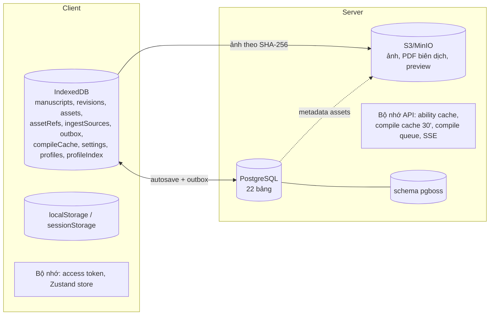
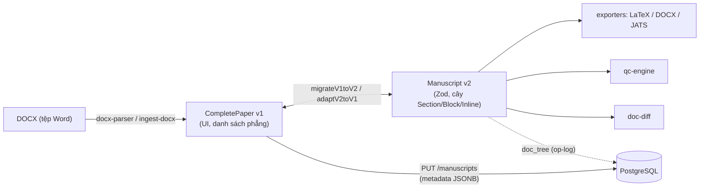

# 4.2.6 View dữ liệu

## Bản đồ nơi lưu dữ liệu

| Dữ liệu | Nguồn sự thật | Bản sao/cache | Ghi chú |
|---|---|---|---|
| Danh tính, vai trò, thành viên bài | PostgreSQL | ability cache (RAM) | vô hiệu qua `permissions_version` |
| Quy tắc profile | PostgreSQL `profile_versions` | IndexedDB `profiles`; snapshot trong `manuscript_profile_snapshots` | bản published bất biến |
| Nội dung bài | **Client IndexedDB trước**, rồi PostgreSQL `manuscripts.metadata` | `manuscript_docs.doc_tree` (kênh op-log) | khóa lạc quan theo `version` |
| Lịch sử | PostgreSQL `manuscript_revisions` | IndexedDB `revisions` (cục bộ) | server tính `stats` |
| Ảnh | S3 (khóa `manuscripts/<id>/…`) + `assets` | IndexedDB `assets` (Blob theo hash) | JSON chỉ giữ `asset:<sha256>` |
| PDF | Client (`compileCache`), S3 (`previews/<id>.pdf`, `…/compiles/<job>.pdf`) | cache 30' ở server | |
| Tệp Word gốc | IndexedDB `ingestSources` | – | không gửi lên server |

## Mô hình nội dung bài (3 lớp biểu diễn)

## Toàn vẹn dữ liệu

| Cơ chế | Mục đích |
|---|---|
| FK + CASCADE từ `manuscripts` | Xóa vĩnh viễn một bài dọn sạch dữ liệu con |
| `manuscripts.created_by` RESTRICT | Không xóa người dùng đang là chủ bài |
| CHECK (`status`, màu, ISSN, regex mã loại bài, `profile_pin` là object) | Chặn dữ liệu sai ở mức DB |
| Partial unique index + trigger trên `profile_versions` | Tối đa 1 bản published; bản published bất biến |
| UNIQUE `manuscript_ops.op_id` | Idempotency |
| Checksum SHA-256 (`manuscript_ops`, `manuscript_revisions`, `assets`, `snapshots.hash`) | Phát hiện sai lệch/trùng |
| Giao dịch (`db.transaction`) | Tạo bài, mời thành viên, đổi trạng thái + outbox, áp op |

## Vòng đời dữ liệu & giữ lại

| Dữ liệu | Giữ bao lâu |
|---|---|
| Bài đã xóa mềm | 30 ngày (`TRASH_RETENTION_DAYS`) rồi xóa vĩnh viễn |
| Revision | `named`: vĩnh viễn; `auto`: tối đa 300 bản không ghim; `pre-risk/profile-upgrade`: 90 ngày (giữ ≥ 5) |
| Refresh token | 7 ngày (không có job dọn bản ghi hết hạn) |
| Op log, outbox đã xử lý, audit | Chưa có chính sách dọn |
| Cache biên dịch server | 30 phút / 50 mục |

Chi tiết bảng/cột: [3-Database](../../3-Database/README.md).
