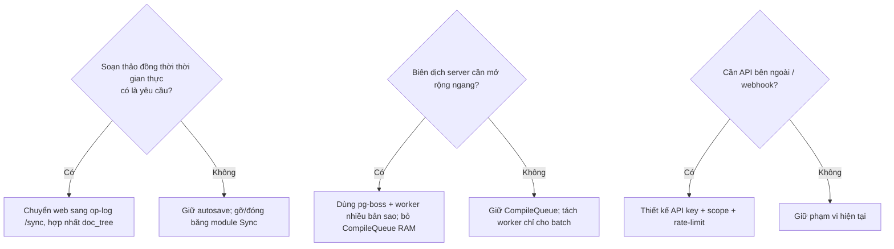

# 4.2.9 Rủi ro, nợ kỹ thuật & khoảng trống kiến trúc

Mức độ: **C** cao · **T** trung bình · **N** thấp. Các mục dưới đây được xác minh bằng cách đọc/grep mã (không suy đoán).

| # | Mục | Mô tả | Bằng chứng | Mức | Đề xuất |
|---|---|---|---|---|---|
| D1 | Hai kênh lưu nội dung chưa hợp nhất | Web lưu `manuscripts.metadata` (PUT/PATCH) còn `/sync/*` + `manuscript_docs` không được web gọi; nếu bật cả hai sẽ lệch | grep `apps/web/src` không có `sync/patches` | C | Quyết định một kênh, hoặc cầu nối `doc_tree` ↔ `metadata.doc` |
| D2 | Worker biên dịch chưa có producer | `compile_jobs` không được API tạo; `compile.requested` không được phát | grep `apps/api` | T | Nối `POST /manuscripts/:id/compile` → outbox/pg-boss hoặc bỏ phần thừa |
| D3 | `idempotency_keys` chưa dùng | Bảng + schema có, không mã nào đọc/ghi | grep | N | Hoặc triển khai interceptor idempotency, hoặc loại bảng |
| D4 | Luật phân lớp API không bắt được vi phạm | `.dependency-cruiser.js` trỏ `apps/api/src/(domain|application|…)` nhưng mã ở `apps/api/src/modules/<m>/…` | đối chiếu cấu trúc thư mục | T | Sửa pattern thành `modules/[^/]+/domain` … |
| D5 | Hai bộ đọc Word song song | `apps/web/src/lib/docx-*` (v1) và `packages/ingest-docx` (v2, đăng ký bộ cũ làm fallback) | `registerLegacyFallbackParser` | T | Hợp nhất sang pipeline v2, giữ golden test |
| D6 | Hai mô hình tài liệu (v1 UI / v2 canonical) | Chuyển đổi hai chiều có thể mất thông tin | `migrate-v1-to-v2`, `layoutOverrides.sectionExtras` | T | Dần chuyển UI sang v2; mở rộng test round-trip |
| D7 | Đọc Word chạy trên luồng chính | Giao diện có thể khựng ~1 s với tệp lớn | `docs/DOCUMENT_WORKFLOW.md` §Còn lại | T | Đưa vào Web Worker (`ingest-worker.ts` đã có sẵn) |
| D8 | Giới hạn biên dịch khác nhau giữa môi trường | WASM/Tectonic desktop/server có thể khác font/kết quả | luật 06 (`parity`) | T | Kiểm "parity" trước khi cho biên dịch cục bộ bản chính thức (đã định tuyến final→server) |
| D9 | Chưa dọn dữ liệu tăng nhanh | `manuscript_ops`, `outbox_events`, `refresh_tokens`, `audit_logs`, S3 mồ côi | xem [3.9](../../3-Database/09-migrations-seed-operations.md) | T | Job dọn định kỳ (pg-boss schedule) |
| D10 | Thiếu quan sát | Không metrics/tracing; log dạng text | – | T | Thêm OTel/Prometheus, correlation id |
| D11 | Bảo mật phiên | Không 2FA, không rate-limit login, secret mặc định ở dev | [SAD §7](07-security-view.md) | C | Xem khuyến nghị §7 |
| D12 | Tài liệu cũ lệch thực tế | `docs/DATA_SCHEMA.md` nói Spring Boot/MySQL; `README` nói font không commit nhưng `docker/fonts/README.md` nói ngược | đối chiếu | N | Cập nhật/loại bỏ; dùng bộ SRS này |
| D13 | Chưa có màn hình audit | `audit_logs` chỉ ghi | – | N | Thêm trang "Nhật ký" cho SuperAdmin |
| D14 | Tính năng chưa có theo yêu cầu phần mềm | Proof/bình luận, cập nhật từ Word bản sửa, API/webhook, PDF/X/CrossMark, tham chiếu chéo bấm được, ORCID trong JATS, kiểm DPI hình đầy đủ, hình EMF/WMF/TIFF/EPS | `docs/Audit/DOI_CHIEU_YEU_CAU_PHAN_MEM_2026-11-20.md` | T | Xếp ưu tiên với tòa soạn |
| D15 | Rủi ro bản quyền font | Font Times New Roman/Palatino… phải có trong image | `docker/fonts/README.md` | T | Xác nhận giấy phép phân phối; thay thế font tự do nếu cần |
| D16 | Hàng đợi biên dịch trong bộ nhớ | Mất hàng đợi khi API khởi động lại; không chia sẻ giữa nhiều bản sao API | `CompileQueue` | N | Chuyển sang pg-boss khi cần scale ngang |

## Khoảng trống cần quyết định kiến trúc

