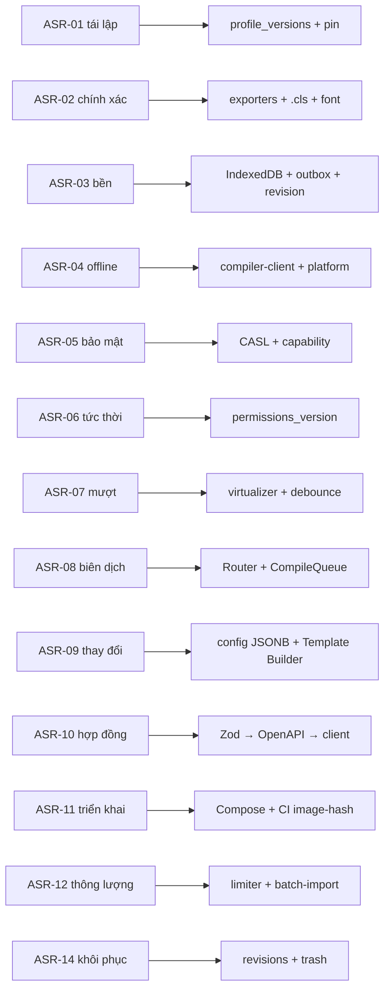

# 4.3 ASR – Architecturally Significant Requirements

ASR là yêu cầu (chức năng hoặc chất lượng) **có ảnh hưởng lớn tới kiến trúc**: nếu bỏ nó, cấu trúc hệ thống sẽ khác. Mỗi ASR mô tả theo mẫu **kịch bản chất lượng** (nguồn – kích thích – môi trường – phản ứng – thước đo), kèm chiến thuật kiến trúc, bằng chứng trong mã và trạng thái đáp ứng.

Thang: **Quan trọng nghiệp vụ** (H/M/L) × **Rủi ro kỹ thuật** (H/M/L). Các ASR có (H,H) quyết định hình dạng kiến trúc nhất (xem [Utility tree](../4.4-Faulttree-Utilitytree/01-utility-tree.md)).

## Danh sách ASR

| ASR | Thuộc tính | Yêu cầu (tóm tắt) | (Nghiệp vụ, Kỹ thuật) | ADR liên quan | Đáp ứng |
|---|---|---|---|---|---|
| ASR-01 | Khả năng tái lập (Reproducibility) | Bài đã viết theo quy định N phải dàn trang đúng như cũ dù tạp chí ra quy định mới | (H, H) | 08 | ✅ |
| ASR-02 | Độ chính xác chế bản (Functional correctness) | PDF/DOCX/JATS khớp mẫu từng tạp chí (cột, bảng dài, công thức, font, tiếng Việt) | (H, H) | 12, 20 | 🟡 |
| ASR-03 | Độ bền dữ liệu (Durability) | Không mất chỉnh sửa khi mất mạng, đóng tab, xung đột, lỗi server | (H, H) | 10, 16 | ✅ |
| ASR-04 | Khả dụng ngoại tuyến (Availability) | Soạn, lưu, biên dịch và xuất được khi không có server | (H, M) | 10, 12, 15 | ✅ |
| ASR-05 | Bảo mật truy cập (Security) | Mặc định từ chối; phân quyền theo vai trò **và** theo từng bài; UI không thể lệch API | (H, M) | 05, 06 | ✅ |
| ASR-06 | Hiệu lực quyền tức thời | Đổi vai trò/thành viên có hiệu lực ngay; phiên thu hồi được | (M, M) | 05, 06 | ✅ |
| ASR-07 | Hiệu năng tương tác (Performance) | Bài 150+ mục vẫn mượt; đổi thẻ < 130 ms; mở trình soạn < 2 s | (M, M) | 15 | ✅ |
| ASR-08 | Biên dịch không treo & công bằng | Biên dịch nặng không chặn giao diện, không để một người chiếm hết server | (M, H) | 12, 13 | ✅ |
| ASR-09 | Khả năng thay đổi (Modifiability) | Thêm tạp chí/loại bài/quy tắc **không cần triển khai lại mã**; thêm capability có kiểm soát biên dịch | (H, M) | 08, 05 | ✅ |
| ASR-10 | Tương thích hợp đồng (Interoperability) | FE/BE dùng chung kiểu; thay đổi hợp đồng bị phát hiện sớm | (M, L) | 07 | ✅ |
| ASR-11 | Khả năng triển khai (Deployability) | Triển khai lặp lại bằng image; migrate/seed tự động; rollback bằng tag | (M, M) | 21 | ✅ |
| ASR-12 | Thông lượng nhập (Throughput) | Nhập tới 100 tệp Word/lần; 7 tệp thật ≈ 57 s (so với ≈ 150 s tuần tự) | (M, M) | 18 | ✅ |
| ASR-13 | Tương thích xuất bản | XML hợp lệ DTD JATS 1.2, ảnh đặt đúng quy ước hệ thống tạp chí | (H, L) | 20 | ✅ |
| ASR-14 | Khả năng khôi phục (Recoverability) | Hoàn tác an toàn: lịch sử phiên bản, bản an toàn trước thao tác rủi ro, thùng rác 30 ngày | (H, M) | 16, 17 | ✅ |
| ASR-15 | Chia sẻ & chỉ xem | Phản biện/khách xem PDF qua link không cần biên dịch, không sửa được | (M, M) | 05 | ✅ |
| ASR-16 | Kiểm thử được (Testability) | Logic cốt lõi kiểm thử được không cần DB/mạng (DI trừu tượng, hàm thuần) | (M, L) | 04, 22 | ✅ |
| ASR-17 | Bảo vệ dữ liệu tác giả | Tệp Word gốc không rời máy khi nhập; khóa AI không lộ cho client | (M, L) | 18, 19 | ✅ |
| ASR-18 | Mở rộng thời gian thực | Soạn đồng thời qua patch/SSE | (L, H) | 11 | 🟡 (API có, web chưa dùng) |

## Chi tiết các ASR chủ chốt

### ASR-01 Khả năng tái lập quy định dàn trang

| Mục | Nội dung |
|---|---|
| Nguồn / Kích thích | Quản lý tạp chí xuất bản quy tắc profile mới |
| Môi trường | Hệ thống đang chạy, hàng nghìn bài cũ tồn tại |
| Phản ứng | Bài cũ vẫn dàn trang đúng quy tắc cũ; tác giả/manager chủ động nâng cấp |
| Thước đo | 0 bài đổi kết quả dàn trang nếu không nâng cấp; bản published không sửa/xóa được (DB từ chối) |
| Chiến thuật | Phiên bản bất biến + trigger DB; **pin** theo bài; snapshot đã resolve; `resolveFromTiers` dùng chung client/server |
| Bằng chứng | `profile_versions_guard`, `manuscripts.profile_pin`, `manuscript_profile_snapshots` |

### ASR-03 Độ bền dữ liệu

| Mục | Nội dung |
|---|---|
| Nguồn / Kích thích | Người dùng sửa bài; mạng/server lỗi, tab đóng, hai phiên cùng sửa |
| Phản ứng | Dữ liệu luôn nằm ở IndexedDB; thử lại server; báo xung đột để người dùng chọn; không bao giờ báo "đã lưu" khi chưa ghi được |
| Thước đo | Mất tối đa ≈ 1,2 s chỉnh sửa (debounce) khi crash; 0 mất dữ liệu khi offline |
| Chiến thuật | Local-first + outbox; khóa lạc quan (412/409); autosave chạy lại nếu có sửa trong lúc lưu; revision tự động + bản an toàn |
| Bằng chứng | `autosave-controller.ts`, `useDocumentAutosave`, `RevisionService.beforeSave`; "lưu thất bại không còn báo thành công" (commit `1e35fa0`) |

### ASR-05/06 Phân quyền kép (vai trò + theo bài) và hiệu lực tức thời

| Mục | Nội dung |
|---|---|
| Kích thích | Quản lý gán vai trò hoặc chủ bài thêm thành viên |
| Phản ứng | Quyền thay đổi ngay ở request kế tiếp; UI ẩn/hiện đúng; API vẫn kiểm lại |
| Thước đo | 0 nút hiển thị mà API từ chối (cùng hàm điều kiện); JWT cũ bị loại khi `pv` lệch |
| Chiến thuật | CASL; `capabilities` tính ở server bằng chính predicates của guard; `permissions_version` trong JWT + cache theo `(userId, pv)`; invalidate khi đổi |
| Bằng chứng | `capabilities.ts`, `ability.factory.ts`, test persona (`apps/web/test/access`) |

### ASR-08 Biên dịch không treo & công bằng

| Mục | Nội dung |
|---|---|
| Kích thích | Nhiều người (hoặc nhập hàng loạt) cùng yêu cầu PDF |
| Phản ứng | Mặc định biên dịch cục bộ; việc nặng/bài lớn/thiết bị yếu → server; server xếp hàng công bằng theo người dùng, từ chối khi quá tải |
| Thước đo | Server tối đa `concurrency` job song song; 60 chờ, 12/người (429 khi vượt); hết thời gian 300 s; bài mẫu HS biên dịch ≈ 23 s |
| Chiến thuật | Compiler Router (11 luật), cache hash, `CompileQueue`, limiter 3 PDF song song ở nhập lô |
| Bằng chứng | `compiler-client/router`, `compile-queue.ts`, `lib/batch-import/limiter.ts` |

### ASR-09 Thay đổi quy định không cần triển khai lại

| Mục | Nội dung |
|---|---|
| Kích thích | Tòa soạn thêm tạp chí/loại bài hoặc đổi cỡ chữ, lề, giới hạn tóm tắt |
| Phản ứng | Thực hiện bằng UI quản lý: tạo bản nháp → kiểm tra → xuất bản; client tự đồng bộ |
| Thước đo | 0 lần deploy cho thay đổi cấu hình; thay đổi cần diff + kiểm tra Zod trước khi xuất bản |
| Chiến thuật | Dữ liệu hóa quy tắc (`profile_versions.config`), `styleMap`, `qc.ruleset/weights`; Template Builder dữ liệu hóa 23 phần tử |
| Giới hạn | Lớp LaTeX `structpaper-<x>.cls` vẫn nằm trong code/resource (tạp chí mới cần lớp `.cls` riêng hoặc dùng `structpaper-std.cls`) |

## Truy vết ASR → thành phần

