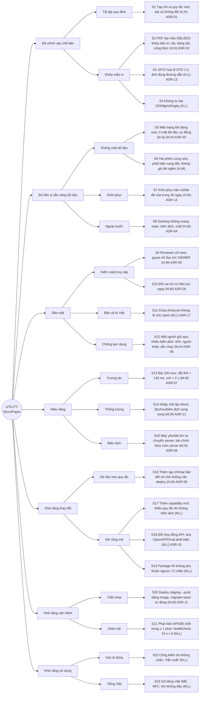

# 4.4.1 Utility tree (cây tiện ích chất lượng)

Gốc **Utility** → thuộc tính chất lượng → mối quan tâm → **kịch bản** kèm ưu tiên **(Mức quan trọng nghiệp vụ, Mức khó kiến trúc)**: H/M/L. Kịch bản (H,H) là ASR cốt lõi, xem [4.3 ASR](../4.3-ASR/README.md).

## Bảng ưu tiên

| Ưu tiên | Kịch bản | Lý do ảnh hưởng kiến trúc |
|---|---|---|
| (H,H) | S1, S2, S5 | Quyết định mô hình profile bất biến, pipeline LaTeX, kiến trúc local-first |
| (H,M) | S6, S7, S8, S9, S16 | Xác định khóa lạc quan, revision/trash, nền tảng đa môi trường, CASL, dữ liệu hóa cấu hình |
| (M,H) | S12, S15 | Xác định Compiler Router + hàng đợi công bằng |
| (M,M) | S10, S13, S14, S20 | Cache quyền, ảo hóa danh sách, limiter, CI/CD |
| (H,L)/(M,L) | S3, S4, S11, S17–S19, S21–S23 | Kỷ luật kỹ thuật (test, contract, guard) hơn là cấu trúc |

## Độ phủ

Mỗi ASR trong [4.3](../4.3-ASR/README.md) xuất hiện ít nhất một lần trong cây; kịch bản không thuộc ASR (S4, S17, S19, S21–S23) là **ràng buộc thiết kế** đã được hiện thực bằng test hoặc luật CI.
