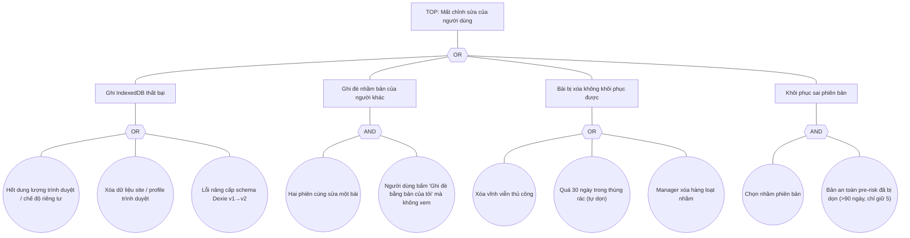
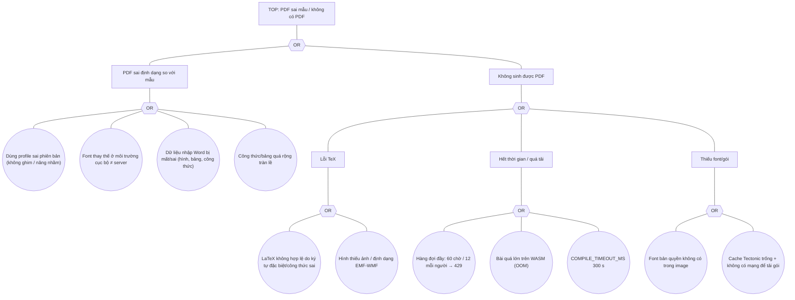
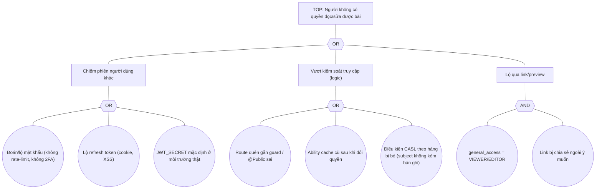
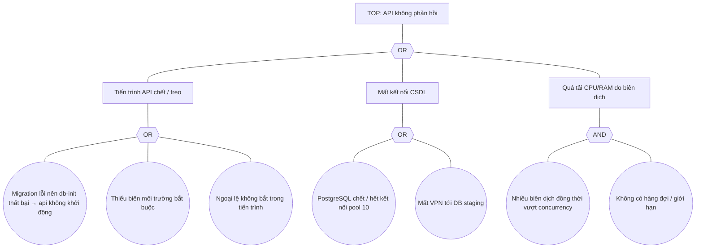
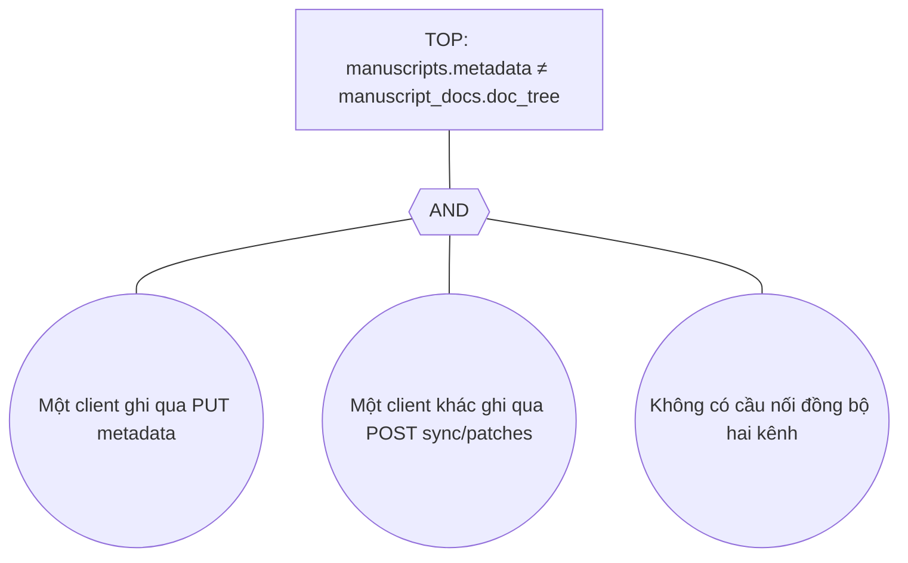

# 4.4.2 Fault tree (cây lỗi)

Mỗi cây phân tích một **sự kiện đỉnh (top event)** không mong muốn bằng cổng logic: **OR** (một nguyên nhân là đủ), **AND** (cần đồng thời). Ký hiệu: hình chữ nhật = sự kiện trung gian, hình tròn = sự kiện cơ bản (nguyên nhân gốc), hình thoi = cổng. Cột "Biện pháp hiện có/đề xuất" liên kết kiến trúc đã có hoặc còn thiếu.

## FT-01 Người dùng mất chỉnh sửa (mất dữ liệu bài)

| Nguyên nhân gốc | Biện pháp hiện có | Còn thiếu / đề xuất |
|---|---|---|
| B1, B2 | Đồng bộ server khi online; sao lưu zip kho cục bộ | Cảnh báo dung lượng sắp hết; nhắc sao lưu; `navigator.storage.persist()` |
| B3 | Hàm `upgrade` Dexie bù trường thiếu; test storage | Test migration với dữ liệu thật |
| C1+C2 | Khóa lạc quan 412/409, trạng thái `conflict`, bản an toàn `pre-risk` trước khôi phục | Hiển thị diff khi ghi đè (có sẵn `doc-diff`) |
| D1–D3 | Thùng rác 30 ngày, xác nhận trước xóa vĩnh viễn, audit `manuscript.purge*` | Thông báo trước khi tự dọn; xác nhận 2 bước cho thao tác hàng loạt |
| F1+F2 | Khôi phục tạo thêm revision `restore` (không phá lịch sử); bản có tên được ghim | Giữ bản an toàn lâu hơn nếu bài đã `PUBLISHED` |

## FT-02 PDF xuất ra sai quy định tạp chí hoặc không biên dịch được

| Nguyên nhân gốc | Biện pháp hiện có | Còn thiếu / đề xuất |
|---|---|---|
| A1 | Pin profile + snapshot; nâng cấp chủ động; revision `profile-upgrade` | — |
| A2 | Luật router 01 (final→server), 06 (`parity` substitute) | Hiển thị cảnh báo "bản nháp dùng font thay thế" |
| A3 | Báo cáo nhập, cổng kiểm tra đầu vào, golden snapshot, "Hình trống" thay vì gán nhầm | Chuyển đổi EMF/WMF; kiểm DPI hình |
| A4 | `latex-math-width`, hộp `\fiteq`, ngắt tại `=`/`+` | Hiển thị cảnh báo overfull từ log trong cổng kiểm tra (G14) |
| C1 | `escape-tex`, làm sạch theme, kiểm cú pháp công thức, `CompileErrorModal` | Fuzz test escape |
| C2 | "Hình trống" + cảnh báo | Chuyển đổi định dạng |
| D1–D3 | `CompileQueue` công bằng, luật router 08–10, limiter nhập lô, hủy/thử lại | Hàng đợi bền (pg-boss) khi scale ngang |
| F1, F2 | Font commit vào `docker/fonts`; volume cache Tectonic; `pnpm warmup:latex` | Kiểm tra font ở bước build image; mirror gói Tectonic nội bộ |

## FT-03 Người dùng truy cập trái phép bài báo

| Nguyên nhân gốc | Biện pháp hiện có | Còn thiếu |
|---|---|---|
| A1 | Argon2id (tốn tài nguyên khi dò) | Rate limit đăng nhập, khóa tạm, 2FA |
| A2 | Cookie httpOnly + sameSite lax; refresh xoay vòng, thu hồi khi dùng/đăng xuất | Phát hiện tái sử dụng refresh token đã thu hồi → thu hồi cả họ |
| A3 | Compose prod bắt buộc `JWT_SECRET` (`:?`) | Từ chối khởi động nếu secret mặc định khi `NODE_ENV=production` |
| B1 | `JwtAuthGuard` toàn cục; test "route-audit" ghim route mở (`@OptionalAuth`) | — |
| B2 | `permissions_version` trong JWT + invalidate cache | Test đồng thời nhiều bản sao API (cache RAM từng bản sao) |
| B3 | `accessOf(ability, row)`, `subject('Manuscript', row)`; test persona | — |
| C1+C2 | Mặc định `RESTRICTED`; khách chỉ đọc khi `VIEWER`; chỉ owner đổi | Thời hạn link / liệt kê người đã mở (`manuscript_visits`) |

## FT-04 Hệ thống không phản hồi / API không khả dụng

| Nguyên nhân gốc | Biện pháp hiện có | Còn thiếu |
|---|---|---|
| A1 | `depends_on: db-init service_completed_successfully`; thất bại thì dừng sớm | Cảnh báo/thông báo khi `db-init` lỗi |
| A2 | `${VAR:?}` ở compose prod | — |
| A3 | `restart: always`, healthcheck 15 s, `init: true` | Báo động khi restart liên tục |
| B1, B2 | `GET /health` kiểm DB; client vẫn làm việc offline (IndexedDB) | Pool/timeout cấu hình theo tải; metrics |
| C1+C2 | `CompileQueue` (concurrency, 60 chờ, 12/người), timeout 300 s, router đẩy việc nặng về local | Tách worker biên dịch riêng, giới hạn CPU/RAM container |

## FT-05 Hai nguồn lưu nội dung bị lệch (rủi ro kiến trúc D1)

Hiện **chỉ kênh `metadata`** được web dùng nên nguy cơ thấp; nếu bật `sync` trong web mà không cầu nối, cây sẽ lệch (xem [ADR-11](../4.1-ADD/01-decisions-core.md), [SAD D1](../4.2-SAD/09-risks-and-technical-debt.md)).
