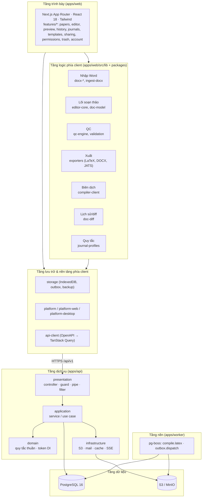
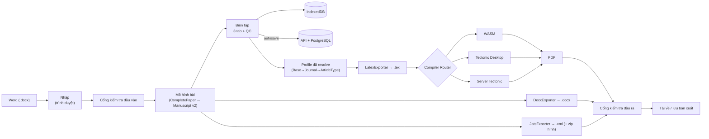

# 4.5.1 Kiến trúc hệ thống (tổng quan)

## Phong cách kiến trúc

| Khía cạnh | Lựa chọn |
|---|---|
| Tổng thể | **Modular monolith** (API NestJS) + **worker** nền + **client giàu logic** (offline-first) |
| Client | SPA/SSR lai (Next.js App Router) với logic chế bản **chạy tại trình duyệt/WebView** (nhập Word, sinh LaTeX/DOCX/JATS, QC, diff) |
| Backend | REST `/api/v1` theo module nghiệp vụ, phân lớp `presentation → application → domain ← infrastructure`, DI của NestJS |
| Dữ liệu | PostgreSQL (nghiệp vụ + hàng đợi), S3/MinIO (tệp), IndexedDB (offline) |
| Tích hợp bất đồng bộ | Transactional Outbox + pg-boss |
| Đa nền tảng | Web (Docker) và Desktop (Tauri) từ cùng mã, ngăn cách bằng `@structpaper/platform` |
| Phân quyền | CASL (RBAC + ABAC theo bản ghi) + capability cho UI |

## Sơ đồ phân tầng tổng thể

## Nguyên tắc kiến trúc

1. **Dữ liệu hóa quy tắc** – quy định tạp chí là dữ liệu có phiên bản, không phải mã (ADR-08).
2. **Local-first** – IndexedDB là nơi ghi đầu tiên; server là bản sao đồng bộ (ADR-10).
3. **Một nguồn sự thật cho hợp đồng** – Zod → OpenAPI → client (ADR-07).
4. **Logic thuần, dễ test** – nghiệp vụ chế bản nằm trong package không phụ thuộc framework (ADR-01).
5. **Mặc định từ chối** – guard toàn cục; ẩn UI chỉ là tiện ích, API luôn kiểm lại (ADR-05, 06).
6. **Không mất việc của người dùng** – bản an toàn trước thao tác rủi ro, thùng rác, cổng kiểm tra không chặn.
7. **Đẩy việc nặng đúng chỗ** – Compiler Router chọn cục bộ/server; worker cho việc nền (ADR-12, 13).
8. **Cùng một mã cho web và desktop** – khác biệt nằm sau `PlatformServices` (ADR-15).

## Luồng chính end-to-end

## Ranh giới và phụ thuộc

| Ranh giới | Quy tắc |
|---|---|
| `doc-model` | Không phụ thuộc React, DOM, `apps/*`, package khác |
| `exporters`, `qc-engine`, `ingest-docx`, `editor-core` | Chỉ phụ thuộc `doc-model` (+ `journal-profiles` trừ `editor-core`) |
| `storage` | Chỉ `doc-model`, `editor-core` |
| `compiler-client` | Không React, không `apps/*`, chỉ `doc-model` |
| `apps/api` module | `domain` không phụ thuộc `application/presentation/infrastructure` (luật nêu trong `.dependency-cruiser.js`, hiện cần sửa pattern – xem [SAD D4](../4.2-SAD/09-risks-and-technical-debt.md)) |
| `apps/web` ↔ API | Chỉ qua `@structpaper/api-client` / `DocumentApi` và `contracts` |
